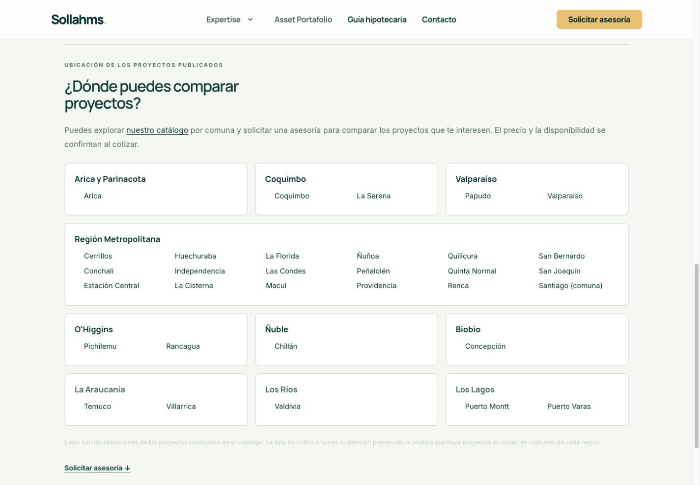

# Agenda: distribución responsive de regiones
Estado: candidato privado listo para revisión. No fusionado ni publicado.
Fecha: 15/11/2026, America/Santiago.

## Candidato
- Implementación: `cb55f8db05495009d5ce15301747ccdf0696ccbd`.
- Rama: `codex/agenda-regions-responsive-20261115`.
- Preview: https://project-wrapp-7dje1d2kz-lsandoval2-8260s-projects.vercel.app/agenda-asesoria.html
- Deployment: `dpl_3otu6np58efcMyX4pSvBmLtjpw3a`, READY, staging (VERCEL_ENV=preview).
- Protección SSO del proyecto conservada, all_except_custom_domains.
- Base publicada: `dpl_BeqmLxC1V4nmNUeE3fG4wpMXGGes`, SHA `69b22400e4e53ee25701449345d03bf526f74467`. No usar main, que conserva una agenda antigua.
- No se ejecutaron promociones, fusiones ni operaciones de asignación de dominio. Vercel añade automáticamente su alias de preview; no se asignó sollahms.cl.

## Archivos runtime modificados
1. `agenda-asesoria.html`: mueve literalmente el bloque AGENDA_COVERAGE completo desde advisory-copy hasta ser hijo directo de advisory-layout, después del panel del formulario.
2. `assets/css/agenda-coverage.css`: grid-column:1/-1, min-width:0 y repeat(auto-fit,minmax(min(100%,280px),1fr)). Listas con columns:9rem y tarjeta con 8 o más comunas a fila completa. Se mantienen tokens, fuentes, colores, bordes y radios. Se preservan explícitamente los estilos de título, enlaces y nota antes heredados del contenedor anterior.

No hay nuevos breakpoints de viewport. La tarjeta extensa usa la cuadrícula existente y no cambia el orden DOM. En móvil el formulario conserva su primera fila; regiones quedan después del texto introductorio.

## QA remoto en Chrome
| Ancho solicitado | Columnas de tarjetas | Columnas de comunas RM | Overflow | Superposiciones | Recortes |
|---|---:|---:|---|---|---|
| 1440 | 3 | 6 | No | No | No |
| 1280 | 3 | 6 | No | No | No |
| 1024 | 3 | 5 | No | No | No |
| 768 | 2 | 3 | No | No | No |
| 390 | 1 | 1 | No | No | No |
| 320 | 1 | 1 | No | No | No |

- El ancho de cobertura coincide con su contenedor principal en los seis tamaños.
- 10 regiones y 32 comunas conservadas, incluyendo orden y relación; comprobación DOM frente a producción.
- Formulario, encabezado y pie idénticos por comparación del DOM; controles habilitados. No se enviaron formularios ni se probaron servicios comerciales.
- Comparación literal del HTML: al retirar el mismo bloque de cobertura de ambas versiones, los archivos son idénticos.
- Paquete: 1660 archivos, 1658 preservados por SHA-1; sólo los dos archivos permitidos cambian. El constructor valida rutas, contenido y tamaños cuando existen y se niega a ejecutarse fuera de preview.
- Scripts, endpoints, funciones, CRM, Resend, SEO/GEO, sitemap, robots y datos estructurados conservados.
- La identidad visual y los efectos de desplazamiento existentes se mantienen. Las capturas completas pueden mostrar textos fuera del viewport atenuados por el efecto de scroll original; la captura overview muestra las tarjetas en el viewport.
- Resultado: aprobado para revisión privada; no autoriza producción.

## Evidencias

- [Captura 1440 px](regions-1440.png)
- [Captura 1280 px](regions-1280.png)
- [Captura 1024 px](regions-1024.png)
- [Captura 768 px](regions-768.png)
- [Captura 390 px](regions-390.png)
- [Captura 320 px](regions-320.png)
- [Mediciones completas](qa.json)
- [Preservación](preservation.json)
- [Manifiesto base](production-manifest.json)
- [Manifiesto candidato](candidate-manifest.json)
- [Constructor privado](prepare-preview.mjs)
- [Log final](build-log.json)

## Incidencias y trazabilidad
- Chromium local no pudo arrancar por restricción socket/EPERM; QA ejecutado en Chrome conectado.
- La API rechazó target=preview antes de crear deployment; se utilizó target=staging, el entorno preview de la API.
- Primer deployment `dpl_8eS4uCVsRrdyA52f9ikEiXFCzTJ6` falló al exigir tamaño en entradas históricas sin ese campo. Se mantuvo la validación SHA-1 para todos los archivos y se validó tamaño sólo si está registrado.
- Candidato intermedio `dpl_4Hc4CFwn4art7m297YKdwFXcm2wq`, commit `9eb9e56c7db61ec955fee821ecdfbf211f53216b`, pasó QA geométrico, pero fue sustituido tras revisión visual: la lista larga estiraba demasiado las tarjetas vecinas.
- El candidato final de esta documentación reduce esa altura mediante una fila completa y columnas internas. Capturas y mediciones pertenecen al candidato final.
- Un scroll DOM agotó el tiempo; se recuperó la sesión con la API de desplazamiento del navegador. No afectó al sitio.
