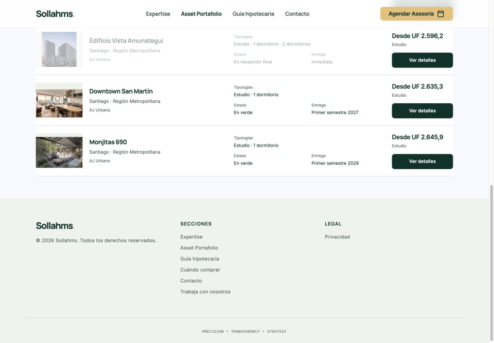
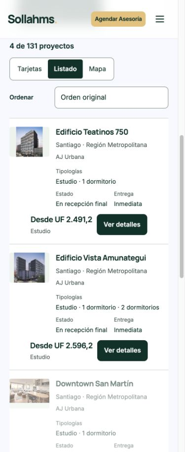

# AJ Urbana — publicación comercial 30/10/2026

Producción: https://sollahms.cl/proyectos.html?inmobiliaria=AJ+Urbana
Código: ee98284172e43ec98b6f2c0eea52e5b04f74c5b6
Deployment READY/promovido: dpl_4Yqd3RdMY8g78HgXj6MvYVhuYBJh
Rollback conservado y READY comprobado: dpl_9e3rtATuLVhTcveV6sHyp8x7Szkj.
Rama: codex/aj-urbana-commercial-20261030. main sigue en86e200ec191b38af355061e21bc0fc1e549cce3b, sin merge; main:false y rama:false.

## Fuente y resultado

Tabla explícita del propietario y capturas 30/10/2026 19:32:42 y19:33:10, leídas íntegramente. Fuente comercial registrada en cada proyecto; no se sustituyeron por campañas externas. 5 proyectos,10 valores,131 fichas conservadas,126 registros ajenos idénticos.

| Proyecto / slug | Precios UF por tipología | Desde UF | Dirección | Entrega | Estado |
|---|---|---:|---|---|---|
| downtown-san-martin | Estudio: 2.635,3; 1D: 3.517,7 | 2.635,3 | San Martín 70 | Primer semestre 2027 | En verde |
| vista-morande | 1D: 3.399 | 3.399 | Morandé 808 | Primer semestre 2027 | En verde |
| monjitas-690 | Estudio: 2.645,9; 1D: 3.351,8 | 2.645,9 | Monjitas 690 | Primer semestre 2029 | En verde |
| edificio-teatinos-750 | Estudio: 2.491,2; 1D: 3.315 | 2.491,2 | Teatinos 750 | Inmediata | En recepción final |
| edificio-vista-amunategui | Estudio: 2.596,2; 1D: 3.308,2; 2D: 3.888 | 2.596,2 | Amunátegui 743 | Inmediata | En recepción final |

## Sincronización

Fuente central: data/proyectos.json.commercialOffers. Rendereraj_urbana_commercial consume esos datos, integrado en project_header_b; build-catalog-facets aplica proyeccióncomercial final. Investigación conserva actualizaciones y prioridad para evitar regresiones. Catálogo/listado/mapa usan el precio de la tipología seleccionada; vistas mantienen filtros y orden. Cotización recibe oferta pública víaoferta=0d/1d/2d; el módulo existente agrega proyecto,inmobiliaria,tipología,precio al mensaje del formulario. Hipotecario resuelve el valor desde el catálogo y no de precios enURL. Recepción final no acredita modalidad educativa de entrega inmediata: se mantiene el criterio de elegibilidad existente.

Monjitas tenía variantes sin categoría de propiedad en la proyección; se completó departamento conforme a la instrucción explícita, manteniendo superficies/baños originales. La consulta Santiago+AJ Urbana+Departamento+Estudio+hastaUF2700 devuelve Teatinos750,VistaAmunátegui,Downtown yMonjitas.

Direcciones comerciales actualizadas: SanMartín74→70 yAmunátegui745→743, incluidos textos y consultas de los mapas existentes. Se mantuvieron las coordenadas documentadas del mismo edificio, con dirección previa y nueva fuente registradas; no se geocodificaron ni inventaron coordenadas nuevas.

VistaMorandé conserva sus tipologías documentadas; sólo1D tiene precio autorizado. No se inventaron precios de2D ni stock. Sin unidades individuales nuevas, cambios de fotos,planos,estilos,formularios ni validaciones. Descripciones conservadas salvo la corrección de número de calle.

## Validaciones

-77 comprobacionesAJ:10 valores exactos,mínimos,estado,entrega,dirección,simulador,cotización,filtros combinados,rangos decimales,orden ypersistencia.
-183 comprobaciones de conservación e idempotencia de regeneración focalizada;126 registros ajenos yproyecciones conservados; imágenes,formularios,estilos idénticos.
-194 comprobacionesECasa superadas tras el cambio.
-10 pruebas existentes de filtros superadas;200 consultas combinadas en65,1ms en ejecuciónlocal.
-12 archivos runtime del candidato:HTTP200 ycontenido idéntico al código;12 verificaciones equivalentes enproducción,incluidaslas5fichas.
-Chrome real escritorio1440×1000 ymóvil390×950:lista,precios decimales,orden,fichas,contexto de cotización,regreso con filtros conservados. Sin desbordamiento de página enmóvil.
-Producción:5de131 proyectosAJ visibles; simuladorMonjitas1D muestra3351.8UF;UFvisible$41.242,32.
-No formularios enviados ni correos reales. Verificado contexto yserialización, noentrega real de correos; el transporte permanece intacto.
-Logs error/fatal del deployment enúltima hora:sin registros coincidentes enla consulta de22:45UTC.
-No reconstrucción indiscriminada:manifest congelado1625entradas;12 archivos runtime actualizados y3entradas deconstrucción. Se conserva contenido protegidoPreview y funciones. Sinactivación deservicios.

## Archivos modificados

- edificio-vista-amunategui.html
- downtown-san-martin.html
- monjitas-690.html
- vercel.json
- proyectos.html
- edificio-teatinos-750.html
- vista-morande.html
- AGENTS.md
- data/fichas-proyectos.json
- data/proyectos.json
- data/project-locations.json
- data/catalog-facets.json
- tests/aj-preservation.py
- tests/aj-commercial.test.mjs
- scripts/project_header_b.py
- scripts/aj_urbana_commercial.py
- scripts/build-catalog-facets.py
- scripts/import_aj_owner_20261030.py
- docs/aj-urbana-20261030/owner-input.json
- assets/js/catalog.mjs
- assets/js/catalog-map.mjs
- assets/js/project-offers.mjs

## Recuperación

Manifest exacto deeste deployment:deployment-files.json. BaselineECasa:docs/ecasa-commercial-20261030/deployment-files.json encommit5a2bd6585830d7409be9767b7695988ebc32280e. La funcióncontact recibe las5filas adicionales mediante sincronización controlada:41registros sincronizados y90restantes idénticos. Secomprobó elalias inmediatamente antes ydespués depromover; rollbackoficial puede restaurar dpl_9e3rtATuLVhTcveV6sHyp8x7Szkj sinreconstrucción.

## Capturas reales

