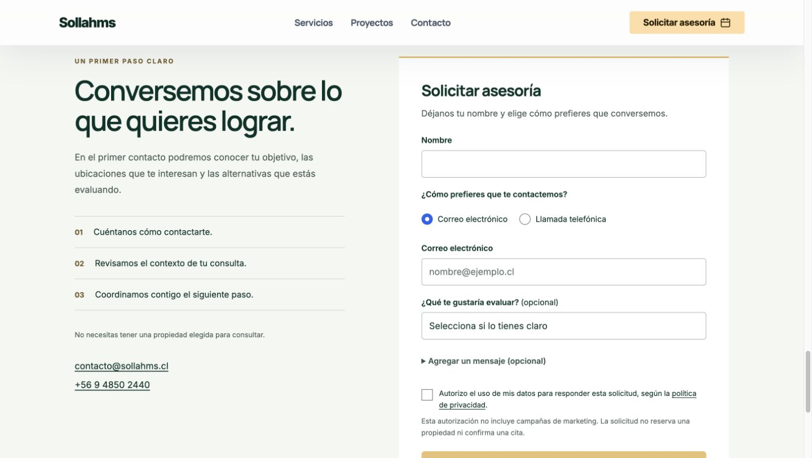

# Captación publicada — 25/10/2026

[Portada](https://sollahms.cl/) · [Contacto](https://sollahms.cl/contacto.html) · [Asesoría](https://sollahms.cl/agenda-asesoria.html)

- [Implementación y alcance de las pruebas](implementation.md)
- [Publicación y protecciones](release-receipt.json)
- [Recuperación](recovery.json)
- [Comprobaciones públicas](public-http.json) y [candidato](candidate-http.json)
- [Integridad de catálogo y funciones](integrity.json)
- [20 pruebas de captación](advisory-tests.txt) y [6 regresiones de operaciones](operation-regression-tests.txt)
- [Recepción HTTP aislada](controlled-reception.json) y [revisión de navegador](browser-qa.json)
- [Rendimiento publicado](pagespeed-published.json)

El formulario solicita nombre y correo **o** teléfono, según el medio elegido. Objetivo y mensaje son opcionales; el consentimiento específico está separado de marketing. La ruta nueva utiliza el mismo canal Resend y destinatario contacto@sollahms.cl. No se activaron CRM, reservas ni respuestas automáticas al visitante.

Se verificó recepción en un destino de prueba controlado, sin correos reales. No se acredita entrega a la bandeja real ni un aumento de conversión.

