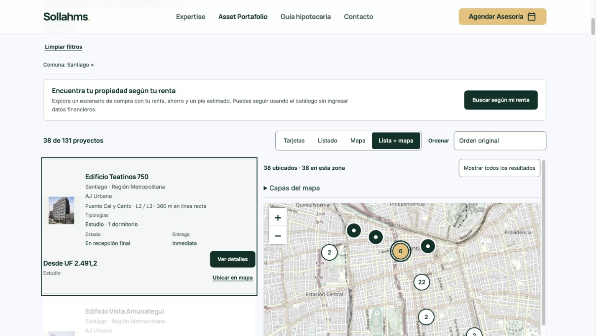

# Publicación autorizada — 31/10/2026
El propietario autorizó «publicar» tras revisar el preview.
Código c9b66b6e9ff44bf7eb91ff9502f1e858438856f8.
Deployment de producción READY: dpl_8rAgvVQSGPF9WbbDHsgeCHV3dkn5.
https://sollahms.cl/proyectos.html?vista=split
Se reconstruyó mediante redeploy oficial del paquete exacto del preview dpl_AM5ZcM3pRKEpZYKVeooC8EbGBWpb, con target production; se verificó READY y se promovió mediante request_promote.
Producción no había avanzado: alias anterior dpl_8covBeLM5RBUZUUX4it3Zgiga9rZ. Conservado para rollback mediante request_rollback del proyecto prj_URomRRU0MAy4etGKP5gWv3Qv4DGH, equipo team_A9VNIW2f2K1IJpd2pGdvDmEN.
Build: 1633 archivos descargados, 1629 artefactos verificados por guardia de integridad; transformaciones existentes de retiro y sincronización de servidor conservadas. Advertencia de CLI original 65.0.0 frente a ejecutor65.4.0; build completado.
Alias público comprobado después: dpl_8rAgvVQSGPF9WbbDHsgeCHV3dkn5.
Chrome público: Santiago38, tarjeta325px, controles anidados Metro, Ubicar Teatinos selecciona y centra; contador38ubicados/7enencuadre escritorio. Móvil390px: foco mapa,38ubicados/5enencuadre, sin desbordamiento. Sin errores de consola capturados. Logs de runtime error/fatal del deployment en ventana10min: sin registros. No se enviaron formularios.
No se modificó main ni configuración de despliegues automáticos. Se reutilizan pruebas previas del mismo código y evidencias de esta carpeta.

