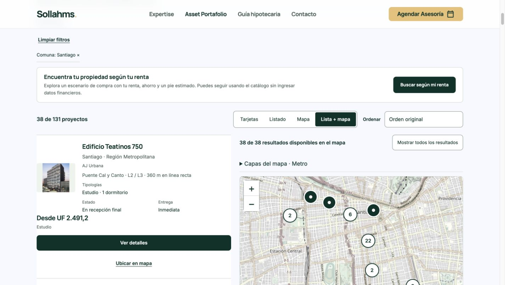
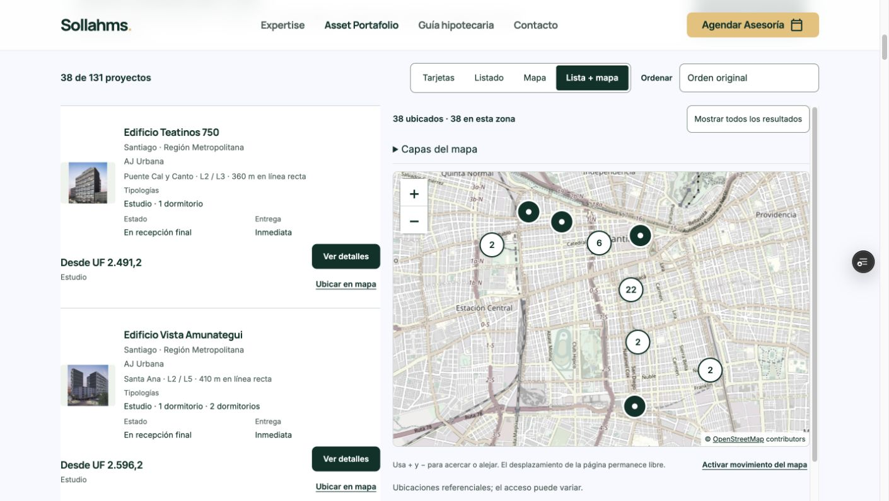
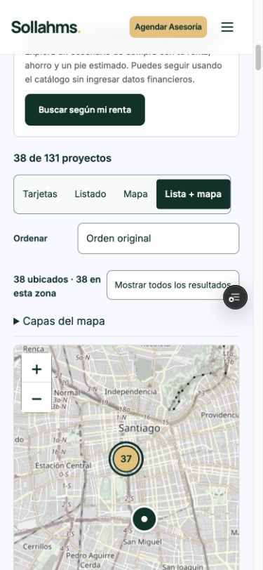
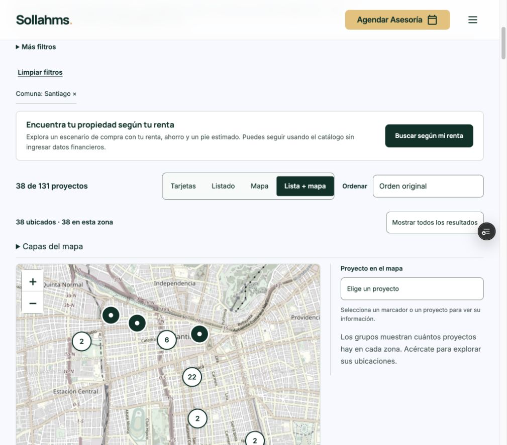
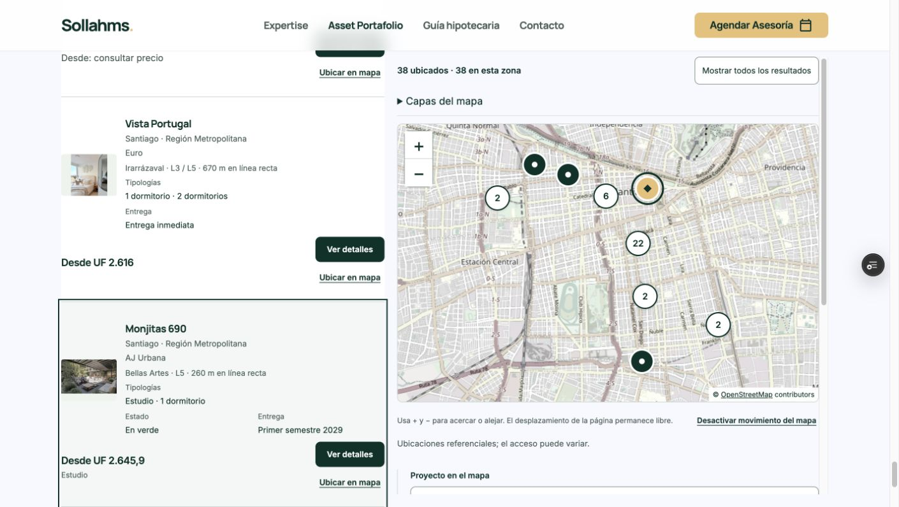
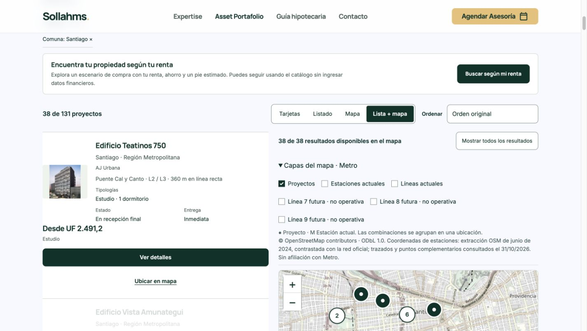
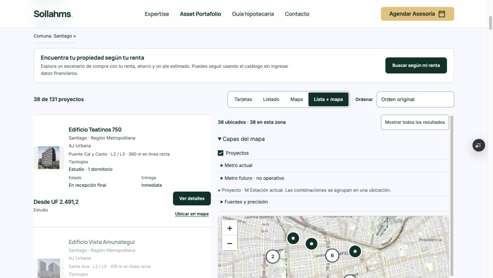

# Vista Lista + mapa — prueba visual, 31/10/2026

## Alcance y base
Preview únicamente. No se promocionó a producción.
Producción comprobada antes y después: dpl_8covBeLM5RBUZUUX4it3Zgiga9rZ, código cb51d71cbdaa268da061946b0f96d98187a60fd4. Rama base de evidencias a46a9bc68b4a379b1a3ea53d0d9a4a52389cb027.
Nueva rama: codex/catalog-split-ux-20261031. Código candidato: c9b66b6e9ff44bf7eb91ff9502f1e858438856f8.
Preview READY: dpl_AM5ZcM3pRKEpZYKVeooC8EbGBWpb
URL: https://project-wrapp-dkhlqnej3-lsandoval2-8260s-projects.vercel.app/proyectos.html?comuna=Santiago&vista=split
Main verificada intacta: 86e200ec191b38af355061e21bc0fc1e549cce3b.
main:false y nueva rama:false. Sin cambios de protecciones, proveedor, datos ni material exclusivo de Preview.

## Auditoría anterior
Funcionan y se conservan: cuatro vistas, filtros compartidos, precio por oferta autorizada, agrupación geográfica, selección diferenciada con forma/borde, atribución, mapa sin capturar rueda, alternativa ante fallos.
Fricciones observadas: primera tarjeta de Santiago medía 408,47 px; acciones apiladas de ancho completo; controles actuales/futuros simultáneos al abrir capas; marcador destacaba tarjeta sin revelarla; contador no distinguía encuadre.
No se encontró inconsistencia entre los 131 registros y sus ubicaciones. Santiago: 38 resultados.

## Cambios y medidas
- Tarjeta equivalente: 325,01 px (20,4% menos altura); acciones junto al precio, miniatura contenida y datos conservados. Solo vista combinada; Tarjetas y Listado independientes intactos.
- Proporción escritorio lista/mapa 0,9/1,2; mapa limitado al alto visible y desplazamiento interno accesible. Corrige pérdida de controles al revelar el último resultado.
- Capas anidadas: Proyectos, Metro actual, Metro futuro; procedencia desplegable. Panel abierto con categorías cerradas: 232,31 px frente a 267,11 px anterior; controles no eliminados.
- Mapa/lista: selecciona, destaca, revela tarjeta fuera de pantalla en escritorio; Ubicar en mapa centra y, en pantalla compacta, revela mapa y dirige el foco al lienzo.
- Selección reversible al elegir Elige un proyecto. aria-pressed en acción Ubicar.
- Total filtrado permanece arriba; mapa informa ubicados y proyectos dentro del encuadre. No filtra por encuadre automáticamente.
- Móvil/tablet: se mantienen Mapa y Listado separados como alternativa; vista combinada apilada, controles de 44 px. Sin nueva animación; desplazamientos de selección instantáneos también compatibles con movimiento reducido.

## Verificaciones realizadas
Chrome real: escritorio 1425 px, tablet 1024 px y móvil 390 px. Sin desbordamiento horizontal.
- Ambas direcciones de selección: Teatinos desde lista y Monjitas desde marcador. La tarjeta final se revela; mapa permanece a 90 px del borde superior.
- Teclado Enter en Ubicar; aria-pressed=true; limpieza devuelve cero tarjetas seleccionadas.
- Móvil: Ubicar Monjitas sitúa panel a 100 px y foco en catalog-map-canvas.
- Santiago + estudio + hasta UF 2700: 10 resultados; orden numérico ascendente 2035,23 a 2700. Limpiar restaura 131.
- Cambios entre Tarjetas, Listado, Mapa y Lista + mapa conservan los 38 resultados de Santiago.
- Abrir ficha Teatinos y regresar conserva comuna y vista split con 38 registros.
- Capas actuales estaciones/líneas y L9 futura se activan; geometrías actuales y futuras no modificadas.
- Mapa cuenta 38 ubicados y 7 visibles al centrar Teatinos; Mostrar todos recupera 38 visibles en escritorio.
- Consola del candidato final: sin errores capturados.
- node tests/catalog-filters.test.mjs: 10 pruebas aprobadas (incluye 200 combinaciones).
- node tests/metro.test.mjs: 1291 comprobaciones aprobadas.
- Regresiones comerciales: AJ 77, ECasa 194, León 139 comprobaciones aprobadas.
- Sintaxis de módulos modificados validada.
- Manifiesto congelado: 1633 entradas, 1627 idénticas; 4 archivos de interfaz + hashes + vercel.json cambiados. Funciones, datos, fichas, precios y geometrías idénticos.
- No envíos de formularios ni comunicaciones.

## Límites observados
No hay rutas peatonales verificadas en la implementación base (walkingRoutes=0). Se conservan distancias geográficas y controles pendientes; no se inventaron tiempos caminando.
Durante un candidato inicial apareció el aviso existente de fallo de tesela; los datos y selección siguieron operativos. El candidato final mostró el mapa y no registró errores de consola. No se cambió proveedor ni se promete disponibilidad externa.
No se efectuó estudio con usuarios ni medición de conversión. Mejora comprobada: menor altura, controles agrupados, selección revelada y contadores por encuadre.
No se simuló una preferencia de movimiento reducido del sistema; se revisó que la implementación nueva no introduzca animaciones y conserve reglas existentes.

## Archivos
assets/js/catalog.mjs
assets/js/catalog-map.mjs
assets/js/metro-map.mjs
assets/css/metro.css
vercel.json (solo nueva rama automática desactivada)
Documentación y capturas en esta carpeta.

## Comparación visual
Capturas reales, mismas consultas Santiago; desplazamiento vertical puede variar por el autoencuadre de los controles.

## Recuperación y siguiente paso
Producción no se modificó; el deployment previo continúa activo, por lo que no hace falta rollback. Candidato aislado y descartable.
Antes de una publicación futura autorizada: volver a comprobar alias activo, incorporar avances posteriores, generar candidato de producción desde paquete congelado protegido, validar y conservar deployment anterior. No promover automáticamente este Preview.
