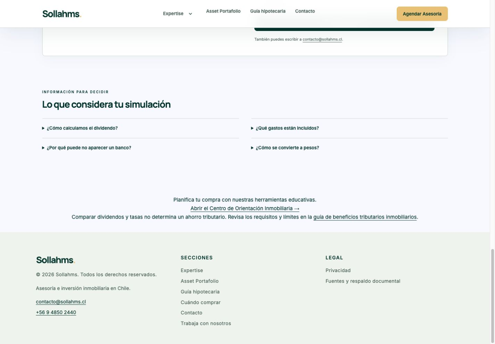
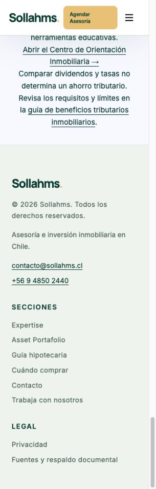

# Publicación controlada — pie del Comparador Hipotecario

Publicado con autorización expresa el **15/11/2026, 10:16:10.904 America/Santiago** en https://sollahms.cl/comparador-hipotecario.html.

| Referencia | Valor |
| --- | --- |
| Producción anterior | `dpl_BeqmLxC1V4nmNUeE3fG4wpMXGGes` |
| SHA anterior | `69b22400e4e53ee25701449345d03bf526f74467` |
| Producción nueva | `dpl_2S4kRYezijcgik4etSnnR3sAY1z6` |
| SHA implementación publicada | `6eefd61edf3843cff603c1a2053eb204920270a7` |
| QA documental autorizado | `890be020b651da1d008711b2134a65796eeb21f8` |
| Preview aprobado | `dpl_Ec3koFKPBYbYfmKZ9moxfRbnNDqD` |

## Integridad y publicación

La producción vigente coincidía con la base del candidato. El paquete conserva los 1.660 archivos runtime: 1.659 idénticos y únicamente `comparador-hipotecario.html` modificado en su pie y CSS aislado. El resto del HTML permanece idéntico, incluidos cálculos, scripts, formularios, contenido educativo, metadatos y datos estructurados. Sitemap, robots, catálogo y fichas no cambian.

El proyecto ya tenía desactivada la asignación automática de dominios de producción; no se modificó esa configuración. Se preparó un deployment de producción sin alias, cuyo build verificó los hashes de los 1.660 archivos. Antes de publicar se comprobó READY, HTTP 200 autenticado, HTML idéntico al aprobado y dominio público todavía en la versión anterior. Solo entonces se asignó `sollahms.cl` al nuevo deployment. No se fusionaron ramas.

Manifiesto congelado: [publication-manifest.json](publication-manifest.json). Comprobación de build: [prepare-production.mjs](prepare-production.mjs). Recibo y mediciones: [publication.json](publication.json).

## Control posterior

- HTTP 200 y HTML público idéntico byte por byte al aprobado. SHA256: `00ac7e04a7ea50fe552500ff560efaa115a02daf89cc8272ebb520355811ae93`.
- Ocho destinos internos del pie responden HTTP 200; véase [resultados](published-links.json).
- Correo y teléfono únicos dentro del pie; teléfono debajo del correo, enlace exacto `https://wa.me/56948502440`. Se reutiliza el clic real de WhatsApp del QA aprobado, sin envío de mensajes.
- Chrome público 1440×1000: tres columnas, ancho útil y scrollWidth 1425 px. Chrome público 320×1000: una columna, ancho útil y scrollWidth 305 px. Sin desbordamientos horizontales ni superposiciones. La diferencia de 15 px es la barra vertical.
- QA previo aprobado a 1440, 768, 390 y 320 px conservado en [RESPONSIVE-QA.md](RESPONSIVE-QA.md); se repiten solo extremos para verificar publicación.
- Prueba funcional mínima pública: 5.000 UF, pie 20%, 25 años, tasa anual efectiva 4% → **20,96 UF**. Formulario visible y habilitado, método POST `/api/contact`; no se enviaron datos ni solicitudes CRM. No se repitió la suite financiera ni se intervino el fallo histórico.
- PR #24 permanece abierto en borrador y sin fusionar. El commit posterior a la autorización solo registra esta evidencia documental.

