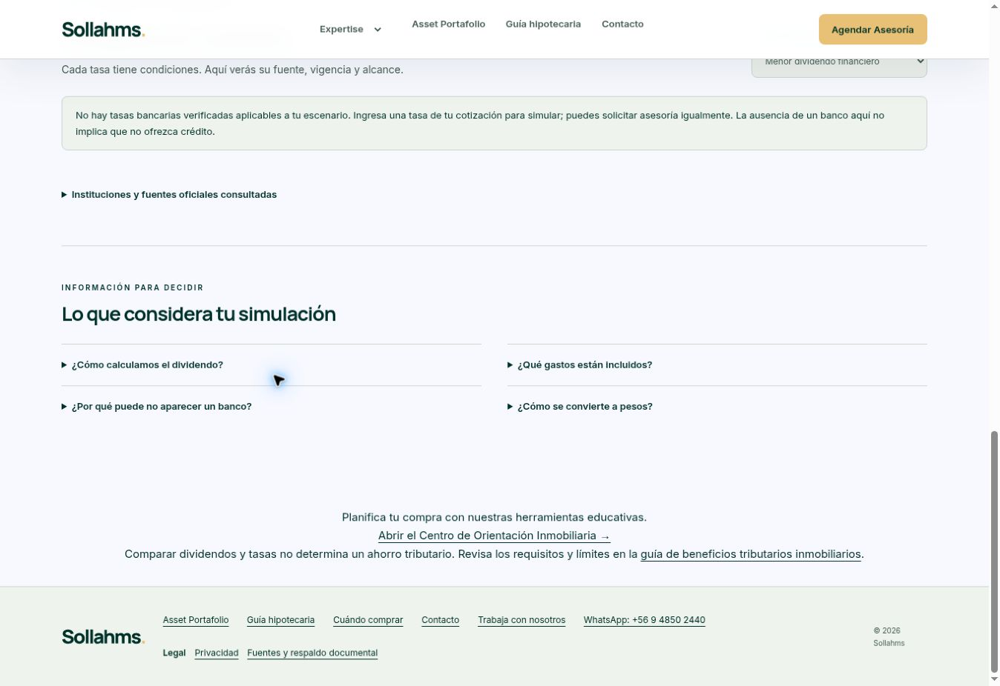
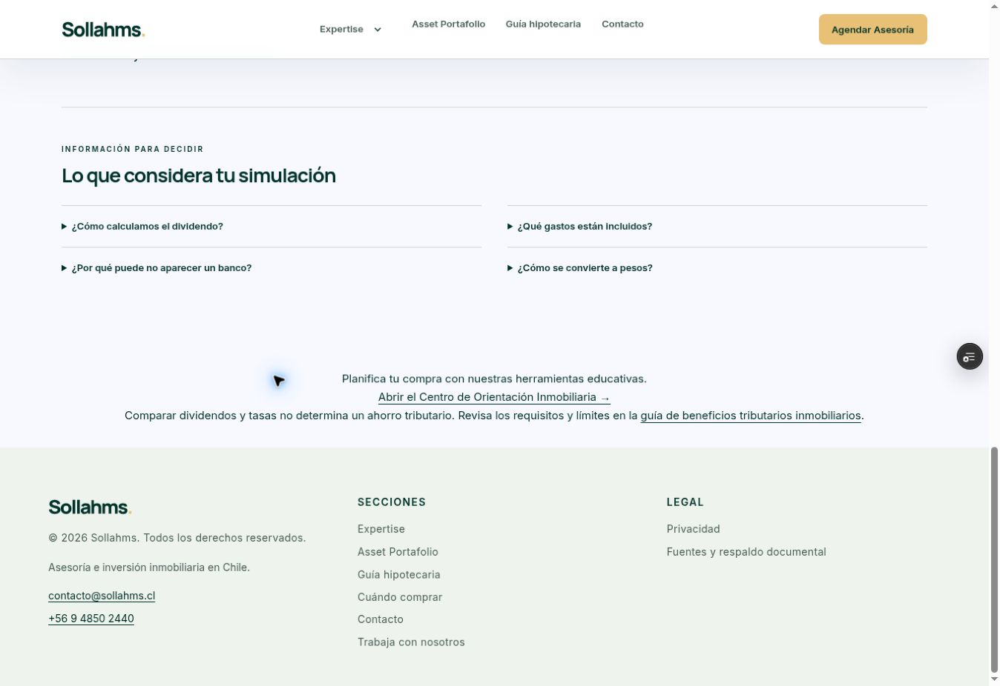

# Pie corporativo del Comparador Hipotecario

Estado actualizado: publicado y verificado en producción el 15/11/2026 a las 10:16:10.904 America/Santiago, con autorización expresa. PR #24 abierto en borrador, sin fusionar. Véase [acta de publicación](PUBLICACION.md) y [QA responsive aprobado](RESPONSIVE-QA.md).

La revisión parcial y las limitaciones anteriores se conservan abajo como historial; quedaron resueltas mediante el navegador Chrome conectado y su control de viewport.

El pie horizontal anterior se reemplaza por el patrón publicado de Trabaja con nosotros, contrastado con la Guía hipotecaria: marca y contacto, Secciones y Legal. Se conserva el destino del catálogo `/proyectos.html`, se añade Expertise como en la referencia, y se conserva Fuentes y respaldo documental. El número aparece una sola vez dentro del pie y apunta exactamente a https://wa.me/56948502440. Correo: contacto@sollahms.cl.

Único archivo de aplicación modificado: `comparador-hipotecario.html` (HTML del pie y CSS aislado por `#comparator-footer`). El resto de ese HTML coincide byte por byte con la producción tomada como base; scripts, fórmulas, datos, formularios, metadatos y demás páginas permanecen intactos.

- Implementación: `6eefd61edf3843cff603c1a2053eb204920270a7`.
- Base publicada: `69b22400e4e53ee25701449345d03bf526f74467` / `dpl_BeqmLxC1V4nmNUeE3fG4wpMXGGes`.
- Preview READY: `dpl_Ec3koFKPBYbYfmKZ9moxfRbnNDqD`.
- URL: https://project-wrapp-kzqqr57mm-lsandoval2-8260s-projects.vercel.app/comparador-hipotecario.html
- Protección SSO del proyecto conservada; respuesta HTTP 200 autenticada y `x-robots-tag: noindex`.
- PR dependiente de la rama de producción documental, para mostrar exclusivamente este cambio y su evidencia; no fusionar ninguna rama.

## Verificación

El manifiesto de producción se identifica por SHA1 `7c78979a38f7c7a3485e22edd50fc5d266a7dc47`, coincidente con `docs/documental-centralization-20261115/candidate-manifest.json` y el archivo del deployment publicado. Se reutilizan sus 1.660 recursos, sustituyendo solo el HTML del comparador. El build comprueba los SHA1 de todos los archivos y los tamaños cuando están registrados: 1.659 archivos runtime idénticos. La preparación exige `VERCEL_ENV=preview`.

Ocho pruebas de motor financiero aprobadas. `tests/integration-comparator.mjs` falla antes de evaluar el comparador por una aserción histórica de hashes de León; se reproduce con el HTML original. No se corrigen datos ajenos al alcance.

Chrome remoto: escenario sintético 5.000 UF / pie 20% / 25 años / tasa anual efectiva 4% produce **20,96 UF** antes y después. No se envían formularios. Inspección del pie confirma correo, WhatsApp exacto y un número único. Las ocho rutas internas del pie responden HTTP 200 en producción.

Revisión visual a `innerWidth=1363`: tres columnas, enlaces sin superposición y documento de 1348 px, sin desbordamiento horizontal. Esta comprobación **no sustituye** la matriz solicitada de 1440/768/390/320 px, todavía pendiente. El navegador local agotó el tiempo de conexión y el navegador remoto bloquea DevTools; no ofrece API para fijar viewport. No se declara aprobado QA móvil/tablet.

Primer build `dpl_2cW1WRwboDfMBTCYjfYbASyZiyd8`: detenido porque algunos tamaños del manifiesto heredado no estaban registrados. Se ajustó exclusivamente la comprobación de tamaños opcionales, conservando todos los hashes; el siguiente build terminó READY.

Producción comprobada sin cambios al cerrar. No publicación ni merge. Para continuar, reutilizar este deployment y SHA y completar únicamente la matriz visual pendiente.

## Antes y después

