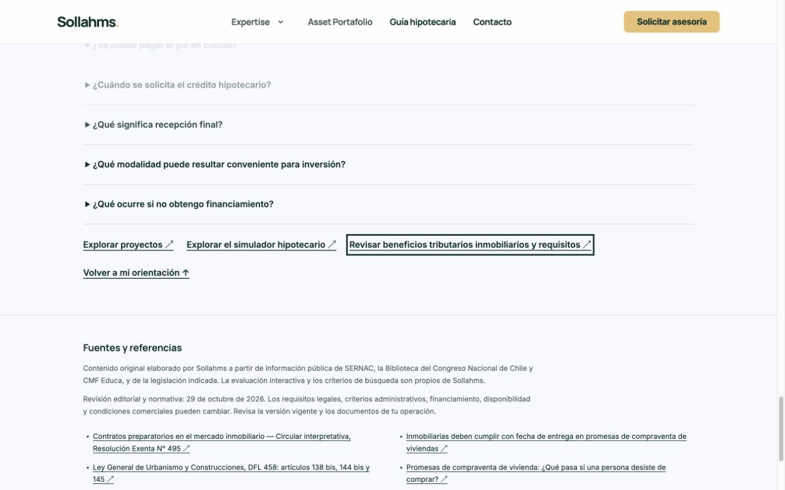
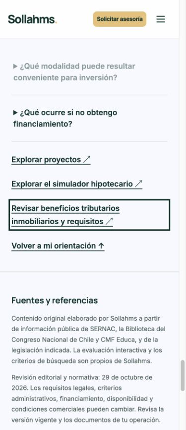

# Publicación del último enlace corporativo
**PUBLICADO Y VERIFICADO.**

- Fecha independiente de intervención: **14/11/2026 23:39:41.747 America/Santiago**, 15/11/2026 02:39:41.747 UTC (updatedAt del alias: 1794710381747).
- Deployment anterior: dpl_6ittTviwNMv8RyaKvYLdTiPdZu2L.
- Commit anterior: 9182da81a75a6ce1b026b67736291ebef3e4ac2f.
- Deployment publicado: **dpl_9wtwmxsxawGBf9XGb6yK1hWKUuqC**.
- Commit de código publicado: **4bea6abcb3fbc663c0f3a559e0086d70a5b977a2**.
- Rama: codex/corporate-journeys-current-20261115.
- [Página pública](https://sollahms.cl/cuando-comprar-propiedad.html).
- Preview aprobado conservado: dpl_Fs6Tf1eNmHrSJe8ocGfD7e7kpqoB.

## Alcance exacto
Único archivo de sitio modificado: cuando-comprar-propiedad.html.
En el bloque ps-links posterior a las preguntas frecuentes se agregó:
```html
<a data-ecosystem-link="tributarios" href="/beneficios-tributarios-inmobiliarios.html">Revisar beneficios tributarios inmobiliarios y requisitos <span aria-hidden="true">↗</span></a>
```
Se conservaron los enlaces anteriores, estilos y scripts. No se añadieron CSS, JS ni botones.
SHA-1 anterior: 34e642043ed4be4f7a29369170ca969fde5db7ee.
SHA-1 publicado: 39900a93326c2af82d504e4523e643301a17be4f; 35.076 bytes.
Al retirar esta inserción se recupera exactamente el archivo anterior, incluido todo el head, H1, contenido, menús y pie.

## Procedimiento y preservación
Se comprobó el alias al inicio y de nuevo inmediatamente antes de asignarlo. Producción no cambió respecto de la referencia autorizada.
El manifiesto vigente fue corroborado contra el identificador SHA-1 69cf9b7160784f6ec8c2afce9430c8e3b5d38cf3 del archivo candidate-manifest.json del deployment anterior.
Se confirmó en la interfaz que Auto-assign Custom Production Domains estaba Disabled; no se modificó.
Se creó un deployment independiente target production. No se promovió el Preview.
El build exigió VERCEL_ENV=production, inventario completo exacto y hashes SHA-1 de todos los archivos; verificó tamaños cuando estaban disponibles. Resultado: **1.659 archivos, 1.658 preservados, un HTML modificado**.
Existe una limitación heredada: una entrada de función sin tamaño registrado, preservada y validada por hash.
READY y HTTP 200 del candidato confirmados antes de asignar exclusivamente sollahms.cl.
El alias se consultó después y confirmó dpl_9wtwmxsxawGBf9XGb6yK1hWKUuqC.
Los manifiestos completos están en manifest-production.json y manifest-candidate.json, en esta misma carpeta. Los documentos y capturas no están en el artefacto público.

## QA público ejecutado
- 15 GET HTTP 200: las 13 páginas corporativas, sitemap y robots. Todos los bytes coinciden con el manifiesto aprobado (PUBLICACION-HTTP.json).
- Canonicals correctos; ausencia de noindex en HTML y cabeceras. Head completo preservado por igualdad del cambio acotado.
- Sitemap XML válido, 143 URL únicas; hash bfa42b14ed615e3658436925f7dc8982badde28a.
- Robots idéntico: a2697d8941e99c14c517ce1da5eafc25ae4953b1.
- Enlace visible, texto y destino exactos; una sola inserción en el bloque.
- Tab y Shift+Tab: foco sobre el enlace, contorno solid visible. Enter llevó a https://sollahms.cl/beneficios-tributarios-inmobiliarios.html.
- Responsive: 320/390/768/1440 px; scrollWidth 305/375/753/1425 respectivamente. Sin desbordamientos horizontales; capturas sin superposiciones que impidan usarlo.
- Menú móvil abre; Expertise abre mediante Enter y muestra una opción empresarial visible; Escape cierra correctamente.
- Cero errores de consola observados en el recorrido.
- Recorridos corporativos preservados por igualdad del HTML de las otras doce páginas y HTTP 200 de todos sus destinos corporativos. Se reutiliza la auditoría de enlaces anterior; no se repiten pruebas exhaustivas de calculadoras o formularios sin cambios.
- No se enviaron formularios reales. Empresarial continúa desactivado por preservación de su HTML y recursos. WhatsApp, atribución, fichas, CRM y AI Lab intactos.
- No se declara certificación WCAG ni prueba nueva con lector de pantalla.




## SEO/GEO y cierre
corporate-education-v2 conserva T0 09/11/2026 20:11:23 America/Santiago.
corporate-enterprise-v1 conserva T0 14/11/2026 21:03:45.065 America/Santiago.
La intervención tributaria anterior del 14/11/2026 23:24:35.656 y sus cinco HTML quedan íntegros.
Esta publicación tiene fecha propia y no implica indexación, posicionamiento ni visibilidad IA.
PR18 y PR20 consultados: abiertos, en borrador, sin fusionar. No se modificaron.
Sin cambios de variables, configuraciones globales, sitemap, robots, servicios, indexación o Search Console/Bing.
Sin incidencias críticas; no fue necesaria reversión. Producción final comprobada en el deployment publicado.
