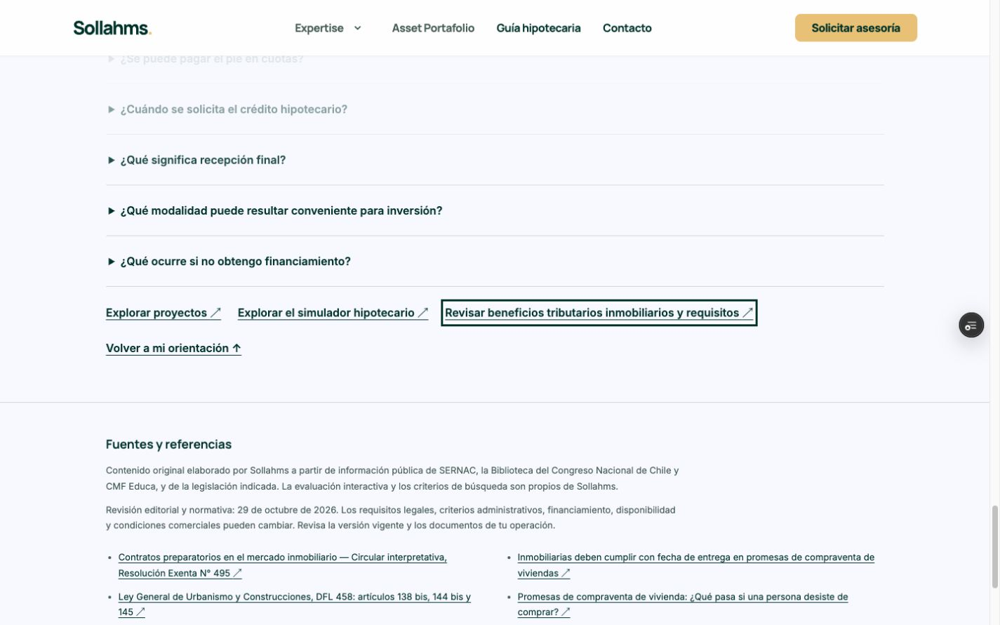
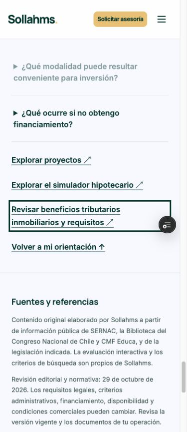

# Integración corporativa: revisión para autorización
Control: 14/11/2026 23:30 America/Santiago (15/11 UTC). Preparación, sin publicación.

## Producción y preservación
Inicial: dpl_A6HxKsPgvbfDTaHqUHqSgaBbegPM, 72ceaa022fa3c9bd8db90c07a2aa6656ec9c1025.
Durante la auditoría cambió legítimamente a dpl_6ittTviwNMv8RyaKvYLdTiPdZu2L, commit 9182da81a75a6ce1b026b67736291ebef3e4ac2f. El alias sollahms.cl se volvió a comprobar al cierre y sirve este deployment.
La actualización tributaria incorporó enlaces en portada, Centro, Guía, Comparador y Empresas. Se preservan los cinco HTML íntegros. Las propuestas iniciales de Centro y Empresas se retiraron por redundantes.
La primera vista previa dpl_2UzkpFYR7JWuDLyxzeDk3H87RE8A queda SUPERADA y no es candidata a publicación.

## Candidato definitivo
Rama: codex/corporate-journeys-current-20261115.
Código: 4bea6abcb3fbc663c0f3a559e0086d70a5b977a2, padre 9182da81a75a6ce1b026b67736291ebef3e4ac2f.
Deployment READY: dpl_Fs6Tf1eNmHrSJe8ocGfD7e7kpqoB.
[Vista previa](https://project-wrapp-9kfasofh8-lsandoval2-8260s-projects.vercel.app/cuando-comprar-propiedad.html).
Sin alias productivo; cabecera X-Robots-Tag noindex.
Única diferencia de sitio: cuando-comprar-propiedad.html. Sin recursos nuevos. Los documentos de esta carpeta no se incluyen en el artefacto.
Manifiesto: 1.659 archivos, 1.658 idénticos, uno modificado. El build comprobó todos los hashes y el inventario exacto antes de emitir el artefacto.
SHA1 anterior del HTML: 34e642043ed4be4f7a29369170ca969fde5db7ee.
SHA1 candidato: 39900a93326c2af82d504e4523e643301a17be4f (35.076 bytes).

## Inventario y mapa actual
Se revisaron navegación de escritorio/móvil, cuerpo y pie en 13 páginas. Se excluyen fichas de proyectos de toda modificación.
El inventario JSON adjunto conserva los enlaces iniciales; la tabla siguiente incorpora la actualización productiva posterior.
| Página | Conexiones pertinentes existentes |
|---|---|
| Portada | Centro, Guía, Comparador, Cuándo comprar, Catálogo, Empresas, Beneficios tributarios, Contacto |
| Centro | Guía, Comparador, Empresas, Beneficios tributarios, Catálogo, Agenda, Contacto |
| Guía | Comparador, Empresas, Beneficios tributarios, Cuándo comprar, Catálogo, Contacto |
| Comparador | Guía, Beneficios tributarios, Centro, Catálogo, Contacto |
| Cuándo comprar | Guía, Catálogo, Contacto; retorno al orientador |
| Entorno | Catálogo; Agenda/Contacto mediante navegación |
| Catálogo | Entorno, Cuándo comprar; Agenda/Contacto mediante navegación |
| Contacto | Agenda, Privacidad |
| Agenda | Guía, Catálogo, Privacidad |
| Trabaja con nosotros | Privacidad y recorrido laboral propio |
| Privacidad | Contacto |
| Empresas | Centro, Guía, Beneficios tributarios; Agenda/Contacto mediante navegación |
| Beneficios tributarios | Empresas, Centro, Guía, Comparador, Catálogo, Agenda |

Se conservan los desplegables Expertise en las 12 páginas auditadas previamente. El destino original Expertise, Asset Portafolio y Contacto no cambian. Las repeticiones entre navegación de escritorio, móvil y pie cumplen funciones distintas; no se añaden duplicados en un mismo bloque. Privacidad y Trabaja con nosotros mantienen su finalidad, sin enlaces empresariales forzados.
Empresas dispone de entradas contextuales y de navegación suficientes. La guía tributaria, inicialmente aislada de las otras páginas revisadas, ya recibió cinco entradas por la intervención concurrente. No se duplica ese trabajo.

## Mapa propuesto y justificación
| Origen / ubicación | Texto nuevo | Destino | Justificación |
|---|---|---|---|
| Cuándo Comprar / bloque existente de enlaces tras preguntas frecuentes | Revisar beneficios tributarios inmobiliarios y requisitos | /beneficios-tributarios-inmobiliarios.html | Completa el recorrido de quien evalúa el momento y modalidad de una inversión; permite consultar requisitos sin prometer beneficios ni atribuirlos automáticamente a sociedades. |

Se reutiliza ps-links, sin CSS, JavaScript ni CTA nuevos. Se mantienen todos los enlaces del bloque y el retorno al orientador.
Recorridos disponibles, no obligatorios:
A. Portada → Centro → Guía → Catálogo → Agenda.
B. Portada → Cuándo comprar → Beneficios tributarios → Catálogo → Agenda. El único tramo nuevo es Cuándo comprar → Beneficios tributarios.
C. Portada/Expertise → Empresas → Beneficios tributarios → Agenda/Contacto.
D. Centro → Guía → Comparador → Asesoría.
Cada página sigue siendo accesible directamente. Los recorridos combinan enlaces contextuales y navegación corporativa existente.

## QA y evidencia
- Build READY; guardia previewOnly; 1.658 archivos preservados y un cambio permitido.
- HTTP 200 en HTML modificado, destino tributario, sitemap y robots del candidato.
- Sitemap XML conserva 143 URL únicas; su hash y el de robots son idénticos a producción.
- Cuatro anchos: 320, 390, 768, 1440. Anchos de contenido 305, 375, 753, 1425 respectivamente: sin desbordamiento horizontal.
- Tab/Shift+Tab enfocan el enlace con contorno solid visible; Enter abre la guía tributaria. URL final comprobada.
- Consola: cero errores observados durante el recorrido final.
- Capturas de escritorio y móvil adjuntas.
- Menú móvil y Escape comprobados en la primera vista previa; el HTML de Cuándo Comprar y sus recursos son idénticos en el candidato final. Se reutiliza esa evidencia, sin repetir componentes inalterados.
- Reversión de la única inserción restituye exactamente el HTML base: head, metadatos, canonical, JSON-LD, Open Graph, H1, encabezado, pie, contenido y scripts intactos.
- Calculadoras, formularios, WhatsApp y demás recursos se preservan por hashes. No se enviaron formularios ni se activó el empresarial. No se afirma una nueva prueba funcional exhaustiva de componentes sin cambios.
- No se certifica WCAG ni compatibilidad con lector de pantalla.
- Las comprobaciones HTTP detalladas están en qa.json; manifiestos completos adjuntos.

## SEO/GEO, límites y siguiente paso
corporate-education-v2 conserva T0 09/11/2026 20:11:23 America/Santiago.
corporate-enterprise-v1 conserva T0 14/11/2026 21:03:45.065 America/Santiago.
Esta preparación es un evento independiente; no tiene aún T0 de publicación. No se atribuyen indexación ni resultados orgánicos.
Sitemap, robots, contenido financiero/tributario y fichas individuales intactos. Sin cambios en CRM, AI Lab, variables o infraestructura. Sin solicitudes de indexación, merges ni modificaciones de PR18/20.
No se amplía el sitemap para la guía tributaria en este trabajo.
Riesgo operativo: producción puede volver a cambiar. Antes de publicar, comprobar de nuevo el alias y comparar manifiestos; preservar todo cambio posterior. El paquete es deliberadamente previewOnly: una publicación futura requiere el procedimiento controlado y autorización expresa, no una promoción ciega del preview.
**APTO PARA SOLICITAR AUTORIZACIÓN DE PUBLICACIÓN**, limitada al enlace de cuando-comprar-propiedad.html.
