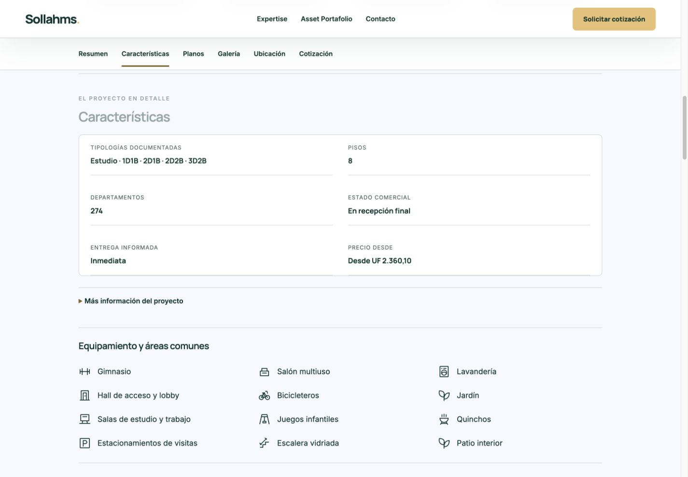
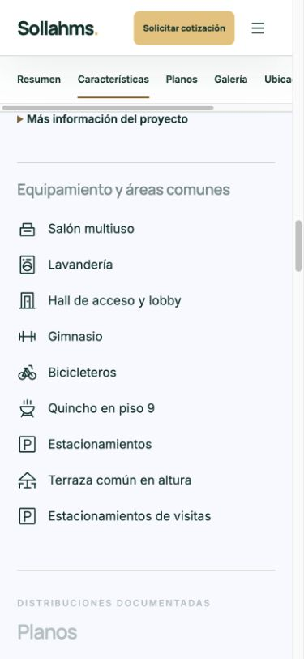

# Crescer: fichas completas y amenities compartidos

Publicado en producción el 29 de octubre de 2026.

- https://sollahms.cl/don-tomas.html
- https://sollahms.cl/don-rafael.html

## Alcance y resultado

Se completaron únicamente Don Tomás y Don Rafael. Las otras 129 fichas, sus registros comerciales y sus proyecciones de filtros permanecen idénticos. El sistema global sigue cubriendo 131 fichas, con 153 grupos, 979 elementos y 49 íconos disponibles.

Don Tomás incorpora ocho pisos, 274 departamentos, dirección Teniente Yávar 1733 en Conchalí, estudios y distribuciones 1D1B, 2D1B, 2D2B y 3D2B. Don Rafael incorpora nueve pisos, 108 departamentos, Domeyko 1950 esquinaO. Edwards en Santiago, estudios, 1D1B y 2D1B. En ambos casos se conserva la entrega informada Inmediata y el estado En recepción final proporcionados por el propietario. Las coordenadas de ambos edificios se conservan; sólo se normalizó la tilde de Yávar en el registro del mapa.

## Precios del propietario

| Proyecto | Estudio | 1 dormitorio | 2 dormitorios | 3 dormitorios |
|---|---:|---:|---:|---:|
| Don Tomás | UF 2.360,10 | UF 3.292,89 | UF 3.292,89 | UF 3.292,89 |
| Don Rafael | UF 2.817,14 | UF 3.668,54 | UF 4.985,77 | No documentado |

Los mínimos del proyecto son UF 2.360,10 y UF 2.817,14. Se respetan dos decimales en ficha, tarjetas, listado, mapa, directorio sin JavaScript y contexto de cotización. Los filtros y ordenamientos usan valores numéricos del catálogo. No se publican descuentos, precios por unidad ni inventario.

## Características y sistema reutilizable

El catálogo único está en `data/amenities.json`; el contenido por ficha, en `data/project-features.json`; el renderizador, en `scripts/project_amenities.py`; los estilos, en `assets/css/project-amenities.css`.

Se mantiene SVG de 24 unidades, trazo 1,5, extremos y uniones redondeados, sin relleno, tamaño 26 px y verde #003229. La grilla usa 3 columnas en escritorio, 2 en tablet y 1 en móvil; la tipografía y los espacios heredan la identidad de Sollahms.

Se añadieron los íconos centrales `stairs` (escalera vidriada) y `height` (altura interior). Terraza común en altura y quincho en piso 9 reutilizan la familia existente. La construcción completamente eléctrica y la altura 2,4 m quedan separadas de los espacios comunes.

Don Tomás conserva gimnasio, salón multiuso, lavandería, hall de acceso y lobby, bicicleteros, jardín, salas de estudio y trabajo, juegos infantiles y quinchos. Se añaden estacionamientos de visitas, escalera vidriada y patio interior, además de las dos características constructivas.

Don Rafael conserva salón multiuso, lavandería, hall de acceso y lobby, gimnasio, bicicleteros y estacionamientos. Precisa quincho en piso 9 y terraza común en altura, y añade estacionamientos de visitas. Ningún estacionamiento se presenta como incluido en el precio.

Los filtros usan la misma taxonomía; se añade `terraza-comun`, distinta de terraza privada y terraza panorámica. Desconocido no se interpreta como ausencia.

## Fuentes, planos y fotografías

Se revisaron las 34 páginas de ambos PDF. Se agregaron 24 láminas completas:12 por proyecto, de las que 15 son técnicas y 9 ilustradas. Las 32 filas técnicas contienen 31 modelos coherentes y 1 conflictivo. Cada plano conserva su procedencia, sus cifras y sus avisos integrados; puede ampliarse y abrirse el PDF original.

Hay 4 imágenes nuevas: fachada y entorno de Don Tomás; entorno y quincho de Don Rafael. Se mantienen las dos portadas anteriores por su calidad y las siete imágenes existentes. El total de la galería pasa a 5 imágenes en Don Tomás y 6 en Don Rafael. Se excluye una fachada Rafael duplicada y no se publican los dos diagramas de ubicación opcionales. Se verificaron dimensiones, decodificación y hashes. Los 58 archivos binarios publicados incluyen 24 planos, 24 miniaturas, 4 imágenes, 4 miniaturas y 2PDF.

El inventario detallado está en `asset-manifest.json`; la auditoría documental, en `brochure-audit.md` y `data/crescer-brochures.json`. Los originales de los folletos se guardan en `assets/brochures/crescer/` y las imágenes en `assets/propiedades/crescer/`.

## Inconsistencias y pendientes

- Don Tomás repite UF 3.292,89 para 1, 2 y 3 dormitorios. Se conservaron exactamente los valores del propietario; conviene confirmar la coincidencia.
- Don Tomás publica Departamento, Shaft, Total departamento y Terraza. Total departamento es una métrica propia, denominada Departamento (según plano) en filtros; nunca se convierte en útil, interior ni total con terraza. Las 16 comprobaciones aritméticas resultaron correctas.
- Don Rafael publica superficie interior y terraza, sin total. No se sumaron ni se presentaron como útil.
- Don Rafael, lámina 12 derecha: el dibujo muestra 2D1B, el título indica estudio y las superficies duplican el estudio vecino. Se conserva la lámina en un grupo de revisión con nota visible, enlazado desde la opción 2D. Sus superficies se excluyen de filtros. La tipología general 2D1B sigue documentada, sin área asociada.
- Don Rafael, lámina 9: título 210 al 210 y referencia inferior 210–810; se conserva la discrepancia documental.
- Las nueve distribuciones ilustradas no tienen una correspondencia técnica exacta probada; no se les asignaron áreas de otros planos.
- Disponibilidad, unidad, inclusiones y condiciones se confirman durante la cotización. Los folletos no acreditan stock vigente.

## Navegación y cotización

Ambas fichas usan Resumen → Características → Planos → Galería → Ubicación → Cotización. Los precios por tipología quedan dentro del resumen, sin inventario. `assets/css/project-brochure.css` y `assets/js/project-brochure.mjs` son componentes compartidos reutilizables.

La selección agrega proyecto, Crescer, tipología y precio de referencia al mensaje del formulario existente. Puede quitarse sin borrar el mensaje del visitante. Se respeta el límite del contrato y se conservan nombre, RUT, correo, teléfono, consentimiento, intenciones de cotización/llamada, endpoint, destino, validaciones e idempotencia. Las pruebas de transporte fueron aisladas; no se envió ningún lead real.

## Verificación

65 pruebas automatizadas pasaron:19Python y 46Node. Cubren amenities, taxonomía, navegación, datos y alcance Crescer, precios, selección, filtros, mapa, formularios, validación de campos obligatorios y retiro de Patio Brasil.

Se comprobó en navegador a 1440, 768 y 390 px: sin desborde de página, íconos cuadrados 26 px, grilla 3/2/1, navegación, expansión de planos, selección y eliminación de tipología, campos obligatorios en ambas intenciones y precios del catálogo en Tarjetas/Listado/Mapa. Ambos marcadores conservan coordenadas y muestran los precios correctos. No hubo errores de aplicación en la revisión de ficha.

Los renderizadores globales de amenities y navegación recorrieron 131 fichas sin diferencias pendientes. La integración de Crescer en el generador compartido y su ejecución repetida también se verificaron. `verification.json` contiene el resumen estructurado y las capturas adjuntas muestran producción.

## Archivos de implementación y mantenimiento

- `data/crescer-commercial.json`: autoridad comercial y siete precios exactos.
- `data/crescer-brochures.json`: modelos, superficies, evidencia y conflictos.
- `scripts/crescer_details.py`: actualización de los dos registros y enriquecimiento de fichas; conectado a `scripts/project_header_b.py`.
- `scripts/catalog_property_facts.py` y `scripts/build-catalog-facets.py`: proyección de datos coherentes para búsqueda.
- `scripts/project_navigation.py`, `assets/js/catalog-model.mjs`, `catalog.mjs`, `catalog-map.mjs` y `project-request.mjs`: precisión comercial manteniendo el formato anterior para las demás inmobiliarias.
- `tests/crescer.py` y `tests/crescer.test.mjs`: alcance, modelos, medios, precios, filtros, selección y mapa.

Para una nueva característica, registrar un nombre normalizado y un ícono en `data/amenities.json`, añadir su evidencia y alcance en `data/project-features.json`, y regenerar ficha e índice. Los nombres desconocidos detienen la generación. Los filtros privados o residenciales requieren evidencia específica; nunca se deducen de áreas comunes.

## Publicación y recuperación

Producción READY: `dpl_JAYMooKS6Sa8mSTjyPfbazAo6aqT`. Commit fuente: `96715d351ba86c51fa30da75b2ef50f8a1089b8a`, rama `codex/crescer-brochures-20261029`.

Vista previa final: `dpl_9pxbCD8fJLB9wX4UaCUxB3zGUoEx`. El artefacto final de 1498 archivos coincide exactamente con producción: SHA256 `f5852f054a7c5f4fb8c49bb5494b2d49e348714baf5826752470e57aa2d9b4dd`.

Se utilizó `docs/advanced-filters-20261029/deployment-files.json` como base congelada y `scripts/package-crescer.py` para superponer 13 archivos de texto y 58 activos binarios. Las funciones se conservan; la única transformación de datos del contacto sincroniza los siete registros Nollagam existentes y los dos Crescer, dejando 122 registros restantes intactos. Se mantiene Patio Brasil 410.

El paquete validado queda en `deployment-files.json`. Las fichas públicas, catálogo, índice y registro de ubicaciones se compararon con este paquete después de publicar, todos conHTTP 200; Patio Brasil respondió 410. `main` y la rama de trabajo mantienen despliegue automático desactivado. El despliegue anterior recuperable es `dpl_24fFPj7gmpr41spEjfj9JpRN3rJY`.

## Capturas de producción

