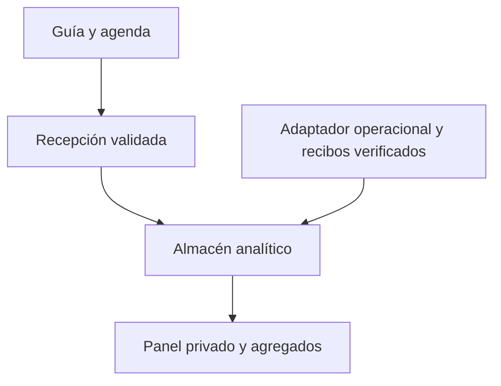

# Consolidación de QA y evaluación arquitectónica — PR #23

Fecha: 15/11/2026. Zona: America/Santiago (UTC−03:00). Informe exclusivamente documental.
Base revisada: `1cfe9fe013c49d7323faa9a4b7565aa875ce2a44`.
Código del laboratorio: `180f621630f70e34da5207ed924d0cf5f3499dc2`.
Deployment privado de referencia: `dpl_4HdweiyWVmBtJZbbvbHumXCmCBn6`.
PR #23 comprobado abierto, en borrador y sin fusionar.

## Dictamen

Continuar con diseño y decisiones de infraestructura, privacidad y seguridad. **No promover el laboratorio ni activar medición real.** La evidencia valida partes del recorrido sintético y su recuperación local; no certifica recepción confiable, almacenamiento compartido, cobertura comercial ni entregas reales.

Este informe consolida [QA.md](QA.md) sin reescribir su historia ni repetir pruebas. No se inspeccionaron nuevamente servicios productivos, permisos, credenciales o recursos remotos. Las referencias de producción históricas no acreditan la versión actualmente publicada.

## 1. Estado consolidado del QA

| Evidencia | Resultado conservado | Alcance |
| --- | --- | --- |
| 40 Node | Aprobadas anteriormente | Contrato, estados, tasas, exportación; no ejecutadas de nuevo |
| 14 IndexedDB | Aprobadas anteriormente | Transacciones, concurrencia y recuperación del laboratorio; no repetidas |
| 7 Web Locks | Aprobadas anteriormente | API y propietarios de prueba; ausencia de API inyectada, no compatibilidad universal |
| Exportación JSON real | Aprobada | Archivo recibido, 943 bytes; agregado sintético sin UUID ni PII observada |
| Importación y lectura Sheets | Confirmadas | 32 campos, tres columnas, lectura autorizada; inspección visual bloqueada |
| Duplicación nativa coordinada | Satisfactoria en alcance observado | Original 60dc48d8/main y copia 8cee12dc/sin CTA, locks adquiridos; sin duplicar atribución |
| Reinicio completo | Confirmación del propietario y verificación posterior | No observación independiente del proceso del SO |
| Persistencia y recuperación | Aprobadas funcionalmente | Cola 1 antes y después de reiniciar; reintento la reduce a 0 |
| Inflación de métricas | No observada | Conserva 1 visita, 1 clic, 1 agenda atribuida; muestra 2; no atribuibles 1; inicios/aceptaciones/entregas 0 |
| Tasas del recorrido manual | NO DISPONIBLE | Cobertura no certificada; no confundir con el fixture cerrado |

Las cifras del fixture cerrado (CTR 100%, conversiones 66,67%, entrega 50%) son exclusivamente sintéticas. La importación no prueba el marcador NO DISPONIBLE: no estaba en el archivo, por lo que ese caso permanece NO APLICA.

Evidencias versionadas: [QA.md](QA.md), [README.md](README.md), [tests-complementarios.txt](tests-complementarios.txt), [qa-complementario-evidencias.json](qa-complementario-evidencias.json). Capturas manuales del propietario y captura posterior al reinicio: conservadas en la conversación; este informe no genera nuevas capturas.

## 2. Límites y riesgos residuales

| Nivel para futura producción | Riesgo / límite | Tratamiento requerido |
| --- | --- | --- |
| Bloqueante | No receptor ni almacén remoto compartido autorizado | Diseñar, autorizar y probar separación de entornos y durabilidad |
| Bloqueante | Recibos actuales fabricados por fixtures | Adaptador servidor y comprobantes verificables; el navegador nunca confirma aceptación o entrega |
| Bloqueante | Privacidad, finalidad, base habilitante, retención y responsables sin aprobación | Revisión competente y decisión expresa antes de capturar personas reales |
| Alto | Cliente puede manipular sesiones/eventos y bots pueden obtener tokens | Validación de servidor, límites distribuidos, métricas de calidad; no prometer identificación de personas |
| Alto | Pérdida de eventos y resultados operacionales inciertos | Conciliación durable, ventanas de maduración y estados desconocidos |
| Medio | Persistencia comprobada mediante interfaz, no auditoría exhaustiva interna | Nuevas pruebas específicas de servidor, recuperación y restauración al existir candidato |
| Medio | Sesión ausente tras reinicio con más de 30 minutos transcurridos | No atribuir causalidad exclusivamente a expiración o restauración de sessionStorage |
| Medio | Cierre de copia y matriz nativa completa no documentados concluyentemente | Delimitar certificación; completar solo casos necesarios para el futuro candidato |
| Bajo | Sheets reduce 66.66666666666667 a 66.6666666666666 | No igualdad exacta; ambos redondean 66,67%; JSON conserva referencia |
| Documental | Captura Sheets bloqueada por permisos | Mantener pendiente; no solicitar acceso ni cambiar permisos |

No hay prueba de crash completo, todos los navegadores, pérdida total de almacenamiento ni cobertura universal. IndexedDB local no equivale a respaldo ni almacén multiusuario. La existencia de un identificador opaco no convierte los datos en anónimos: pueden ser seudónimos vinculables.

## 3. Arquitectura propuesta, no implementada

Separar cinco responsabilidades y permisos:

1. Captura mínima en guía/agenda: cuatro eventos de navegación e interacción.
2. API same-origin de recepción: valida, limita y confirma almacenamiento.
3. Almacén central analítico: transacciones, unicidad, caducidad y agregados.
4. Adaptador operacional restringido: relaciona aceptación y entrega con una referencia analítica.
5. Panel privado de lectura y exportación agregada.

Una avería analítica no debe impedir una solicitud comercial válida. El adaptador conserva una cola durable de proyecciones pendientes cuando sea posible; si no puede registrar evidencia, marca cobertura desconocida. No reconstruye aceptaciones por clics, HTTP 200 o ausencia de error. No se modifica ahora el contrato operacional.

### Recepción y contrato

Crear en un futuro candidato un contrato productivo versionado distinto del fixture: quitar la dependencia de `run.expected` sin presentar por ello cobertura completa. Rechazar mezclas de entornos y cualquier `synthetic=true` en métricas reales. Mantener un contrato sintético separado para pruebas.

Campos permitidos propuestos: versión, event_id aleatorio, sesión opaca efímera, secuencia, tipo, hora cliente acotada, CTA enumerado, página enumerada y versión de instrumentación. Hora de recepción y fuente de confianza las asigna el servidor. Sin URL libre, parámetros, referrer bruto, respuestas tributarias, texto del formulario, nombre, RUT, correo, teléfono, IP persistida ni fingerprint.

| Evento | Emisor admisible | Condición |
| --- | --- | --- |
| guide_view | Cliente validado | Vista de guía, única por sesión según definición explícita |
| tax_advisory_click | Cliente validado | Interacción y CTA cerrado header/main/footer |
| agenda_view | Cliente validado | Contexto explícito; entrada directa no atribuible |
| advisory_form_start | Cliente validado | Primera interacción real, no carga, foco automático ni inicialización |
| advisory_accepted | Adaptador de servidor | Respuesta verificable de aceptación del proveedor vinculada durablemente |
| advisory_delivered | Conciliador de servidor | Comprobante autenticado y correlacionado, aceptación previa conciliada |

Fijar límites de bytes reales, lotes, tipos, propiedades adicionales, secuencias y desfase horario. Rechazar eventos server-only en ingesta pública. Respuestas por evento: confirmado, duplicado, rechazado o reintentable; el cliente elimina de su cola únicamente confirmados/duplicados. Persistir antes de confirmar. Reintentos con backoff, jitter, límite de edad y volumen; una pérdida local se informa, no se reconstruye por fingerprint.

CORS y Origin/Fetch Metadata son controles auxiliares, no autenticación de visitantes ni protección suficiente contra bots. Propuesta: capacidad firmada breve emitida por servidor para el entorno/sesión, sin secretos en JavaScript, y límites distribuidos por capacidad y globales. Para mitigación por IP, decidir procesamiento transitorio en borde y auditar logs del hosting; no guardar IP en analítica ni usar un hash persistente como sustituto. Topes de presupuesto y corte de captura ante abuso; nunca afectar formularios por el corte analítico.

### Sesiones y atribución

Conservar principio de pestaña y 30 minutos de inactividad por eventos pertinentes, pendiente de aprobación definitiva. SessionStorage y Web Locks pueden reutilizarse como coordinación local; servidor acota caducidad y evita renovación mediante un evento antiguo reenviado. Un token nuevo no une identidades entre dispositivos.

Ante duplicación, cambiar identidad y borrar CTA heredado cuando se detecte colisión. Sin almacenamiento o mecanismo seguro soportado, deshabilitar atribución y registrar cobertura no disponible; no inventar continuidad. No prometer que sessionStorage sobrevive o desaparece siempre al reiniciar.

Propuesta de modelo: último clic válido en la misma sesión, antes de enviar la solicitud, conservando historia de clics. Un contexto de atribución sellado por servidor vincula sesión, CTA, versión y vencimiento a una referencia de solicitud analítica independiente. Al aceptar, congelar ese vínculo; entregas posteriores no cambian el CTA aunque caduque la sesión. No usar la clave operacional de idempotencia como identidad analítica.

El README identifica main como CTA comercial y footer como cierre: antes de instrumentar producción debe verificarse el mapa DOM vigente y aprobar la semántica exacta de los tres identificadores. No reasignarlos silenciosamente ni asumir que los nombres describen la ubicación actual.

### Almacenamiento y deduplicación

Opción preferida para evaluación: base relacional central con transacciones y restricciones únicas; sin seleccionar proveedor, plan o recurso por este documento.

| Entidad propuesta | Contenido mínimo | Separación |
| --- | --- | --- |
| analytics_sessions | ID opaco, creación, actividad, expiración, versión | Sin identidad comercial |
| analytics_events | ID, sesión, tipo, CTA, hora evento/recepción, fuente, huella de campos permitidos | Escritura solo vía servidor |
| analytics_requests | ID analítico, contexto congelado, estados aceptado/entregado y fechas | Sin contenido personal |
| operational_correlation | ID analítico ↔ referencia operacional/proveedor | Esquema/rol separado; fuera del panel y exportaciones |
| receipt_inbox | ID proveedor/evento, digest, tipo, estado conciliación y timestamps | Proyección mínima; no payload bruto con destinatarios |
| aggregates / quality | Cohorte, conteos, calidad, versión de cálculo | Solo agregado; sin UUID exportados |

Unicidad por event_id más huella canónica: mismo ID y mismo contenido es duplicado; contenido distinto se rechaza. Unicidad semántica por sesión/tipo/CTA para indicadores únicos y por solicitud/tipo para resultados. No deduplicar solicitudes distintas solo por sesión. Aceptación, proyección e inbox deben tener transiciones atómicas, seguras ante concurrencia y reordenamiento.

La ventana de deduplicación debe cubrir reintentos y recibos tardíos. Si una política de borrado elimina la clave, un evento viejo no debe resucitarla: rechazar por antigüedad o usar tombstones mínimos con retención aprobada. Backups, colas fallidas y restauraciones deben respetar la eliminación, no reintroducir datos caducados.

### Aceptación y entrega verificable

El handler revisado recibe un ID de Resend y responde `providerAccepted:true, deliveryConfirmed:false`. No persiste allí una correlación analítica. Reutilizar esa distinción, no inferir estados desde el HTTP del navegador.

Un futuro adaptador autorizado debe registrar la relación operacional/proveedor antes de proyectar aceptación. No existe transacción distribuida automática entre proveedor y base: una caída tras aceptar y antes de guardar requiere estado desconocido y conciliación; no reenviar con otra clave ni inventar éxito.

Webhook propuesto: verificar firma sobre bytes originales con librería oficial, timestamp/tolerancia, secreto por entorno y deduplicación de recibo. Tras verificación, descartar campos personales y conservar solo la proyección necesaria. Entregas huérfanas esperan conciliación; no computarlas hasta tener aceptación validada. Estados de retraso, rebote y fallo permanecen distintos de entrega.

Resend documenta que `email.sent` representa solicitud API exitosa y que `email.delivered` significa llegada al servidor de correo destinatario [S2]. **No acredita lectura humana, llegada a bandeja principal, atención comercial, venta o cita.** El correo operacional revisado va a contacto@sollahms.cl: el indicador describiría ese canal interno, no una entrega al cliente. No activar aperturas/clics de email.

## 4. Reutilización compatible y componentes faltantes

Inspección del árbol documental fijado; no certificación de archivos actualmente desplegados.

| Componente leído | Reutilización posible | Falta / cautela |
| --- | --- | --- |
| labs/cta-measurement, README y QA | Contrato cerrado, coordinación, deduplicación, reglas de tasas y UI | Adaptación de servidor, cobertura real y seguridad |
| api/advisory.mjs | Validación acotada, preview bloqueado, separación aceptación/entrega | Correlación durable; cambios operacionales requieren autorización separada |
| lib/form-operation-server.mjs | Formato y rechazo de claves, límite temporal, detección de conflicto | Ledger Map por proceso no es durable ni distribuido; no reutilizar como almacén central |
| lib/crm-lead-client.mjs | Patrón de transporte acotado y validación | Existencia en Git no prueba activación; no conectar ni usar para analítica |
| Rama de atribución citada en README | Principios de UUID, contexto cerrado y pestaña | Experimental; no asumida publicada ni importada en esta revisión |
| Hosting existente | Evaluar ruta same-origin y autenticación administrativa | Cuotas, entorno, logs y capacidad no auditados en este turno |
| Infraestructura de datos existente del ecosistema | Evaluar inventario y aislamiento antes de crear otro recurso | Disponibilidad, permisos, costos y garantías no verificados; no usar tablas CRM ni credenciales compartidas |

La analítica debe quedar fuera del esquema de contactos. Reutilizar una instancia solo si permite roles, aislamiento, límites, borrado y recuperación independientes; si no, evaluar almacén separado. CRM es opcional y no requisito para medir aceptación/entrega del canal actual.

## 5. Privacidad, retención y acceso — propuestas no aprobadas

Propuesta para revisar: eventos y correlación hasta 30 días; agregados hasta 90 días, como antecedente del README. Sesión activa 30 minutos; cola local propuesta máximo 24 horas. Estos valores no son obligaciones legales ni autorizaciones. Deben ajustarse a finalidad, recibos tardíos, ventana de conciliación y eliminación.

Tarea automática diaria propuesta para purgar vencidos, con auditoría agregada sin PII y alarma si falla. Definir también retención de tombstones, backups, logs técnicos, recibos fallidos y exportaciones; no declarar borrado completo hasta abarcar esos soportes. La caducidad de sesión no implica borrar el evento histórico inmediatamente.

Acceso al panel con autenticación de servidor, MFA mediante identidad aprobada, roles de lectura/exportación/administración y mínimo privilegio. No basta ocultar una URL o proteger solo el HTML: API y exportación también requieren autorización. Credenciales servidor aisladas, rotación y auditoría de acceso. Consultas agregadas, rangos acotados y supresión de grupos pequeños como propuesta para reducir reidentificación.

El consentimiento actual para responder una solicitud no se extiende automáticamente a medición. Resolver finalidad, base habilitante, información al usuario, derechos, responsables, proveedores y transferencias mediante revisión de privacidad antes de activación. Este informe no emite dictamen jurídico ni presume anonimato.

## 6. Métricas y cobertura

Denominadores comparables por versión, cohorte y período UTC; presentación America/Santiago. CTR: sesiones con clic y vista válida / sesiones con vista. Conversiones: sesiones con aceptación atribuida / sesiones elegibles de guía o clic. Entrega: solicitudes entregadas verificadas / solicitudes aceptadas del mismo conjunto madurado.

Mostrar numerador, denominador, muestra, fecha de corte, retrasos, no atribuibles, rechazos y pérdidas conocidas. No confundir sesión con persona ni aceptación con venta. Mantener NO DISPONIBLE si denominador cero, discrepancias, pérdidas o cobertura no demostrada. Un servidor central no prueba que todos los visitantes enviaron eventos. Si se aprueban tasas de población observada, etiquetarlas explícitamente, separadas de tráfico total y sin declararlas completas.

Definir ventana de maduración de entrega antes de medir; no tratar aceptaciones recientes como fallos. No comparar fixture con tráfico real ni recomenzar T0 editorial. Registrar futura activación como intervención nueva y separada.

## 7. Complejidad, dependencias y autorizaciones

Estimación orientativa de ingeniería, no cotización ni compromiso: 15–27 jornadas, excluye esperas de acceso, revisión jurídica, compras y resolución de incidentes. Depende de la infraestructura elegida.

| Bloque | Complejidad | Jornadas orientativas | Decisión previa |
| --- | --- | ---: | --- |
| Contrato y captura compatible | Media | 2–4 | Mapa CTA, privacidad y alcance |
| Almacén, ingesta y controles de abuso | Alta | 4–7 | Proveedor, capacidad, región, seguridad |
| Conciliación y recibos | Alta | 4–7 | Autorización Resend, secretos, contrato operacional |
| Panel, retención y exportación | Media | 2–4 | Roles, plazos, eliminación |
| QA específico y candidato controlado | Alta | 3–5 | Entorno aislado y criterios de aceptación |

Autorizar por separado: infraestructura/almacenamiento; seguridad y custodios; privacidad; retención y respaldos; conexión de pruebas y luego producción con Resend; eventual CRM (prescindible en etapa inicial); presupuesto y límites; publicación y activación. Ninguna queda concedida por este informe.

No se asegura costo cero. Estimar primero volumen: eventos por día × bytes por evento × retención, más índices, correlaciones, backups, funciones, autenticación y egreso. Usar métricas disponibles o escenarios explícitos, no inventar tráfico. Revisar cuotas existentes y costos vigentes al elegir proveedor; aprobar techo y corte antes de gastos.

## 8. Criterios mínimos para un futuro candidato

- Inventariar producción vigente y preservar cambios posteriores; nunca reconstruir desde la base histórica del PR23.
- Diseño de privacidad/retención y responsabilidades aprobado; plan de rollback que desactive captura sin dañar formularios.
- Almacén aislado, roles mínimos, ingesta fail-closed para eventos inválidos y datos personales; fallo analítico no rompe solicitudes.
- Identidad analítica separada, mapa CTA aprobado y contrato operacional compatible expresamente autorizado.
- Pruebas nuevas necesarias: múltiples instancias, reintentos y caídas en límites de transacción, firma/replay, recibos huérfanos y tardíos, pérdida de cola, cuotas y abuso, borrado/restauración, autenticación y acceso cruzado. No repetir 40/14/7 sin cambio relevante.
- Pruebas con datos sintéticos y fixtures firmados; comprobantes reales solo después de autorización del canal de prueba. No usar clientes reales.
- Confirmar cobertura y fórmulas con conjuntos conocidos; panel no muestra porcentajes engañosos ni PII.
- QA de navegadores expresamente soportados, rutas y accesibilidad; límites de soporte documentados.
- Evidencias, SHA, preview privado, comparación contra producción y revisión independiente antes de pedir publicación.
- Ninguna habilitación automática por merge, dominio o variable global. PR23 permanece laboratorio sintético y abierto.

## 9. Continuidad recomendada

Revisar esta propuesta y resolver primero decisiones de almacenamiento, privacidad y canal operacional. Después, con autorización nueva, preparar un candidato separado de recepción centralizada sintética. Evaluar Resend y CRM en pasos explícitos posteriores; no migrar ni publicar este laboratorio como solución terminada.

La inspección visual de Sheets permanece pendiente, sin cambio de permisos. No bloquea escribir el diseño, pero impide declarar cerrada aquella validación. La publicación y medición real permanecen bloqueadas por las dependencias arquitectónicas y autorizaciones anteriores.

## Fuentes revisadas

Documentación y código fijados a la base de este informe: [QA](https://github.com/lasopho/sollahms-web/blob/1cfe9fe013c49d7323faa9a4b7565aa875ce2a44/docs/cta-first-party-20261115/QA.md), [README](https://github.com/lasopho/sollahms-web/blob/1cfe9fe013c49d7323faa9a4b7565aa875ce2a44/docs/cta-first-party-20261115/README.md), [propuesta anterior](../medicion-cta-tributario-20261115/PROPUESTA-INSTRUMENTACION.md), api/advisory.mjs, lib/form-operation-server.mjs, lib/crm-lead-client.mjs y AGENTS.md.

Fuentes técnicas oficiales consultadas el 15/11/2026, sin acceso a cuenta ni cambios de servicio:

- [S1 — Resend: verificación de webhooks](https://resend.com/docs/webhooks/verify-webhooks-requests): firma sobre bytes originales y prevención de falsificación/replay.
- [S2 — Resend: tipos de eventos](https://resend.com/docs/webhooks/event-types): diferencia entre aceptación y llegada al servidor destinatario.
- [S3 — Resend: idempotencia](https://resend.com/docs/dashboard/emails/idempotency-keys): ventana documentada de 24 horas; no sustituye un ledger durable propio ni autoriza reenvío fuera de ventana.

No se realizaron nuevas pruebas, llamadas de envío, consultas de almacenamiento remoto, deployments o cambios de producción. Única adición prevista: este informe dentro de la documentación del laboratorio.
