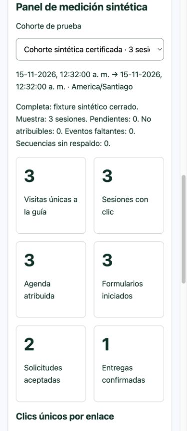

# QA y entrega del laboratorio privado — 15/11/2026

Cierre: 15/11/2026 00:35:45 America/Santiago (03:35:45 UTC).
Código: `ef6b2df3a87729dae441581a7ee78719832dc8fd`.
Deployment READY staging: `dpl_J7Zuey6N6cxEVmmsRtnzFjnDBrB9`.
[Preview privado](https://project-wrapp-e0atb5o9o-lsandoval2-8260s-projects.vercel.app/).
[PR #23, abierto y en borrador](https://github.com/lasopho/sollahms-web/pull/23).

## Resultados
- 33 pruebas automatizadas Node: todas aprobadas (tests.txt). Eventos perdidos/duplicados, sesión, caducidad, navegación, campos prohibidos, comprobantes, rechazo, incompleto y tasas.
- 9 comprobaciones automatizadas reales de IndexedDB en Chrome: todas aprobadas (browser-storage.json). Cola concurrente de 15 eventos, reapertura de base, flush concurrente, deduplicación, persistencia, conciliación y borrado; base de prueba aislada eliminada al finalizar.
- Recorrido manual en preview: guía privada → CTA main → agenda sintética. Sin interacción: no form_start. Formulario incompleto y rechazo: sin aceptación. Aceptación y comprobante de entrega separados y visibles. Panel confirma 1 sesión/1 clic main/1 agenda/1 inicio/1 aceptación/1 entrega; tasas NO DISPONIBLE por cobertura no certificada.
- Desconexión simulada: 1 evento pendiente; reconexión vacía cola sin inflar conteos. No se prueba infraestructura de red o proveedor real porque no existe transporte remoto en este laboratorio.
- Expiración forzada: siguiente agenda crea segunda sesión sin CTA; panel muestra 1 evento no atribuible.
- Cohorte cerrada: 3 sesiones, 3 clics (uno por CTA), 3 agendas, 3 inicios, 2 aceptaciones, 1 entrega; tasas sintéticas 100%, 66,7%, 66,7%, 50%.
- Escritorio y móvil: 320/390/768/1440 px; scrollWidth305/375/753/1425 respectivamente, sin desbordamiento horizontal de documento. Capturas 390 y1440.
- Consola: sin errores ni advertencias observados.
- Build con VERCEL_ENV=production rechazado antes de empaquetar.
- Exportador JSON agregado preparado; no incluye UUID de sesión/solicitud, datos de formulario o PII. No se certificó descarga en disco del usuario.
- Prueba de pestaña duplicada/Web Locks no ejecutada en UI; mecanismo implementado, validación adicional requerida antes de integrar en producción. No hay afirmación de cobertura universal entre navegadores.

## Privacidad y seguridad
Preview con SSO habilitado (all_except_custom_domains), sin cambios globales. Sin API ni funciones en el paquete. CSP connect-src none; form-action none; noindex/nofollow exclusivo del laboratorio. No se enviaron datos reales a Resend/CRM ni se tocaron sus configuraciones.
El almacenamiento persistente autorizado es IndexedDB local del preview con datos sintéticos: no existe persistencia compartida de servidor. Los recibos de fixture no son evidencia de correo real. Estos límites son explícitos en la interfaz.

## Preservación
Alias sollahms.cl conserva `dpl_GqikSrihY6ETwsVJtkF6uB6y4Dsw`, updatedAt1794712257260.
Guía HTTP200:43228 bytes/SHA1 871f1e31e65ed96564ef47df492335f9925f6301.
Agenda HTTP200:19406 bytes/SHA1 c4aa251758099ded68d9ae430859f74cf3d821ec.
Todos los archivos existentes versionados sin cambios. Solo adiciones en labs/cta-measurement y docs/cta-first-party-20261115. Sin merge ni modificaciones de PR18–22. T0, sitemap, robots, SEO/GEO e integraciones intactos.

## Hallazgos y condición de avance
- Alto para producción: falta almacén de servidor, autorización/política de privacidad-retención-accesos y adaptador de recibos reales con verificación de confianza. Son exclusiones deliberadas de esta autorización, no capacidades certificadas.
- Medio: pérdida total de almacenamiento del navegador no permite reconstruir la cobertura; no calcular tasas reales. Validar aislamiento de pestañas/navegadores adicionalmente.
- Bajo: exportación implementada sin certificación de descarga final en el equipo; fechas de fixture pueden mostrarse en el mismo segundo por la escala sintética de milisegundos.
Sin hallazgos críticos que impidan revisar el laboratorio sintético privado. **No apto para activar medición comercial real ni para promoción a producción.**
Cualquier integración productiva exige nueva autorización expresa y resolver los puntos anteriores. No se solicita publicación de este laboratorio.

