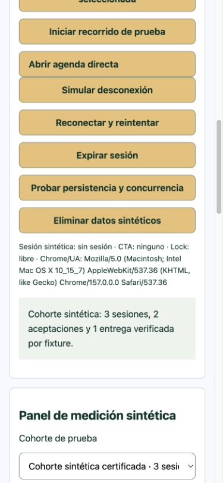

# QA y entrega del laboratorio privado — 15/11/2026

> Las revisiones históricas se conservan. El estado vigente se consolida al final: exportación JSON aprobada y lectura de la importación confirmada; captura visual de Google Sheets, duplicación nativa y reinicio completo pendientes.

Cierre: 15/11/2026 00:35:45 America/Santiago (03:35:45 UTC).
Código: `ef6b2df3a87729dae441581a7ee78719832dc8fd`.
Deployment READY staging: `dpl_J7Zuey6N6cxEVmmsRtnzFjnDBrB9`.
[Preview privado](https://project-wrapp-e0atb5o9o-lsandoval2-8260s-projects.vercel.app/).
[PR #23, abierto y en borrador](https://github.com/lasopho/sollahms-web/pull/23).

## Resultados
- 33 pruebas automatizadas Node: todas aprobadas (tests.txt). Eventos perdidos/duplicados, sesión, caducidad, navegación, campos prohibidos, comprobantes, rechazo, incompleto y tasas.
- 9 comprobaciones automatizadas reales de IndexedDB en Chrome: todas aprobadas (browser-storage.json). Cola concurrente de 15 eventos, reapertura de base, flush concurrente, deduplicación, persistencia, conciliación y borrado; base de prueba aislada eliminada al finalizar.
- Recorrido manual en preview: guía privada → CTA main → agenda sintética. Sin interacción: no form_start. Formulario incompleto y rechazo: sin aceptación. Aceptación y comprobante de entrega separados y visibles. Panel confirma 1 sesión/1 clic main/1 agenda/1 inicio/1 aceptación/1 entrega; tasas NO DISPONIBLE por cobertura no certificada.
- Desconexión simulada: 1 evento pendiente; reconexión vacía cola sin inflar conteos. No se prueba infraestructura de red o proveedor real porque no existe transporte remoto en este laboratorio.
- Expiración forzada: siguiente agenda crea segunda sesión sin CTA; panel muestra 1 evento no atribuible.
- Cohorte cerrada: 3 sesiones, 3 clics (uno por CTA), 3 agendas, 3 inicios, 2 aceptaciones, 1 entrega; tasas sintéticas 100%, 66,7%, 66,7%, 50%.
- Escritorio y móvil: 320/390/768/1440 px; scrollWidth305/375/753/1425 respectivamente, sin desbordamiento horizontal de documento. Capturas 390 y1440.
- Consola: sin errores ni advertencias observados.
- Build con VERCEL_ENV=production rechazado antes de empaquetar.
- Exportador JSON agregado preparado; no incluye UUID de sesión/solicitud, datos de formulario o PII. No se certificó descarga en disco del usuario.
- Prueba de pestaña duplicada/Web Locks no ejecutada en UI; mecanismo implementado, validación adicional requerida antes de integrar en producción. No hay afirmación de cobertura universal entre navegadores.

## Privacidad y seguridad
Preview con SSO habilitado (all_except_custom_domains), sin cambios globales. Sin API ni funciones en el paquete. CSP connect-src none; form-action none; noindex/nofollow exclusivo del laboratorio. No se enviaron datos reales a Resend/CRM ni se tocaron sus configuraciones.
El almacenamiento persistente autorizado es IndexedDB local del preview con datos sintéticos: no existe persistencia compartida de servidor. Los recibos de fixture no son evidencia de correo real. Estos límites son explícitos en la interfaz.

## Preservación
Alias sollahms.cl conserva `dpl_GqikSrihY6ETwsVJtkF6uB6y4Dsw`, updatedAt1794712257260.
Guía HTTP200:43228 bytes/SHA1 871f1e31e65ed96564ef47df492335f9925f6301.
Agenda HTTP200:19406 bytes/SHA1 c4aa251758099ded68d9ae430859f74cf3d821ec.
Todos los archivos existentes versionados sin cambios. Solo adiciones en labs/cta-measurement y docs/cta-first-party-20261115. Sin merge ni modificaciones de PR18–22. T0, sitemap, robots, SEO/GEO e integraciones intactos.

## Hallazgos y condición de avance
- Alto para producción: falta almacén de servidor, autorización/política de privacidad-retención-accesos y adaptador de recibos reales con verificación de confianza. Son exclusiones deliberadas de esta autorización, no capacidades certificadas.
- Medio: pérdida total de almacenamiento del navegador no permite reconstruir la cobertura; no calcular tasas reales. Validar aislamiento de pestañas/navegadores adicionalmente.
- Bajo: exportación implementada sin certificación de descarga final en el equipo; fechas de fixture pueden mostrarse en el mismo segundo por la escala sintética de milisegundos.
Sin hallazgos críticos que impidan revisar el laboratorio sintético privado. **No apto para activar medición comercial real ni para promoción a producción.**
Cualquier integración productiva exige nueva autorización expresa y resolver los puntos anteriores. No se solicita publicación de este laboratorio.

## QA complementario — 15/11/2026 09:12:07 America/Santiago

Revisión UTC: 2026-11-15T12:12:07Z. Chrome 157.0.0.0, UA macOS 10.15.7; Node 24.22.1. No se afirma compatibilidad universal.

- Código corregido: `180f621630f70e34da5207ed924d0cf5f3499dc2`.
- Deployment READY, target staging: `dpl_4HdweiyWVmBtJZbbvbHumXCmCBn6`.
- [Preview privado vigente](https://project-wrapp-22p2y0vsc-lsandoval2-8260s-projects.vercel.app/).
- Solo laboratorio y documentación. Ninguna modificación de archivos productivos, integraciones, T0 o PR18–22.

### Correcciones y pruebas nuevas

| Área | Resultado y alcance | Estado |
| --- | --- | --- |
| Lógica | 40 pruebas Node aprobadas; evidencia `tests-complementarios.txt` | APROBADO |
| IndexedDB | 14 pruebas reales: dos conexiones, flush concurrente, 15 eventos sin duplicados, reintentos, reapertura, rechazo de PII, ID alterado, rollback y recuperación, borrado entre conexiones | APROBADO |
| Web Locks | 7 pruebas con API real y propietarios independientes dentro del mismo documento: colisión, rotación, atribución reiniciada, liberación/readquisición; ausencia de API inyectada falla cerrado | APROBADO con alcance limitado |
| Dos pestañas reales | Sesiones distintas, CTA main/footer conservados, acciones simultáneas. Tras recarga y cierre de una: 2 visitas, 2 clics, 2 agendas; sin inflación | APROBADO |
| Duplicación nativa | Chrome API chrome.tabs.duplicate no permitida por el control disponible. La prueba controlada de colisión no sustituye esta prueba visual | PENDIENTE |
| Expiración | Nueva sesión sin CTA; 1 evento no atribuible y porcentajes NO DISPONIBLE | APROBADO, expiración forzada |
| Cola y recuperación | Desconexión simulada deja 1 pendiente; cerrar pestañas de prueba y abrir otra conserva IndexedDB; reintento vacía cola sin inflación | APROBADO |
| Reinicio completo Chrome | No se cerró ni reinició el proceso del navegador. Reapertura de base/pestañas y aborto transaccional son pruebas diferentes | PENDIENTE |
| Borrado | Invalida escrituras de otras conexiones y limpia métricas/exportación visible; no resucita cohortes borradas | APROBADO |
| JSON agregado | Proyección cerrada, JSON válido, sin UUID de sesión/solicitud ni PII; contenido visible guardado como evidencia, no como archivo descargado | APROBADO contenido |
| Descarga efectiva | Espera del evento de descarga agotó el plazo. Acceso a chrome://downloads rechazado por política; no se intentó eludirlo. No se certifica guardado en disco | PENDIENTE |
| Error de descarga | Bloqueo simulado muestra error y conserva JSON copiable. Bloqueo silencioso del navegador no es detectable automáticamente; interfaz lo advierte | APROBADO simulación |
| Hojas de cálculo | CSV agregado con BOM y cuatro filas; estructura validada en pruebas. Importación en Excel/Sheets no ejecutada | PARCIAL |
| Responsive | Documento sin desbordamiento a 320, 390 y 768 px (305/375/753 px útiles); captura escritorio1440 y móvil390. Consola del panel sin errores/advertencias observados | APROBADO alcance observado |

La matriz de 40 pruebas cubre denominador cero, faltantes, pendientes, duplicados, expiración, no atribuibles, aceptación sin entrega y entrega sin aceptación. Solo el fixture cerrado con IDs y contenidos esperados completos habilita porcentajes: CTR 3/3=100%, guía→aceptación 2/3=66,7%, clic→aceptación 2/3=66,7%, entrega 1/2=50%. Todos son sintéticos. Aceptación no equivale a entrega ni a venta. Sin cobertura comprobable se devuelve NO DISPONIBLE; entrega cero solo es válida en una cohorte cerrada conocida.

### Hallazgos corregidos

- **Medio:** ID ya confirmado con contenido alterado podía no rechazarse suficientemente. Ahora se compara la huella canónica en cola y eventos; la cohorte verifica contenidos, no solo IDs.
- **Medio:** borrado desde otra conexión podía dejar sesión local obsoleta. El enqueue exige cohorte existente dentro de la transacción y la interfaz limpia datos visibles.
- **Medio:** ciclo de liberación de locks reforzado con liberación esperada, pagehide y reacquisición pageshow; cobertura nativa duplicada sigue pendiente.
- **Medio:** campos proof ajenos a recibos podían transportar propiedades no previstas. Se rechazan antes de almacenar.
- **Bajo:** exportación sin confirmación suficiente. Ahora hay proyección cerrada, JSON visible, CSV, captura de excepciones y aviso honesto de verificación de descarga; no se afirma guardado automático.

### Seguridad y preservación

SSO confirmado en proyecto: enabled=true, all_except_custom_domains. Build de producción vuelve a rechazarse antes de empaquetar. Paquete estático sin API, transporte analítico ni servicios externos; búsqueda de fetch/XMLHttpRequest/sendBeacon/WebSocket/URLs externas en laboratorio sin coincidencias. CSP configurada del paquete: connect-src 'none', form-action 'none', default-src 'self', base-uri 'none'; noindex/nofollow y no-store. Esta revisión no es una captura exhaustiva de tráfico ni una prueba de penetración. No se introducen credenciales.

IndexedDB pertenece al origen aislado del preview; no hay base comercial, Resend ni CRM conectados. El usuario con control de DevTools puede alterar todo el almacenamiento/fixture: la validación local no constituye evidencia confiable para producción. Ausencia real de Web Locks en otro navegador no probada; solo inyección de dependencia ausente.

Alias sollahms.cl al cierre conserva `dpl_GqikSrihY6ETwsVJtkF6uB6y4Dsw`, updatedAt `1794712257260`, idéntico al inicio. No se asignaron dominios productivos ni se alteraron configuraciones globales. La revisión no repite hashes de todo el sitio productivo: el diff queda restringido a labs/cta-measurement y docs/cta-first-party-20261115.

### Pendientes y decisión

**QA complementario parcial; laboratorio apto para revisión privada, no certificado para medición real.** Pendientes: duplicación nativa en Chrome con recarga/navegación/expiración, reinicio completo del navegador, archivo realmente descargado e importación en hoja de cálculo. Deben validarse con evidencia antes de cerrar estos casos. No se consideran fallos funcionales demostrados por una limitación de la herramienta.

Permanecen fuera de autorización el almacenamiento remoto, recibos reales, políticas productivas de retención/accesos y seguimiento real. PR23 debe seguir abierto en borrador. Solicitar revisión; no publicar ni fusionar.

Evidencias nuevas: `qa-complementario-evidencias.json`, `export-visible-qa.json`, `panel-escritorio-complementario.jpg`, `panel-movil-complementario.jpg`.

## Actualización documental — exportación real aprobada

Registro: 15/11/2026 09:30:43 America/Santiago (UTC−03:00).

**Estado: APROBADA la exportación efectiva y posterior inspección del archivo `cta-sintetico-agregado.json`, recibido del propietario.** Fuente de esta actualización: resultado confirmado expresamente por el propietario en la solicitud de registro. No se presenta como una nueva descarga automatizada ni como una nueva inspección independiente ejecutada en este turno. Esta evidencia sustituye el pendiente de descarga efectiva de las revisiones históricas anteriores; sus timeouts se conservan como limitaciones de automatización, no como prueba de fallo de la descarga.

Candidato sin cambios: `180f621630f70e34da5207ed924d0cf5f3499dc2`.
Deployment sin cambios: `dpl_4HdweiyWVmBtJZbbvbHumXCmCBn6`.

### Evidencia confirmada

- Archivo recibido y abierto: `cta-sintetico-agregado.json`, extensión JSON, **943 bytes**, JSON válido.
- Fixture sintético cerrado; muestra de tres sesiones.
- Cero eventos faltantes, inesperados, pendientes, no atribuibles y defectuosos.
- Agregado sin UUID de sesión o solicitud y sin información personal observada.
- Conteos y tasas matemáticamente consistentes.

| Métrica exclusivamente sintética | Numerador | Denominador | Resultado |
| --- | ---: | ---: | ---: |
| CTR | 3 | 3 | 100% |
| Conversión guía → aceptación | 2 | 3 | 66,67% |
| Conversión clic → aceptación | 2 | 3 | 66,67% |
| Entrega | 1 | 2 | 50% |

Estas cifras corresponden únicamente al fixture; no son visitas, conversiones ni entregas comerciales reales. La aprobación se basa en el archivo efectivamente descargado y recibido, no en la mera generación del objeto JSON visible en el panel. No se inventa hora exacta de descarga ni hash del adjunto.

### Consolidación y pendientes vigentes

Las **40 pruebas Node, 14 IndexedDB y 7 Web Locks** conservan sus resultados anteriores. **No se ejecutaron nuevamente** para esta actualización documental.

Permanecen pendientes exactamente las tres validaciones de cierre:

1. Importación efectiva del archivo exportado en una hoja de cálculo.
2. Duplicación nativa de Chrome y comprobación visual de sesiones/locks/atribución.
3. Reinicio completo del navegador y comprobación de persistencia, sesiones y cola.

La recepción del JSON no certifica por sí misma ninguna de estas tres pruebas. Se mantiene QA parcial y laboratorio exclusivamente sintético, sin autorización de medición real ni publicación.

Único archivo modificado en esta actualización: `docs/cta-first-party-20261115/QA.md`. Sin cambios de código, deployment, producción, T0, Resend o CRM 360. PR #23 abierto y en borrador, sin fusionar.

## Importación efectiva en Google Sheets — 15/11/2026 09:36:00 America/Santiago

**Resultado: importación real realizada; validación global PARCIAL.** No se cierra QA general.

### Origen y procedimiento

Se recuperó el archivo realmente adjuntado por el propietario, `cta-sintetico-agregado.json`, sin reconstruirlo desde el panel. UTF-8 válido, 943 bytes. SHA-256 antes y después: `891e517feeb72c661d3528748e06480588c82ac30039d881b57a353b35bc2919`; original intacto.

Se convirtió una copia a CSV UTF-8 con BOM, aplanando exclusivamente los 32 campos escalares agregados. Tres columnas: Campo JSON, Valor original, Tipo; 33 filas incluyendo encabezado. No se añadieron identificadores ni datos personales. Se importó mediante conversión nativa de Drive (converted=true, MIME application/vnd.google-apps.spreadsheet) y se releyó A1:C33 desde Google Sheets.

Aplicación: **Google Sheets web**, versión de servicio no expuesta por la API; no se inventa número de versión. Chrome de la revisión previa: 157.0.0.0. Hoja importada con locale en_GB y zona America/Los_Angeles; los timestamps se mantienen como milisegundos Unix, sin conversión dependiente de esa zona.

[Hoja de prueba con el agregado importado](https://docs.google.com/spreadsheets/d/1JzLhbqyhStD0zutLOiHW-f2mOni1Nr1unR-h96j2984/edit).

### Resultados de lectura efectiva

| Comprobación | Resultado |
| --- | --- |
| Encabezados y estructura | 3 columnas correctas y 32 campos agregados recuperados |
| synthetic / coverage | true / Completa: fixture sintético cerrado |
| sample | 3 |
| missing / unexpected / changed / pending / unattributable / broken | Todos 0 |
| Conteos guía / clic / agenda / inicio / aceptación / entrega | 3 / 3 / 3 / 3 / 2 / 1 |
| CTA header / main / footer | 1 / 1 / 1 |
| Numeradores y denominadores | CTR 3/3; guía 2/3; clic 2/3; entrega 1/2, todos exactos |
| Fechas de origen | from 1794744315034 y to 1794744315050, exactos |
| Lectura temporal de referencia | 15/11/2026 09:05:15.034 a 09:05:15.050 America/Santiago (UTC−03:00) |
| PII / UUID | Sin datos personales ni UUID de sesión o solicitud en los campos importados |
| NO DISPONIBLE | NO APLICA a este archivo: no contiene null ni ese marcador. No se añadieron valores artificiales para darlo por probado |

### Precisión y captura pendientes

**Hallazgo bajo: precisión decimal.** En ambas conversiones (guía y clic), JSON contiene 66.66666666666667; Google Sheets devuelve 66.6666666666666. Diferencia aproximada 7,1×10⁻¹⁴ puntos porcentuales. Ambos redondean a 66,67%, pero no existe igualdad exacta del valor original. CTR 100 y entrega 50 se conservan exactos. No se declara ausencia total de alteraciones numéricas. Para conservación decimal estricta se requiere un control textual adicional en una copia de prueba; no se alteró el archivo original ni el laboratorio.

**Captura de la hoja no obtenida:** al abrir la URL en Chrome, la cuenta lsandoval@sollahms.cl mostró «Necesitas acceso». La importación y lectura mediante la cuenta conectada sí fueron efectivas, pero no sustituyen inspección visual. No se solicitaron permisos, no se cambió la compartición ni se eludió la restricción. Se deja la hoja para que el propietario la abra con la cuenta autorizada y pueda completarse la captura y revisión visual. No se presenta una imagen reconstruida como captura de Google Sheets.

### Estado consolidado

- Exportación real JSON: APROBADA, sin repetirla.
- Importación en hoja: REALIZADA; cierre PARCIAL por captura/revisión visual pendiente y precisión decimal documentada. Caso NO DISPONIBLE no cubierto por el adjunto.
- Duplicación nativa Chrome: PENDIENTE.
- Reinicio completo del navegador: PENDIENTE.
- 40 pruebas Node, 14 IndexedDB y 7 Web Locks: evidencia anterior conservada, NO repetidas.

Único archivo del repositorio actualizado: QA.md. Sin cambios de código, deployment, producción, formularios, guía tributaria, CTA o T0. Sin conexión Resend/CRM ni fusión. PR23 permanece abierto en borrador. No autoriza medición comercial real.

## Consolidación de revisión Google Sheets — 15/11/2026 09:48:07 America/Santiago

Actualización exclusivamente documental con la nueva evidencia confirmada por el propietario y la lectura directa previa mediante la conexión autorizada. No se repitieron la importación ni las pruebas 40/14/7.

[Hoja verificada](https://docs.google.com/spreadsheets/d/1JzLhbqyhStD0zutLOiHW-f2mOni1Nr1unR-h96j2984/edit). La nueva comunicación indica **A1** como referencia. La verificación de los 32 campos se sustenta en la lectura completa **A1:C33** ya registrada arriba; no se atribuye a la lectura de una única celda la comprobación de todo el agregado.

### Datos confirmados mediante conexión autorizada

- Tres columnas y 32 campos agregados, con tres sesiones sintéticas.
- Conteos, numeradores, denominadores y timestamps Unix conservados.
- Sin información personal ni UUID en el agregado.
- Archivo JSON original intacto.
- Importación efectiva y lectura de datos: **CONFIRMADAS**, con la observación de precisión que sigue. Esto no equivale a inspección visual completada.

### Observación de precisión

JSON original: `66.66666666666667`. Lectura Google Sheets: `66.6666666666666`. Ambos redondean a **66,67%**, pero **no son exactamente iguales**. Se registra como observación de precisión, sin afirmar conservación decimal exacta. Los resultados corresponden exclusivamente al fixture sintético, no a métricas comerciales reales.

**NO DISPONIBLE: NO APLICA.** El marcador no aparece en el archivo original; su conservación no se clasifica como aprobada ni se inventa un caso de prueba.

### Inspección visual y pendientes vigentes

La apertura visual en Chrome con `lsandoval@sollahms.cl` continúa reportada como «Necesitas acceso». La conexión autorizada permitió leer los datos, pero no completa la inspección visual. **No hay captura de la hoja validada.** No se cambiaron permisos ni se compartió públicamente la hoja; no se fabricaron capturas.

Quedan pendientes:

1. Captura e inspección visual de Google Sheets.
2. Duplicación nativa de Chrome.
3. Reinicio completo del navegador.

**QA general permanece parcial y abierto.** Las 40 pruebas Node, 14 IndexedDB y 7 Web Locks se conservan como resultados anteriores, sin repetirlas. PR #23 confirmado abierto y en borrador antes de esta actualización. Único archivo modificado: `docs/cta-first-party-20261115/QA.md`. Código, deployment y producción sin cambios; no se activa seguimiento real ni se conectan Resend/CRM 360.

## QA manual final — bloqueo visual confirmado por captura del propietario

Evidencia recibida: `Captura de pantalla 2026-11-15 a la(s) 9.55.33 a.m..png`, adjunta en la conversación. Fecha/hora nominal del archivo: 15/11/2026 09:55:33, contexto America/Santiago; no se presenta como timestamp extraído de Google Sheets.

La imagen muestra Google Hojas de cálculo con **«Necesitas acceso»**, la cuenta **lsandoval@sollahms.cl**, y el botón «Solicitar acceso». No muestra celdas de la hoja. La captura es evidencia real del bloqueo, **no una captura de la importación ni una inspección visual aprobada**. La lectura autorizada de datos anterior permanece confirmada y separada de este resultado.

Se detiene la fase visual conforme a la instrucción del propietario. No se pulsó «Solicitar acceso», no se enviaron mensajes ni se cambiaron permisos o compartición. La captura original permanece en la conversación; no se añade ningún archivo al repositorio aparte de la actualización de QA.md.

Pendientes sin cambios:

1. Captura e inspección visual de Google Sheets con una cuenta que tenga acceso.
2. Duplicación nativa de Chrome.
3. Reinicio completo de Chrome, previa captura de sesiones, eventos y cola.

No se ejecutaron nuevas pruebas de duplicación/reinicio ni se repitieron las 40/14/7 anteriores. No se borraron datos ni se cerró Chrome. QA general parcial. PR23 abierto y en borrador; código, deployment, producción y T0 sin modificaciones.
