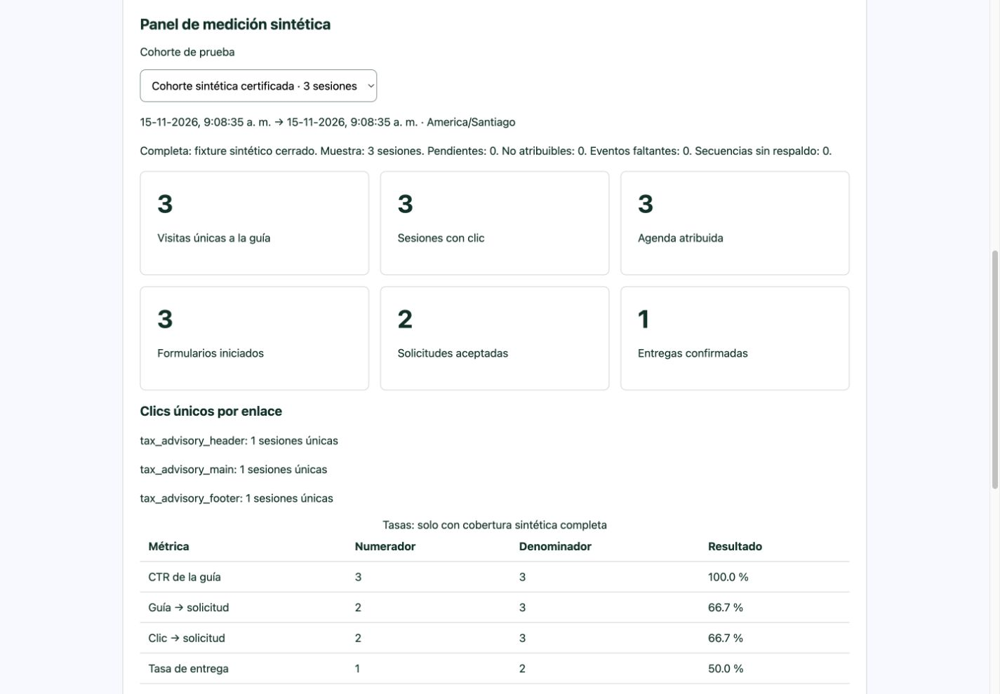

# QA y entrega del laboratorio privado — 15/11/2026

> La certificación histórica de abajo se conserva. El seguimiento complementario al final identifica el candidato vigente y las pruebas que todavía no están certificadas.

Cierre: 15/11/2026 00:35:45 America/Santiago (03:35:45 UTC).
Código: `ef6b2df3a87729dae441581a7ee78719832dc8fd`.
Deployment READY staging: `dpl_J7Zuey6N6cxEVmmsRtnzFjnDBrB9`.
[Preview privado](https://project-wrapp-e0atb5o9o-lsandoval2-8260s-projects.vercel.app/).
[PR #23, abierto y en borrador](https://github.com/lasopho/sollahms-web/pull/23).

## Resultados
- 33 pruebas automatizadas Node: todas aprobadas (tests.txt). Eventos perdidos/duplicados, sesión, caducidad, navegación, campos prohibidos, comprobantes, rechazo, incompleto y tasas.
- 9 comprobaciones automatizadas reales de IndexedDB en Chrome: todas aprobadas (browser-storage.json). Cola concurrente de 15 eventos, reapertura de base, flush concurrente, deduplicación, persistencia, conciliación y borrado; base de prueba aislada eliminada al finalizar.
- Recorrido manual en preview: guía privada → CTA main → agenda sintética. Sin interacción: no form_start. Formulario incompleto y rechazo: sin aceptación. Aceptación y comprobante de entrega separados y visibles. Panel confirma 1 sesión/1 clic main/1 agenda/1 inicio/1 aceptación/1 entrega; tasas NO DISPONIBLE por cobertura no certificada.
- Desconexión simulada: 1 evento pendiente; reconexión vacía cola sin inflar conteos. No se prueba infraestructura de red o proveedor real porque no existe transporte remoto en este laboratorio.
- Expiración forzada: siguiente agenda crea segunda sesión sin CTA; panel muestra 1 evento no atribuible.
- Cohorte cerrada: 3 sesiones, 3 clics (uno por CTA), 3 agendas, 3 inicios, 2 aceptaciones, 1 entrega; tasas sintéticas 100%, 66,7%, 66,7%, 50%.
- Escritorio y móvil: 320/390/768/1440 px; scrollWidth305/375/753/1425 respectivamente, sin desbordamiento horizontal de documento. Capturas 390 y1440.
- Consola: sin errores ni advertencias observados.
- Build con VERCEL_ENV=production rechazado antes de empaquetar.
- Exportador JSON agregado preparado; no incluye UUID de sesión/solicitud, datos de formulario o PII. No se certificó descarga en disco del usuario.
- Prueba de pestaña duplicada/Web Locks no ejecutada en UI; mecanismo implementado, validación adicional requerida antes de integrar en producción. No hay afirmación de cobertura universal entre navegadores.

## Privacidad y seguridad
Preview con SSO habilitado (all_except_custom_domains), sin cambios globales. Sin API ni funciones en el paquete. CSP connect-src none; form-action none; noindex/nofollow exclusivo del laboratorio. No se enviaron datos reales a Resend/CRM ni se tocaron sus configuraciones.
El almacenamiento persistente autorizado es IndexedDB local del preview con datos sintéticos: no existe persistencia compartida de servidor. Los recibos de fixture no son evidencia de correo real. Estos límites son explícitos en la interfaz.

## Preservación
Alias sollahms.cl conserva `dpl_GqikSrihY6ETwsVJtkF6uB6y4Dsw`, updatedAt1794712257260.
Guía HTTP200:43228 bytes/SHA1 871f1e31e65ed96564ef47df492335f9925f6301.
Agenda HTTP200:19406 bytes/SHA1 c4aa251758099ded68d9ae430859f74cf3d821ec.
Todos los archivos existentes versionados sin cambios. Solo adiciones en labs/cta-measurement y docs/cta-first-party-20261115. Sin merge ni modificaciones de PR18–22. T0, sitemap, robots, SEO/GEO e integraciones intactos.

## Hallazgos y condición de avance
- Alto para producción: falta almacén de servidor, autorización/política de privacidad-retención-accesos y adaptador de recibos reales con verificación de confianza. Son exclusiones deliberadas de esta autorización, no capacidades certificadas.
- Medio: pérdida total de almacenamiento del navegador no permite reconstruir la cobertura; no calcular tasas reales. Validar aislamiento de pestañas/navegadores adicionalmente.
- Bajo: exportación implementada sin certificación de descarga final en el equipo; fechas de fixture pueden mostrarse en el mismo segundo por la escala sintética de milisegundos.
Sin hallazgos críticos que impidan revisar el laboratorio sintético privado. **No apto para activar medición comercial real ni para promoción a producción.**
Cualquier integración productiva exige nueva autorización expresa y resolver los puntos anteriores. No se solicita publicación de este laboratorio.

## QA complementario — 15/11/2026 09:12:07 America/Santiago

Revisión UTC: 2026-11-15T12:12:07Z. Chrome 157.0.0.0, UA macOS 10.15.7; Node 24.22.1. No se afirma compatibilidad universal.

- Código corregido: `180f621630f70e34da5207ed924d0cf5f3499dc2`.
- Deployment READY, target staging: `dpl_4HdweiyWVmBtJZbbvbHumXCmCBn6`.
- [Preview privado vigente](https://project-wrapp-22p2y0vsc-lsandoval2-8260s-projects.vercel.app/).
- Solo laboratorio y documentación. Ninguna modificación de archivos productivos, integraciones, T0 o PR18–22.

### Correcciones y pruebas nuevas

| Área | Resultado y alcance | Estado |
| --- | --- | --- |
| Lógica | 40 pruebas Node aprobadas; evidencia `tests-complementarios.txt` | APROBADO |
| IndexedDB | 14 pruebas reales: dos conexiones, flush concurrente, 15 eventos sin duplicados, reintentos, reapertura, rechazo de PII, ID alterado, rollback y recuperación, borrado entre conexiones | APROBADO |
| Web Locks | 7 pruebas con API real y propietarios independientes dentro del mismo documento: colisión, rotación, atribución reiniciada, liberación/readquisición; ausencia de API inyectada falla cerrado | APROBADO con alcance limitado |
| Dos pestañas reales | Sesiones distintas, CTA main/footer conservados, acciones simultáneas. Tras recarga y cierre de una: 2 visitas, 2 clics, 2 agendas; sin inflación | APROBADO |
| Duplicación nativa | Chrome API chrome.tabs.duplicate no permitida por el control disponible. La prueba controlada de colisión no sustituye esta prueba visual | PENDIENTE |
| Expiración | Nueva sesión sin CTA; 1 evento no atribuible y porcentajes NO DISPONIBLE | APROBADO, expiración forzada |
| Cola y recuperación | Desconexión simulada deja 1 pendiente; cerrar pestañas de prueba y abrir otra conserva IndexedDB; reintento vacía cola sin inflación | APROBADO |
| Reinicio completo Chrome | No se cerró ni reinició el proceso del navegador. Reapertura de base/pestañas y aborto transaccional son pruebas diferentes | PENDIENTE |
| Borrado | Invalida escrituras de otras conexiones y limpia métricas/exportación visible; no resucita cohortes borradas | APROBADO |
| JSON agregado | Proyección cerrada, JSON válido, sin UUID de sesión/solicitud ni PII; contenido visible guardado como evidencia, no como archivo descargado | APROBADO contenido |
| Descarga efectiva | Espera del evento de descarga agotó el plazo. Acceso a chrome://downloads rechazado por política; no se intentó eludirlo. No se certifica guardado en disco | PENDIENTE |
| Error de descarga | Bloqueo simulado muestra error y conserva JSON copiable. Bloqueo silencioso del navegador no es detectable automáticamente; interfaz lo advierte | APROBADO simulación |
| Hojas de cálculo | CSV agregado con BOM y cuatro filas; estructura validada en pruebas. Importación en Excel/Sheets no ejecutada | PARCIAL |
| Responsive | Documento sin desbordamiento a 320, 390 y 768 px (305/375/753 px útiles); captura escritorio1440 y móvil390. Consola del panel sin errores/advertencias observados | APROBADO alcance observado |

La matriz de 40 pruebas cubre denominador cero, faltantes, pendientes, duplicados, expiración, no atribuibles, aceptación sin entrega y entrega sin aceptación. Solo el fixture cerrado con IDs y contenidos esperados completos habilita porcentajes: CTR 3/3=100%, guía→aceptación 2/3=66,7%, clic→aceptación 2/3=66,7%, entrega 1/2=50%. Todos son sintéticos. Aceptación no equivale a entrega ni a venta. Sin cobertura comprobable se devuelve NO DISPONIBLE; entrega cero solo es válida en una cohorte cerrada conocida.

### Hallazgos corregidos

- **Medio:** ID ya confirmado con contenido alterado podía no rechazarse suficientemente. Ahora se compara la huella canónica en cola y eventos; la cohorte verifica contenidos, no solo IDs.
- **Medio:** borrado desde otra conexión podía dejar sesión local obsoleta. El enqueue exige cohorte existente dentro de la transacción y la interfaz limpia datos visibles.
- **Medio:** ciclo de liberación de locks reforzado con liberación esperada, pagehide y reacquisición pageshow; cobertura nativa duplicada sigue pendiente.
- **Medio:** campos proof ajenos a recibos podían transportar propiedades no previstas. Se rechazan antes de almacenar.
- **Bajo:** exportación sin confirmación suficiente. Ahora hay proyección cerrada, JSON visible, CSV, captura de excepciones y aviso honesto de verificación de descarga; no se afirma guardado automático.

### Seguridad y preservación

SSO confirmado en proyecto: enabled=true, all_except_custom_domains. Build de producción vuelve a rechazarse antes de empaquetar. Paquete estático sin API, transporte analítico ni servicios externos; búsqueda de fetch/XMLHttpRequest/sendBeacon/WebSocket/URLs externas en laboratorio sin coincidencias. CSP configurada del paquete: connect-src 'none', form-action 'none', default-src 'self', base-uri 'none'; noindex/nofollow y no-store. Esta revisión no es una captura exhaustiva de tráfico ni una prueba de penetración. No se introducen credenciales.

IndexedDB pertenece al origen aislado del preview; no hay base comercial, Resend ni CRM conectados. El usuario con control de DevTools puede alterar todo el almacenamiento/fixture: la validación local no constituye evidencia confiable para producción. Ausencia real de Web Locks en otro navegador no probada; solo inyección de dependencia ausente.

Alias sollahms.cl al cierre conserva `dpl_GqikSrihY6ETwsVJtkF6uB6y4Dsw`, updatedAt `1794712257260`, idéntico al inicio. No se asignaron dominios productivos ni se alteraron configuraciones globales. La revisión no repite hashes de todo el sitio productivo: el diff queda restringido a labs/cta-measurement y docs/cta-first-party-20261115.

### Pendientes y decisión

**QA complementario parcial; laboratorio apto para revisión privada, no certificado para medición real.** Pendientes: duplicación nativa en Chrome con recarga/navegación/expiración, reinicio completo del navegador, archivo realmente descargado e importación en hoja de cálculo. Deben validarse con evidencia antes de cerrar estos casos. No se consideran fallos funcionales demostrados por una limitación de la herramienta.

Permanecen fuera de autorización el almacenamiento remoto, recibos reales, políticas productivas de retención/accesos y seguimiento real. PR23 debe seguir abierto en borrador. Solicitar revisión; no publicar ni fusionar.

Evidencias nuevas: `qa-complementario-evidencias.json`, `export-visible-qa.json`, `panel-escritorio-complementario.jpg`, `panel-movil-complementario.jpg`.

