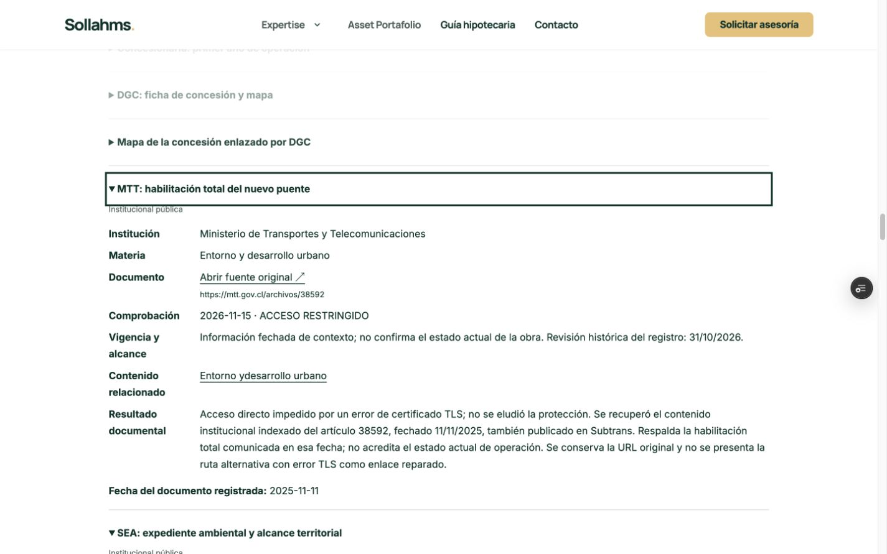
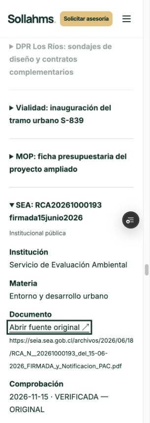

# QA del preview — ocho referencias

Cierre: 2026-11-15T12:14:40.646Z (UTC), zona de presentación America/Santiago.

- Código: 69b22400e4e53ee25701449345d03bf526f74467.
- Deployment privado READY: dpl_JE8gT82j2kTrphDbESJHJbo9M27m.
- URL: https://project-wrapp-fi4a0tqy2-lsandoval2-8260s-projects.vercel.app/fuentes-respaldo-documental.html
- HTTP 200; X-Robots-Tag: noindex. Sin aliases productivos.
- HTML servido idéntico al código como prefijo; Vercel añade su script de feedback de Preview al final. No es una modificación del artefacto ni se trasladará por esta tarea a producción.
- Los ocho details abren mediante Enter. Tab alcanza el enlace de origen y Shift+Tab vuelve al summary; foco visible de 3 px.
- 320, 390, 768 y 1440 px: sin desbordamiento horizontal, con los ocho registros abiertos. Capturas de escritorio y móvil 320 adjuntas.
- Cero errores de consola capturados en la pestaña de QA.
- 140 referencias conservadas; 132 details idénticos byte por byte. HTML externo a los ocho details idéntico, incluidos head, estilos, navegación, scripts y pie. Categorías y anclas intactas.
- Build privado valida todos los 1660 SHA-1 y tamaños contra candidate-manifest.json. Solo el hub cambia frente al Preview anterior; 1659 archivos idénticos. API de listado de archivos devuelve datos truncados y no se utiliza como prueba completa: la evidencia completa es el manifiesto y la validación ejecutada en build, registrada en qa-eight.json.
- Sitemap, robots, catálogo, fichas y recursos comerciales preservados por manifiesto. Calculadoras/formularios sin cambios; QA funcional certificado anterior reutilizado, sin envíos de formularios.
- No se afirma certificación WCAG ni prueba de lector de pantalla.
- Producción final comprobada: dpl_GqikSrihY6ETwsVJtkF6uB6y4Dsw / f0e8bd59a9589e7d1b5a737778c6bf4783e89e88, sin cambios de esta intervención. No merges ni solicitudes de indexación.

139 accesos recuperados; MTT sigue ACCESO RESTRINGIDO con contenido institucional indexado y limitación explícita. Véase RESOLUCION-OCHO-FUENTES.md.

**APTO PARA SOLICITAR AUTORIZACIÓN DE PUBLICACIÓN.** Se requiere autorización expresa posterior y paquete público validado sobre producción vigente. Este preview exige VERCEL_ENV=preview; no se promueve directamente.

