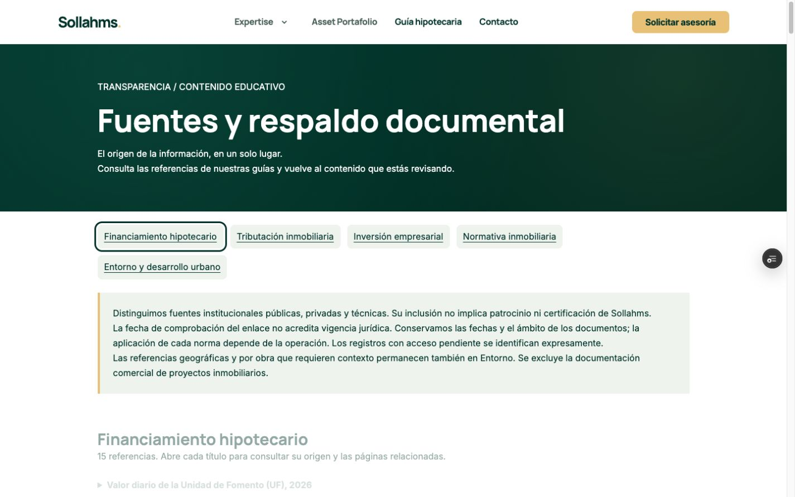
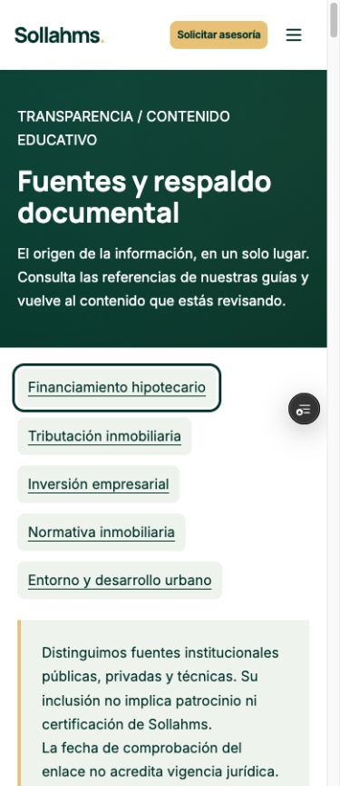
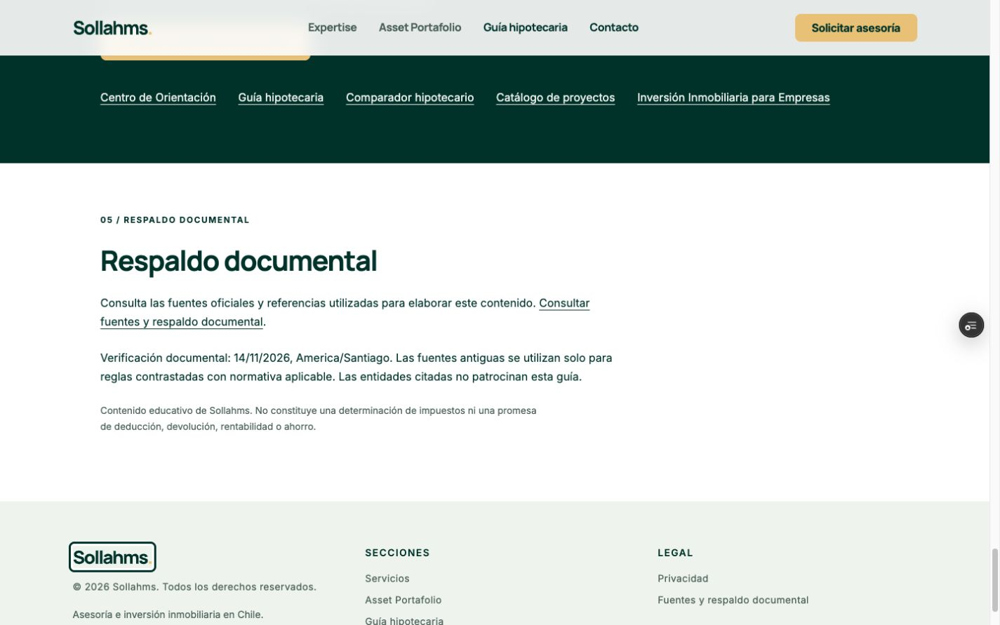
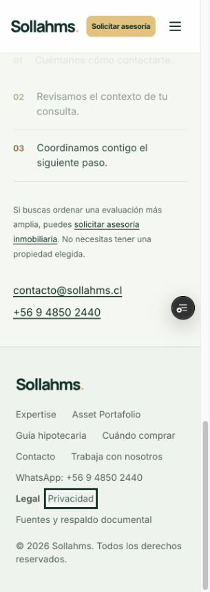

# Centralización documental corporativa — revisión privada

Fecha de cierre de revisión: 15/11/2026, America/Santiago. No constituye fecha de publicación.

## Estado y procedencia

- Producción inicial comprobada: `dpl_9wtwmxsxawGBf9XGb6yK1hWKUuqC`, SHA `4bea6abcb3fbc663c0f3a559e0086d70a5b977a2`.
- Durante el trabajo se publicó legítimamente el CTA tributario. Producción final comprobada: `dpl_GqikSrihY6ETwsVJtkF6uB6y4Dsw`, SHA `f0e8bd59a9589e7d1b5a737778c6bf4783e89e88`. Se recuperó su manifiesto completo de la rama de publicación y se conservó su HTML, estilos y CTA. El único cambio entre bases era ese HTML.
- Rama independiente: `codex/documental-centralization-20261115`.
- Código final: `00ce536094556338a20c7221c168f4e4e0b6ff8c`.
- Preview READY: `dpl_AqkpTTnQjTmqva3CyEgu3nqjMBEc`.
- [Vista previa](https://project-wrapp-5e04l8qt5-lsandoval2-8260s-projects.vercel.app/fuentes-respaldo-documental.html).
- Target Preview, sin asignación de dominio productivo. El build exige VERCEL_ENV=preview, verifica todos los hashes y copia únicamente el artefacto autorizado. No se promociona este paquete a producción.

## Páginas e implementación

Se auditó la navegación corporativa y sus referencias. Doce páginas existentes cambian; se añade el centro documental. El catálogo y las fichas están excluidos del registro y de cualquier modificación.

| Archivo | Referencias únicas relacionadas | Cambio |
| --- | ---: | --- |
| `agenda-asesoria.html` | 0 | Solo pie; citas contextuales intactas |
| `beneficios-tributarios-inmobiliarios.html` | 18 | Lista centralizada + pie |
| `centro-orientacion.html` | 9 | Solo pie; citas contextuales intactas |
| `comparador-hipotecario.html` | 2 | Solo pie; citas contextuales intactas |
| `contacto.html` | 0 | Solo pie; citas contextuales intactas |
| `cuando-comprar-propiedad.html` | 8 | Lista centralizada + pie |
| `entorno-desarrollo-urbano.html` | 91 | Solo pie; citas contextuales intactas |
| `guia-hipotecaria.html` | 9 | Lista centralizada + pie |
| `index.html` | 0 | Solo pie; citas contextuales intactas |
| `inversion-inmobiliaria-empresas.html` | 11 | Lista centralizada + pie |
| `privacidad.html` | 0 | Solo pie; citas contextuales intactas |
| `trabaja-con-nosotros.html` | 0 | Solo pie; citas contextuales intactas |

Nuevo archivo: `fuentes-respaldo-documental.html`. No se añade ni modifica CSS/JS externo. La nueva página reutiliza la cabecera y pie corporativos y añade estilos aislados en su propio HTML. Los 12 heads existentes son idénticos.

Los cuatro listados extensos se sustituyen por un bloque breve y un enlace a la materia correspondiente. Se mantienen avisos, fechas históricas, notas de cálculo y citas contextuales. Las citas tributarias apuntan a la referencia concreta del centro, con anclas históricas conservadas. Los enlaces por obra de Entorno permanecen junto al contexto geográfico; no se modifica su data ni sus scripts.

En los 12 pies se incorpora una sola entrada documental bajo Legal. En pies planos se agrupan Privacidad y el nuevo enlace; Entorno recibe el grupo Legal con Privacidad. Los demás destinos, contactos y orden relativo permanecen. No se corrigen nomenclaturas ajenas a este encargo.

## Inventario y trazabilidad

140 referencias únicas: 15 de financiamiento, 18 tributarias, 8 empresariales, 8 normativas y 91 de entorno. Se distinguen fuentes públicas, privadas/académicas, cartográficas y colaborativas. No hay categorías vacías.

- `master-references.json`: institución, títulos/etiquetas originales, URL, categoría, tipo, fecha de acceso, vigencia/alcance y todas las ocurrencias.
- `matrix-source-page.csv`: correspondencia de cada fuente con sus páginas.
- `moved.json`: 46 ocurrencias trasladadas desde listados.
- `contextual-retained.json`: 107 ocurrencias contextuales inventariadas; conservadas junto a sus afirmaciones o con destino documental específico.
- `excluded-references.json`: 14 referencias comerciales excluidas deliberadamente del registro central; no eliminadas de la producción original ni editadas en archivos de proyectos.

No se pierde ninguna de las 140 referencias incluidas. El acceso de 132 pudo recuperarse: 126 mediante HTTP y 6 por recuperación web complementaria. Ocho no permitieron confirmar el acceso. Esto no prueba que estén rotas para todos los visitantes. Las pendientes se muestran expresamente en la vista previa y en `pending-sources.json`.

La comprobación de acceso no certifica vigencia jurídica. Se reutilizan las auditorías financieras/tributarias previas, no se reescribe ni se recertifica el contenido. Los documentos urbanos se presentan con alcance histórico; no acreditan avance actual de las obras. La identificación del oficio IND se contrastó con el PDF alojado por la Cámara.

## QA y preservación

- 13 rutas de la vista previa: HTTP 200 y X-Robots-Tag: noindex. Los canonicals existentes se verifican mediante DOM estático; el nuevo apunta a su URL definitiva futura.
- 52 comprobaciones de disposición: 12 HTML existentes y el centro, a 320/390/768/1440 px. Sin desbordamiento horizontal. Se reutilizaron las pruebas de 11 HTML sin cambios entre revisiones; la guía tributaria se repitió tras incorporar el CTA concurrente. Las últimas correcciones de etiquetas/clasificación del centro no cambiaron su CSS ni estructura.
- Menú móvil del centro abierto/cerrado con Enter. Categorías activadas por teclado. Details abiertos/cerrados con Enter, foco visible de 3 px, Tab hacia la fuente original; Shift+Tab en el pie y Enter hacia el centro. Enlace de la guía tributaria llega a #tributacion.
- Sin errores de consola capturados en las pestañas de QA. No se afirma certificación WCAG ni prueba de lector de pantalla.
- Prueba estática estricta de heads, cabeceras, H1, formularios, scripts y contenido ajeno a fuentes/pies: idénticos. Destinos previos del pie preservados. Anclas del centro y de citas válidas, IDs únicos y todos los IDs históricos presentes.
- Calculadoras y formularios conservados por comparación de HTML/scripts y hashes. No se enviaron formularios ni se repitieron sus suites funcionales. El formulario empresarial no fue activado.
- Manifiesto: 1.659 → 1.660 archivos; 1.647 idénticos, 12 HTML modificados, 1 nuevo. Sin eliminaciones. Catálogo, fichas, imágenes, brochures, plantillas, APIs, CRM y recursos comerciales sin cambios.
- Sitemap y robots idénticos por hash. No se añade la nueva URL al sitemap en esta fase.

Evidencias: `pages-qa.json`, `preservation.json`, manifiestos completos, `changes.patch`, `qa-browser-http.json` y capturas. Los documentos de auditoría quedan en GitHub, fuera del artefacto desplegado.

## SEO/GEO

Se mantienen title, description, canonical, H1, JSON-LD y Open Graph de las páginas existentes. El centro tiene metadatos propios y CollectionPage, pero solo está en Preview con noindex HTTP.

Evento independiente: preparación documental de 15/11/2026; todavía sin T0 de publicación. Se conservan corporate-education-v2 (09/11/2026 20:11:23 America/Santiago), corporate-enterprise-v1 (14/11/2026 21:03:45.065) y los registros tributarios existentes. No se modifica atribución, buscadores, sitemap ni robots; no se solicita indexación.

## Pendientes y dictamen

REQUIERE COMPLETAR VERIFICACIÓN DOCUMENTAL ANTES DE PUBLICAR.

La implementación y vista previa están listas para revisión. Quedan ocho accesos externos sin confirmar; no se declara verificado lo que no pudo recuperarse. Antes de una autorización de publicación, resolver o aceptar explícitamente el tratamiento de esas referencias, comprobar otra vez la producción vigente y preparar un paquete publicable independiente. Este artefacto lleva una protección de build exclusiva para Preview.

No se publicó, no se fusionó ningún PR y no se ejecutaron intervenciones de indexación. La revisión visual del usuario y cualquier autorización de publicación siguen pendientes.

### Fuentes con acceso pendiente

- [Promesas de compraventa de vivienda: ¿Qué pasa si una persona desiste de comprar?](https://www.sernac.gob.cl/portal/604/w3-article-82955.html) — Acceso no confirmado: HTTP Error 503: Service Unavailable
- [Derechos del consumidor financiero](https://www.sernac.gov.cl/portal/618/w3-propertyvalue-27777.html) — Acceso no confirmado: HTTP Error 503: Service Unavailable
- [MTT: habilitación total del nuevo puente](https://mtt.gov.cl/archivos/38592) — Acceso no confirmado: HTTP Error 503: Service Unavailable
- [SEA: expediente ambiental y alcance territorial](https://seia.sea.gob.cl/expediente/ficha/fichaPrincipal.php?id_expediente=2143540297) — Acceso no confirmado: HTTP Error 500: Internal Server Error
- [Delegación Presidencial Coquimbo: apertura](https://www.dprcoquimbo.dpr.gob.cl/2025/09/26/nuevo-parque-urbano-cerro-grande-abre-sus-puertas/) — Acceso no confirmado: HTTP Error 503: Service Unavailable
- [SEA: RCA20261000193 firmada15junio2026](https://seia.sea.gob.cl/archivos/2026/06/18/RCA_N__20261000193_del_15-06-2026_FIRMADA_y_Notificacion_PAC.pdf) — Acceso no confirmado: HTTP Error 500: Internal Server Error
- [SEA: expediente2164395409, calificación favorable registrada18junio](https://seia.sea.gob.cl/expediente/ficha/fichaPrincipal.php?modo=normal&id_expediente=2164395409) — Acceso no confirmado: HTTP Error 500: Internal Server Error
- [Servicio Salud Concepción: terreno ex Liceo Balmaceda](https://ssconce.redsalud.gob.cl/nuevo-cesfam-0higgins-demuelen-ruinas-de-ex-liceo-balmaceda/) — Acceso no confirmado: HTTP Error 403: Forbidden

### Capturas

