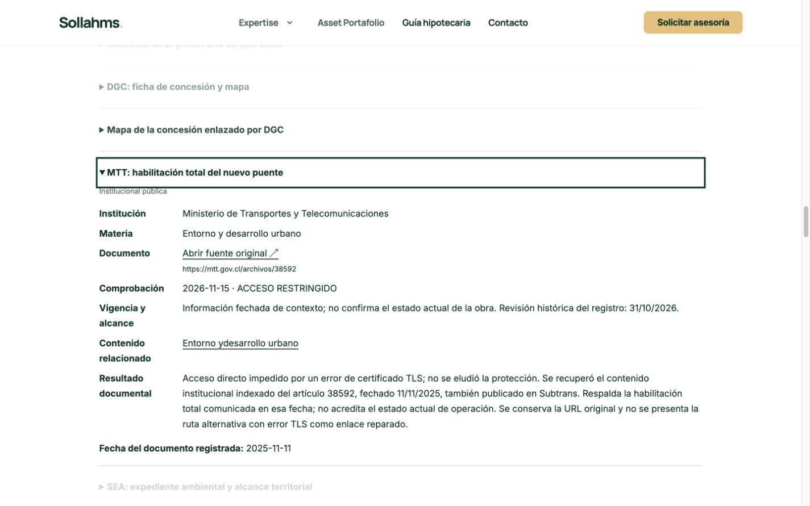

# Publicación — Centro de Fuentes y Respaldo Documental

**Publicado y verificado en https://sollahms.cl/fuentes-respaldo-documental.html.**

## Trazabilidad

- T0 propio: **15/11/2026 09:21:29.394 America/Santiago (UTC−03:00)**, según updatedAt del alias. UTC: 2026-11-15T12:21:29.394Z.
- Deployment anterior: `dpl_GqikSrihY6ETwsVJtkF6uB6y4Dsw`, commit `f0e8bd59a9589e7d1b5a737778c6bf4783e89e88`.
- Deployment publicado: `dpl_BeqmLxC1V4nmNUeE3fG4wpMXGGes`, target production, READY.
- Commit de código aprobado/publicado: `69b22400e4e53ee25701449345d03bf526f74467`.
- Rama: `codex/documental-centralization-20261115`. Este registro documental posterior no cambia el código desplegado.
- Se confirmó nuevamente producción antes de crear el artefacto y antes de asignar el dominio. No había publicaciones posteriores a la base. Auto-assign Custom Production Domains estaba Disabled; se verificó en Vercel sin modificarlo.
- Se creó un artefacto de producción nuevo, no se promovió el Preview. Validación completa en build; READY y QA previo antes de asignar exclusivamente sollahms.cl. Se confirmó el alias después.

## Alcance exacto y hashes SHA-1

1659 → 1660 archivos runtime; 1647 existentes idénticos, 12 HTML modificados y un HTML nuevo; sin eliminaciones. Los manifiestos completos están en ../production-manifest.json y ../candidate-manifest.json. El script prepare-production.mjs valida cada SHA-1 y tamaño disponible, rutas y exclusión de documentos de auditoría antes de copiar a output.

| Archivo | SHA-1 anterior | SHA-1 publicado |
| --- | --- | --- |
| index.html | d6c0b9853396655eb3262173f18f93bd2b8fc28c | e9c1a14c112e6a4bd271547150865dda1de2ff96 |
| agenda-asesoria.html | c4aa251758099ded68d9ae430859f74cf3d821ec | 7844b99af292978c8b0f836b075f99cdd45768ed |
| privacidad.html | 69144de69f594f1ca47eb187aa7c39e947c86338 | c668be08e9133feebb0b4cb01c857b0f57c39e7e |
| contacto.html | 0982909d86bbd1c1535043161c44818113914600 | 69c2519a92d9a67e826bcbd580f3e67570eeb359 |
| comparador-hipotecario.html | 90de7bfd0e62ecc7b6d1ba39dc295af919262bfd | f4e504bff19405caa646a4faa8c3195d9195f25b |
| trabaja-con-nosotros.html | f63d429899ab209f4d8ccef8feaab416be79aecc | a14b3cec00e86afc1257944e18cef0d974d82f62 |
| guia-hipotecaria.html | ff9cefe830c88c506eaad88b715b815cc9a17d9b | 1a51795b2a348ed7b46f4a2c84fd31911a4da133 |
| cuando-comprar-propiedad.html | 39900a93326c2af82d504e4523e643301a17be4f | 3533e25ee2774f64f94c3ceb5c52fb90f8dd3e70 |
| entorno-desarrollo-urbano.html | c5e221cafcdd99015553bb557ee465420b362081 | 04bdfe2144ccede13a1696c7bbe3518465d41d95 |
| centro-orientacion.html | a97ea1daf01beab3e6764a5e867ed16ae91625f8 | 4eb6cb0cdc2ed38f27f2f41dd6beb4995bef8c6b |
| inversion-inmobiliaria-empresas.html | b7919024c69365d549d440fbbe3aac199860d6c0 | c1e5cbefa5e9654f1078b20b6092dd898a1674cc |
| beneficios-tributarios-inmobiliarios.html | 871f1e31e65ed96564ef47df492335f9925f6301 | 765d8136197d17e7fdc6b44d21285da94af1d3c3 |
| fuentes-respaldo-documental.html | Nuevo | f9791df44a5812f423936f43058538748d3dd1b9 |

No se cambió ningún CSS, JS, API, archivo del catálogo, ficha, imagen, brochure, cotizador ni recurso comercial. Las configuraciones runtime se conservaron por hash. Solo los controles de empaquetado externos al output son propios de target production.

## Documentación y pies

140 referencias únicas, cinco categorías, 139 accesos recuperados y una MTT con acceso directo restringido. Se reutiliza la verificación documental certificada; no se afirma recertificación jurídica.

MTT conserva https://mtt.gov.cl/archivos/38592, fecha 11/11/2025, relación con Entorno y aviso visible de restricción TLS. El contenido institucional indexado respalda la habilitación comunicada en esa fecha; no se afirma reparación ni operación actual.

Cuatro listados centralizados: Guía Hipotecaria, Cuándo Comprar, Empresas y Beneficios Tributarios. Se conservan las citas esenciales y los contextos auditados. Todas las anclas documentales presentes en los 12 HTML apuntan a IDs existentes. Se preservaron los 140 IDs y la matriz fuente–página.

Los 12 pies tienen exactamente un enlace documental, después de Privacidad en Legal, conforme al candidato aprobado. Los 12 HTML públicos son idénticos byte por byte al candidato; no se alteraron destinos restantes, WhatsApp, correo ni orden relativo. Se reutilizan las pruebas visuales certificadas de los pies.

## QA previo y posterior

- Antes de asignar el dominio: 13 rutas HTTP 200 y cuerpos idénticos al código aprobado; 140 referencias, canonical y teclado comprobados. El hostname Vercel conservaba noindex automático, sin noindex en HTML.
- Después: 13 rutas públicas HTTP 200, cuerpos idénticos al paquete; sin noindex en HTML ni cabeceras. Canonical del centro correcto.
- Cinco categorías activadas mediante Enter y fragmentos comprobados. Details abierto con Enter; Tab a fuente original, Shift+Tab al summary; foco sólido de 3 px.
- Centro público a 320/390/768/1440: scrollWidth 305/375/753/1425 respectivamente; sin desbordamiento. Se conservan las 52 comprobaciones previas de disposición para componentes cuyo HTML y recursos no cambian entre Preview y producción.
- Sin errores de consola capturados en centro ni página empresarial.
- Calculadora empresarial: 5000 UF al 80% → 1000 UF de aporte + 4000 UF de financiamiento; 81% inválido por max=80. Restituido el supuesto inicial 70% en la pestaña de prueba. Botón Envío no disponible desactivado; no se ingresaron datos personales ni enviaron formularios.
- Scripts y formularios de los 12 HTML idénticos a producción anterior. Se reutiliza QA de calculadoras no modificadas; no se repiten suites ajenas al cambio ni se afirma una nueva certificación WCAG/lector de pantalla.
- Captura pública adjunta en escritorio. Las capturas móviles certificadas del Preview siguen aplicables por igualdad de HTML/recursos; no se etiqueta como móvil una captura pública obtenida a 1440.

## Preservación pública

| Recurso | Resultado | SHA-1 |
| --- | --- | --- |
| sitemap.xml | HTTP 200, XML válido, 143 URL únicas, idéntico | bfa42b14ed615e3658436925f7dc8982badde28a |
| robots.txt | HTTP 200, idéntico | a2697d8941e99c14c517ce1da5eafc25ae4953b1 |
| proyectos.html | HTTP 200, idéntico | 9ec5862cc32c271e0fc64eec5f69b1ffa2dae0b8 |

Todas las fichas y sus recursos se preservan por manifiesto y build; no se repite QA exhaustivo de fichas. CRM 360, AI Lab, variables de entorno y servicios sin modificaciones. No se activó el formulario empresarial.

## SEO/GEO y cierre

Heads y H1 de los 12 HTML idénticos a producción anterior; title, descriptions, canonicals, Open Graph y JSON-LD conservados. Centro público indexable técnicamente, sin afirmar indexación real. Sitemap no incorpora la nueva URL en esta intervención, por instrucción expresa; descubrimiento mediante los pies y citas. Preview aprobado mantiene su noindex de entorno, no se alteró.

Se conservan corporate-education-v2 (09/11/2026 20:11:23 America/Santiago), corporate-enterprise-v1 (14/11/2026 21:03:45.065) y trazabilidad tributaria. Este T0 documental es independiente. Sin solicitudes de indexación, reenvíos de sitemap, cambios de buscadores ni fusiones de PR.

Sin incidencias críticas; no fue necesaria reversión. Dominio confirmado sobre dpl_BeqmLxC1V4nmNUeE3fG4wpMXGGes. Pendiente externo: acceso directo MTT, ya aceptado y documentado; no bloquea esta publicación autorizada.

