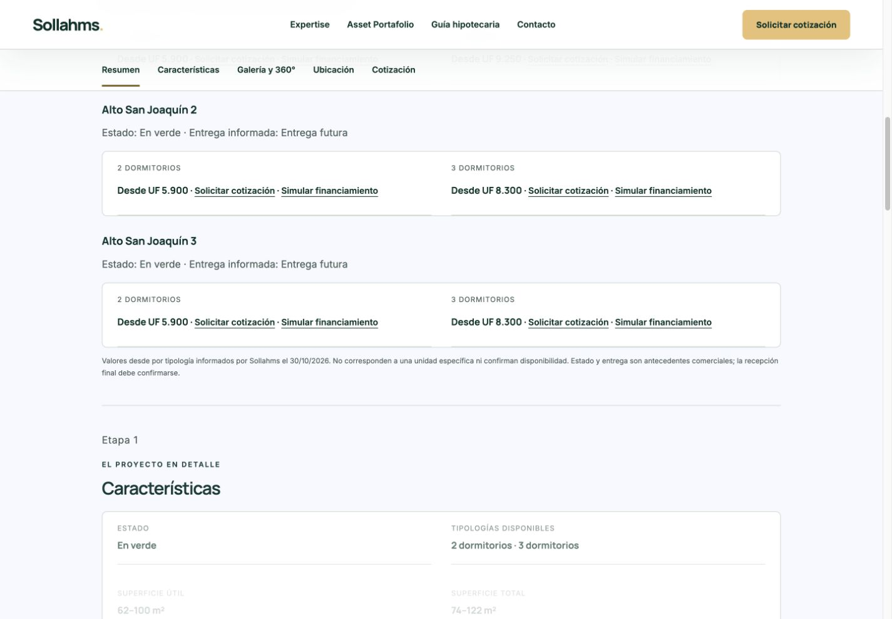
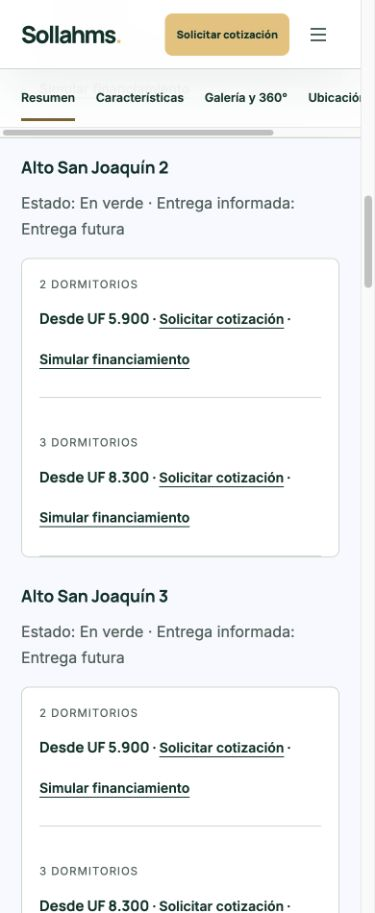
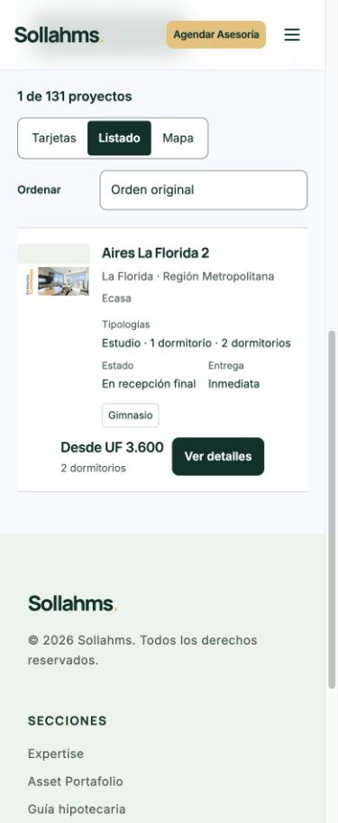

# ECasa — publicación y sincronización comercial

Fecha: 30/10/2026. Fuente comercial: tabla del propietario y cinco capturas entregadas, identificadas en owner-input.json. Las capturas prevalecen sobre campañas externas.

## Resultado

Producción: https://sollahms.cl/proyectos.html
Deployment: dpl_9e3rtATuLVhTcveV6sHyp8x7Szkj
Código: c818354d20ee31dca7768aef00ce52b2f92ab2c2
Rama: codex/ecasa-commercial-20261030 (autodeploy desactivado).

131 fichas conservadas; 15 fichas ECasa contienen 22 etapas existentes, de las cuales 21 recibieron 46 precios. Los 116 registros de otras inmobiliarias permanecen idénticos. La tabla recibida contiene realmente 22 etapas con 50 precios, no 19/49. Los cuatro de Nuevo Vivaceta están registrados como pendientes y no se asignaron al Vivaceta de Ingevec.

## Fuente única y propagación

Los precios autorizados residen en data/proyectos.json, por identificador estable de etapa y tipología, con prioridad y procedencia comercial. El importador documentado no debe ejecutarse para sobrescribir una actualización posterior. El renderizador y la proyección de filtros consumen esa fuente; no se mantiene una segunda base comercial independiente. El registro de investigación conserva trazabilidad.

Catálogo, lista, mapa, filtros, fichas, selección de cotización y simulador consumen la etapa/oferta correspondiente. La búsqueda combinada usa precio de la tipología solicitada, no el mínimo de otro dormitorio. Las etapas conservan sus identidades dentro de las fichas existentes; el catálogo mantiene una tarjeta por ficha, seleccionando la etapa coincidente. Los locales mantienen precio y alcance independientes. Baños, superficies, amenities e interiores usan únicamente datos documentados de la etapa; no se inventaron atributos. Las categorías de filtros se intersectan; amenities conserva OR o ALL explícito del sistema existente. Recepción final no se convierte automáticamente en entrega habilitada.

## Precios, estados y entregas

| Etapa | Desde residencial UF | Valores autorizados UF | Estado | Entrega informada |
|---|---:|---|---|---|
| aires-la-florida-2 | 2.350 | Estudio: 2.350; 1D: 3.230; 2D: 3.600 | En recepción final | Inmediata |
| conecta-huechuraba | 4.340 | 3D: 4.340 | En recepción final | Inmediata |
| urban-la-florida | 3.240 | Estudio: 4.400; 1D: 3.240; 2D: 4.230 | En recepción final | Inmediata |
| alto-san-joaquin | 5.900 | 2D: 5.900; 3D: 9.250 | En verde | Entrega futura |
| alto-san-joaquin-2 | 5.900 | 2D: 5.900; 3D: 8.300 | En verde | Entrega futura |
| nucleo-costanera | 3.100 | 1D: 3.100; 2D: 3.840; 3D: 5.520 | En verde | Segundo semestre de 2027 |
| nucleo-costanera-2 | 3.100 | 1D: 3.100; 2D: 3.920; 3D: 5.600 | En verde | Entrega futura |
| alto-san-joaquin-3 | 5.900 | 2D: 5.900; 3D: 8.300 | En verde | Entrega futura |
| enlace-mackenna | 3.260 | 1D: 3.260; 2D: 3.570; Local: 4.800 | En blanco | Entrega futura |
| ferroparque-2 | 2.240 | Estudio: 2.240; 1D: 2.740; 2D: 2.980 | En verde | Entrega futura |
| espacio-victoria | 2.410 | Estudio: 2.410; 1D: 2.890; 2D: 3.260 | En blanco | Entrega futura |
| lamara | 4.540 | 2D: 4.540; 3D: 7.510 | En verde | Entrega futura |
| terratolten-3 | 2.780 | 2D: 2.780; 3D: 3.840 | En verde | Entrega futura |
| wayra | 7.300 | 2D: 7.300; 3D: 8.300 | En recepción final | Inmediata |
| nuevo-vivaceta | Pendiente de ficha ECasa | Estudio: 2.050; 1D: 2.190; 2D: 2.600; 3D: 4.280 | En verde | Julio de 2027 |
| lomas-de-puyai-3 | 4.220 | 2D: 4.220; 3D: 5.040 | En verde | Entrega futura |
| cumbres-de-penuelas | 5.700 | 3D: 5.700 | En recepción final | Inmediata |
| lomas-de-puyai | 5.260 | 3D: 5.260 | En recepción final | Inmediata |
| ferroparque | 2.360 | 1D: 2.360; 2D: 3.500; 3D: 3.510 | En recepción final | Inmediata |
| edificio-bezanilla | 2.620 | 1D: 2.620; 2D: 3.570 | En recepción final | Inmediata |
| endemico | 11.343 | 4D: 11.343 | En recepción final | Inmediata |
| terratolten-1 | 3.750 | 2D: 3.750; 3D: 4.370 | En verde | Próxima entrega |
| terratolten-2 | Consultar precio | Sin precio autorizado | En verde | Entrega futura |

## Comprobaciones

- 194 comprobaciones comerciales automatizadas: 46 precios exactos, etapas, filtros combinados, rangos inclusivos, orden, oferta local, identidad de cotización y simulador.
- 519 comprobaciones de conservación: 131 registros, 116 ajenos idénticos, 15 fichas ECasa, imágenes, iframes, formularios y estilos preservados; regeneración focalizada y proyección de filtros idempotentes.
- 10 pruebas existentes del catálogo superadas. 200 filtros combinados en 66,9 ms en la última ejecución local (no es medición de conversión ni benchmark de clientes).
- 27 respuestas HTTP 200 del candidato con contenido idéntico al código validado; 27 respuestas HTTP 200 idénticas en el dominio público tras promover.
- Chrome real: escritorio 1440×1000 y móvil 390×950. Revisión de bloques de etapas, selección de cotización, simulador y listado. Sin desbordamiento horizontal de página (scrollWidth 375, viewport 390; navegación de ficha conserva su scroll horizontal propio).
- Ejemplo solicitado: ECasa + La Florida + 2D + máximo UF 4.000 + gimnasio produce únicamente Aires La Florida 2, UF 3.600. Abrir ficha y volver conserva filtros y vista Listado.
- Alto San Joaquín 2 / 3D muestra contexto de etapa2 en solicitud, selección UF8.300 y simulador con valor8300. Confirmado también en producción.
- UF visible en navegador público: $41.242,32. La consulta del conector a /api/uf respondió400 por consulta no admitida; la navegación normal cargó el valor correctamente. No se alteró la función UF.
- Logs de runtime del deployment, niveles error/fatal, última hora revisada: sin registros coincidentes. Esto no acredita ausencia de cualquier error futuro.
- No se enviaron formularios ni correos. El transporte de recepción y sus validaciones no cambió; se verificó el contexto por funciones puras y navegador, no entrega real de correos.
- No se ejecutó una reconstrucción indiscriminada de recursos protegidos de Preview. Se reutilizó el paquete congelado de producción, actualizando27 archivos runtime y tres entradas de construcción. Recursos protegidos y funciones conservados; el catálogo interno de contacto se sincroniza durante el empaquetado.

## Pendientes

- Nuevo Vivaceta ECasa: no existe ficha/identificador propio en el catálogo vigente. Se conservan los cuatro precios en el registro de entrada sin contaminar /vivaceta.html (Ingevec). Su incorporación exige integrar una ficha nueva con material e identidad de ECasa; no se declaró publicada.
- Terratoltén2: no hay precio autorizado; mantiene Consultar precio y no hereda los de etapas1/3.
- Los atributos no documentados permanecen desconocidos y no producen coincidencias falsas.

## Archivos de código modificados

- data/proyectos.json
- data/catalog-facets.json
- proyectos.html
- nucleo-costanera.html
- wayra.html
- lamara.html
- edificio-bezanilla.html
- endemico.html
- lomas-de-puyai.html
- ferroparque.html
- cumbres-de-penuelas.html
- espacio-victoria.html
- terratolten.html
- urban-la-florida.html
- aires-la-florida-2.html
- enlace-mackenna.html
- conecta-huechuraba.html
- alto-san-joaquin.html
- assets/js/catalog-model.mjs
- assets/js/catalog-filter-engine.mjs
- assets/js/catalog-filter-controls.mjs
- assets/js/catalog.mjs
- assets/js/catalog-map.mjs
- assets/js/project-offers.mjs
- assets/js/project-request.mjs
- assets/js/project-brochure.mjs
- assets/js/mortgage-guide-engine.mjs
- data/fichas-proyectos.json
- scripts/ecasa_commercial.py
- scripts/update_ecasa_commercial.py
- scripts/build-catalog-facets.py
- scripts/project_header_b.py
- tests/ecasa-commercial.test.mjs
- tests/ecasa-preservation.py
- docs/ecasa-commercial-20261030/owner-input.json
- vercel.json
- AGENTS.md

## Recuperación y controles

Rollback listo: dpl_FrKgzZBDjTj5Qd13i5FE7faZYhEe (READY comprobado antes de promover).
Baseline de fuentes/evidencias: 946a42a6a6dba5aaf0eb7a83ea228aa071586adf.
Código anterior: 6d4524e8d95d8935d4c977f48514571e85a23212.
Manifest anterior: docs/featured-minimum-20261030/deployment-files.json, Git blob2c50edbb0a540d091c6a4bf78df1a955f1264b13.
main permanece en86e200ec191b38af355061e21bc0fc1e549cce3b; main:false y nueva rama:false preservados.
El alias se comprobó inmediatamente antes y después de promover. La publicación fue una promoción explícita del candidato probado. La recuperación autorizada puede restaurar el deployment anterior mediante rollback oficial de Vercel sin reconstruirlo.

## Capturas reales

