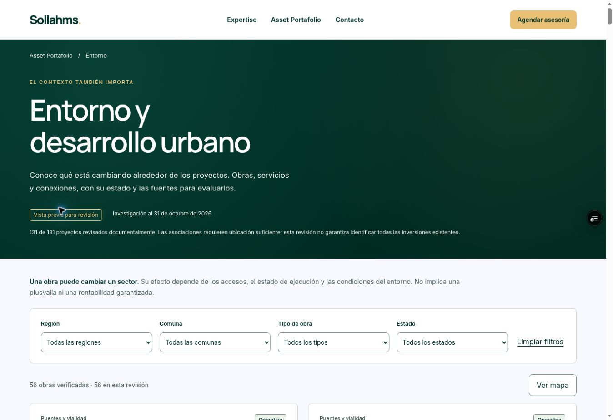

# Entrega — cobertura documental de 131 proyectos

Fecha de corte: **31 de octubre de 2026**.

[Vista previa funcional](https://project-wrapp-5hxxnc2fm-lsandoval2-8260s-projects.vercel.app/entorno-desarrollo-urbano.html) · protegida por Vercel. Se entregó un enlace temporal de revisión en la conversación.

- Entorno: preview; estado **READY**; sin alias de producción.
- Despliegue: `dpl_GDkgXSB3vzKPRXY51GvP3ddsxsKM`.
- Código revisado: `709337eda09eb94b2796b4e4ccd9e9d8eeb60da4`.
- Catálogo: **131 revisiones únicas**, 56 obras, 74 relaciones para 59 proyectos.
- Otros resultados: 67 revisados sin asociación admitida y 5 con ubicación pendiente.
- **32 pruebas aprobadas**, sin fallos: cobertura completa, relaciones, distancias, bloqueo de ubicaciones, filtros, catálogo y mapa.
- HTML de las 131 fichas, datos comerciales, registro de ubicaciones y facetas: idénticos byte por byte a la vista previa anterior.
- Funciones y configuración de rutas conservadas en el paquete de 1.636 artefactos.

## Comprobación visual

En escritorio se comprobó el filtro combinado Región Metropolitana + anuncio preliminar (4 resultados), mapa con MultiPolygon de Almagro (3 de 4 obras con geometría), navegación a Edificio Santo y sus dos obras con estados diferenciados. En vista móvil mediante iframe de 390 px, ancho útil 375 px y contenido 375 px, sin desbordamiento; filtro Ñuble devuelve cero obras sin afirmar ausencia de inversiones. No equivale a una prueba en dispositivos físicos.

En el despliegue remoto se verificó la carga de **56 obras** y el indicador **131 de 131**. No se enviaron formularios comerciales.

Las teselas de OpenStreetMap devuelven imágenes de bloqueo 403 por política del proveedor en este entorno. No se evadió ese bloqueo. Se probó ocultar el mapa base: geometrías verificadas, controles, listado y filtros siguen utilizables. La disponibilidad visual del mapa base externo sigue siendo una limitación.

## Alcance pendiente

La revisión documental está cerrada para todos los proyectos. Las fuentes, candidatos excluidos y pendientes de precisión permanecen en [el registro individual](catalog-coverage.json); no se han convertido en afirmaciones comerciales. Se conservan cuatro proyectos sin dirección precisa y la discrepancia SEA de Vicuña Mackenna 7589, sin corregir coordenadas por inferencia.

Producción comprobada al cierre: `dpl_8rAgvVQSGPF9WbbDHsgeCHV3dkn5`, commit `c9b66b6e9ff44bf7eb91ff9502f1e858438856f8`. **Sollahms.cl no fue modificado.** No se crearon automatizaciones ni revisiones programadas.

