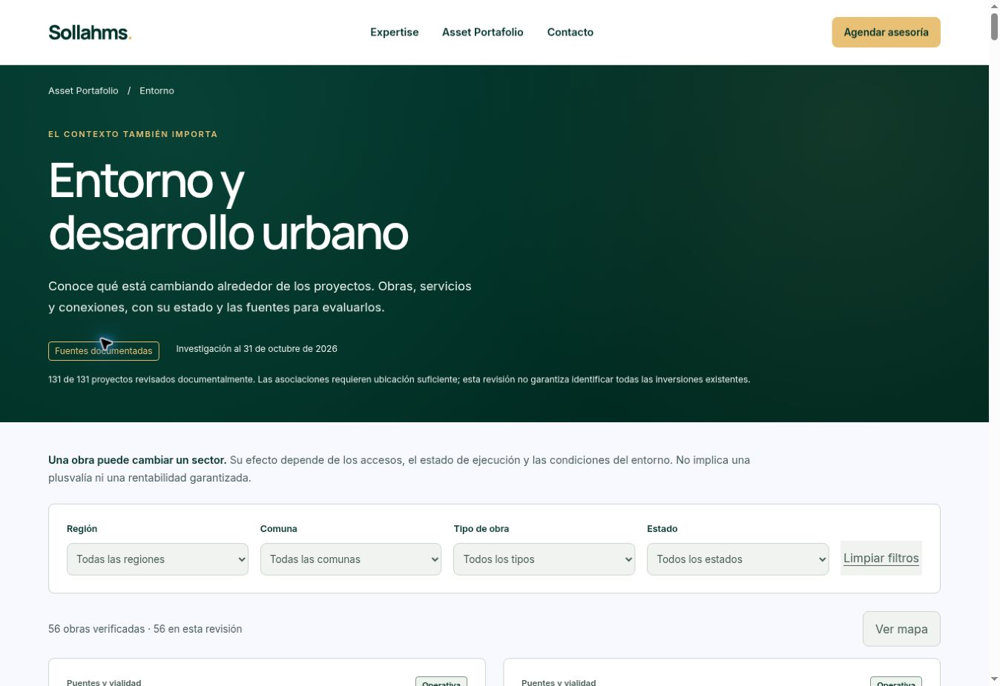

# Publicación autorizada — 31 de octubre de 2026

- URL: https://sollahms.cl/entorno-desarrollo-urbano.html
- Entorno: producción; estado READY.
- Despliegue: dpl_72BPGbcxhuj55cztQnAJ7fohvcvq.
- Commit de código: af469b8466915fb256f5954d753628ff88dcadc5.
- Framework: HTML/JavaScript estático y funciones existentes; compilación de 8 segundos aproximadamente.
- Dominio sollahms.cl confirmado en el despliegue nuevo después de promoción explícita.
- Rollback conservado: dpl_8rAgvVQSGPF9WbbDHsgeCHV3dkn5, commit c9b66b6e9ff44bf7eb91ff9502f1e858438856f8.

Se retiró el aviso de vista previa, se habilitó index,follow y se agregó canonical. No se modificó la investigación ni los datos comerciales. Se reutilizó el paquete congelado, preservando funciones, rutas, retiro410 y recursos protegidos.

## Validación

32 pruebas aprobadas antes de publicar. 12 comprobaciones HTTP públicas satisfactorias: portada, catálogo, página nueva, dos fichas, datos, módulos y retiro Patio Brasil410. Coincidencia byte por byte para los datos y módulos comprobados. En navegador público:56 obras, filtro LosLagos6 resultados, ficha Nórdico con760m geográficos al acceso documentado.

Errores de runtime: consulta error/fatal de los10min iniciales sin registros. Drains configurados:ninguno. Monitoreo continuado:no creado ni activado. Esta revisión inmediata no garantiza ausencia futura de errores.

Se mantienen las limitaciones documentadas de cinco ubicaciones y del mapa base externo. No se enviaron formularios ni se crearon automatizaciones. Esta publicación autorizada supersede el estado «vista previa» de los documentos históricos.

