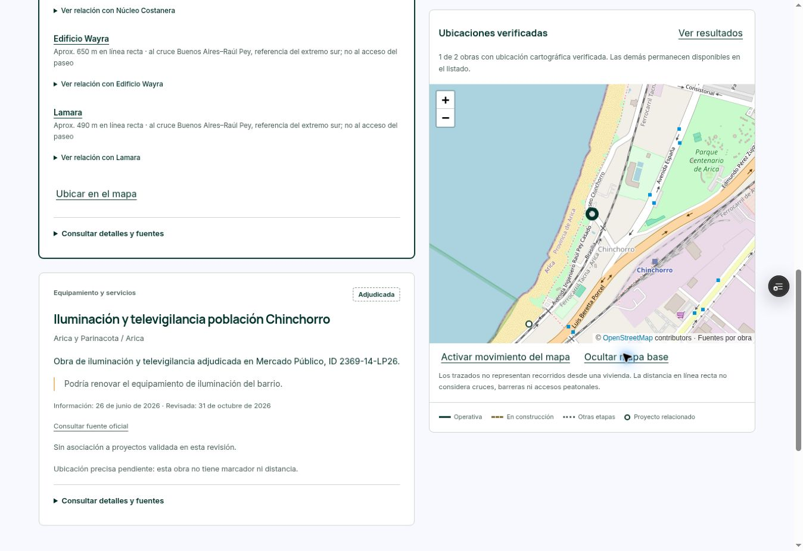

# Ampliación lista para revisión

Corte: 31 de octubre de 2026. Producción no modificada.

Resultado: 59 obras, 121 asociaciones y 84 proyectos relacionados. Se añaden 3 registros de obra y 47 asociaciones; 25 proyectos obtienen su primera asociación. Los 131 proyectos conservan revisión documental: 84 con asociaciones, 42 sin asociación admitida y 5 con ubicación bloqueada.

## Comprobaciones

- 32 pruebas aprobadas: catálogo, filtros, mapa, distancias, evidencia, cobertura y rechazo de ubicaciones alteradas.
- Datos comerciales y 131 fichas preservados; ver preservation-checks.json.
- Vista previa Vercel READY: dpl_3rgGqkdJ6X5nG3saAVi6ot9B3YZC. Commit d51ca9513b1255deb4abd48810bb23cb1f1ea1fe.
- Navegador: filtro Macul, tres obras cartografiadas y ficha Jardines de Ramón Cruz con acceso futuro L8; vista móvil de 390 px, filtro Ñuble; versión alojada, Arica y asociaciones Wayra/Lamara/Núcleo. Navegación aprobada conservada.
- Sólo dos archivos públicos cambian: datos centralizados y etiqueta/noindex de revisión. Funciones y rutas preservadas desde la publicación anterior.

## Proyectos que obtienen su primera asociación

Vista Portugal; Barrio Zenteno; Centenario 1; Edificio San Francisco 1204; Edificio Vivaceta; Bezanilla; Edificio Santa María; Mirador Mapocho; Mapocho 3521; Santa Elena 1670; Diagonal Vicuña; Pintor Cicarelli I; Pintor Cicarelli II; VIMA; Aires La Florida 2; Enlace Mackenna; Entre Vicuñas; Edificio Liverpool; Mirador La Florida; Núcleo Costanera; Edificio Wayra; Lamara; Edificio Bold; Distrito Centro; Condominio Jardines de Ramón Cruz

## Limitaciones

Persisten candidatos sin ubicación suficiente, accesos ferroviarios modificados o no corroborados y aperturas no acreditadas. Pintor Cicarelli III se excluyó de la nueva asociación por alerta de precisión. La distancia siempre es línea recta y especifica si se mide a un perímetro, acceso futuro o referencia territorial; no implica recorrido.

La operación de Ñuble se limita a Imagenología. La L8 conserva aprobación ambiental, sin afirmar financiamiento ni construcción. Las fuentes oficiales determinan el estado; OSM es cartografía auxiliar contrastada. Fondo OSM puede bloquear teselas en este entorno; existe control para ocultarlo. La vista alojada mostró cartografía de Arica correctamente.

Evidencias documentales en los seis JSON por zona y README.md. Los PDF completos y dos HTML no UTF-8 se conservaron localmente; el repositorio conserva enlaces primarios, extractos y coordenadas reproducibles. No se programaron actualizaciones.

## Vista previa

https://project-wrapp-fdqon859z-lsandoval2-8260s-projects.vercel.app/entorno-desarrollo-urbano.html

El enlace compartido de revisión temporal expira el 1 de noviembre de 2026 a las 18:59 UTC.

