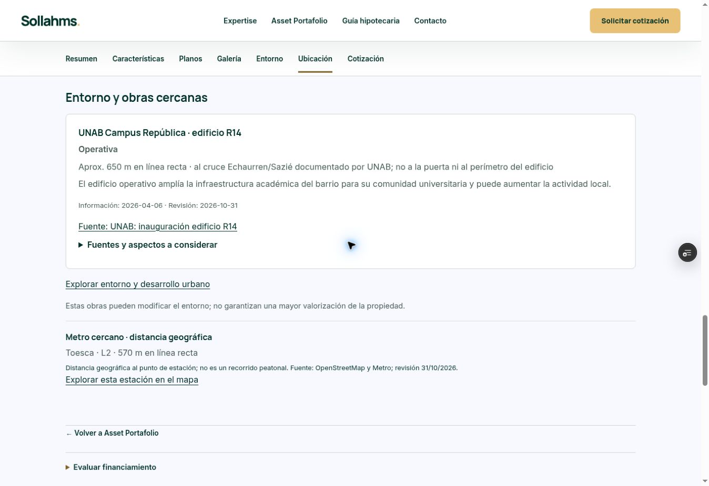

# Cuarta ronda de investigación

Corte: 31 de octubre de 2026. Vista previa para revisión; producción sin cambios.

61 obras, 131 asociaciones y 90 proyectos relacionados. Ocho asociaciones nuevas: siete con UNAB R14 y una con Túnel Lo Ruiz. Cuatro proyectos obtienen su primera asociación: Domeyko 2055, Vergara Domeyko, Don Rafael y Plaza Quilicura. Los otros 41 proyectos se distribuyen entre 38 revisados sin asociación admitida y tres con ubicación bloqueada.

UNAB se mide al cruce Echaurren/Sazié identificado oficialmente. Túnel Lo Ruiz se mide a un vértice del enlace Américo Vespucio documentado en la RCA. Ninguno representa una puerta, recorrido o tiempo de viaje. La referencia vial no garantiza acceso directo ni ahorro de tiempo.

34 pruebas aprobadas; 131 fichas y tres registros comerciales/de ubicación idénticos a la versión anterior. Paquete conserva funciones y rutas. No hay asociaciones duplicadas; todas pasan la validación de fuentes y ubicaciones del modelo compartido por mapa y fichas.

Teleférico actualizado con informe DGC de agosto de 2026; conserva pendientes los accesos. Hospital Pichilemu cuenta ahora con plano histórico, pero diferencias de dirección y superficie impiden usarlo como perímetro vigente. Parque Metropolitano Puerto Montt continúa sin huella verificada. No se han resuelto por aproximación los demás pendientes previos.

Fuentes y distancias: [README.md](README.md). Evidencia adicional: root-evidence.md, rmrest-evidence.json y south-evidence.md. La revisión no equivale a un inventario exhaustivo. No se programaron actualizaciones.

## Vista previa comprobada

https://project-wrapp-ae9pijwki-lsandoval2-8260s-projects.vercel.app/entorno-desarrollo-urbano.html

Vercel READY: dpl_AcRiVyi5kJwDdLQPic5KEfaheDZ6. Código: 37c616fd07c38aab12e7e00cae6c2043ee4dbcd1. Navegador comprobó los filtros Quilicura y Santiago/Educación, las ocho relaciones en el listado, las fichas Plaza Quilicura y Domeyko 2055 y las geometrías filtradas. La cartografía base externa puede demorar en cargar; los puntos y el listado conservan su funcionamiento. Esta ronda no cambió la interfaz ni repitió la revisión móvil de la ronda anterior.

