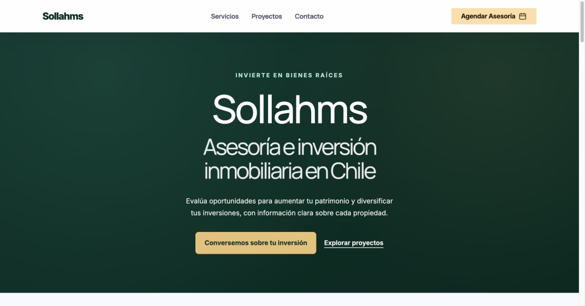

# Portada de Sollahms: publicación SEO del 25 de octubre de 2026

Publicado en https://sollahms.cl/ mediante promoción oficial de Vercel, desde una rama independiente sin merge a main.

- [Investigación y decisiones](research-and-decisions.md)
- [Recibo de publicación y protecciones](release-receipt.json)
- [Recuperación](recovery.json)
- [Verificaciones públicas](public-checks.json)
- [Comprobaciones de integridad](static-checks.json)
- [Revisión en navegador](browser-candidate-qa.json)
- [Rendimiento inicial](pagespeed-baseline-ui.json) y [publicado](pagespeed-published-ui.json)
- [Prueba de Google de datos estructurados](google-rich-results.json)
- [Disponibilidad de métricas](measurement-baseline.json)
- [Fuentes tipográficas y licencias](font-provenance.json)

La prueba de laboratorio de PageSpeed pasa de 57 a 100 en móvil y de 88 a 100 en escritorio. El LCP móvil observado pasa de 9,2 a 1,2 segundos. Son mediciones puntuales, no garantías de rendimiento de todos los visitantes ni prueba de posicionamiento.

Google pudo rastrear la portada y reconoció marcado válido. Robots permite Googlebot, bingbot y OAI-SearchBot; las solicitudes de prueba devolvieron el mismo HTML. No se ha verificado la indexación en las propiedades de Search Console/Bing ni se dispone de clics, impresiones, posiciones o citas por IA. No se han inventado métricas.

