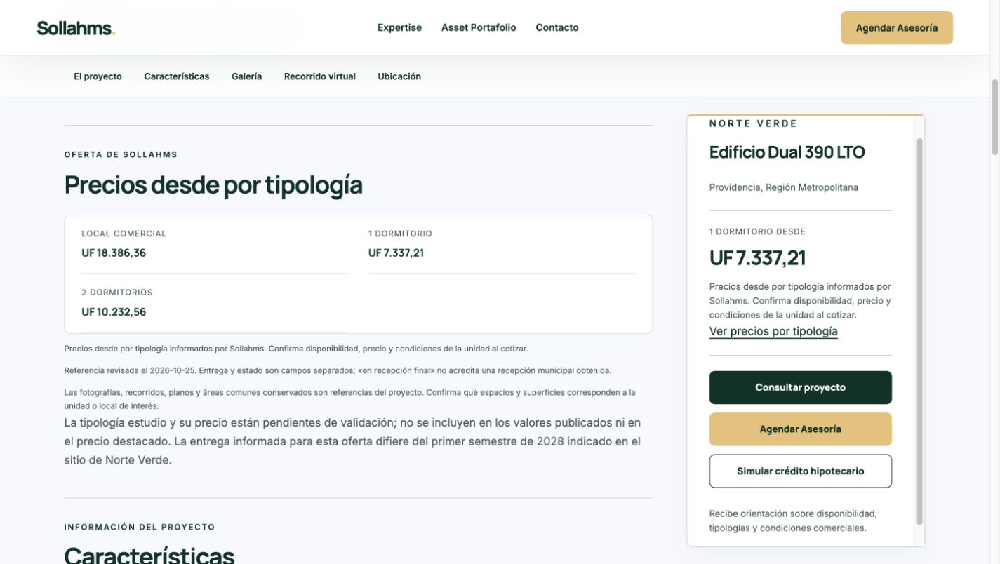
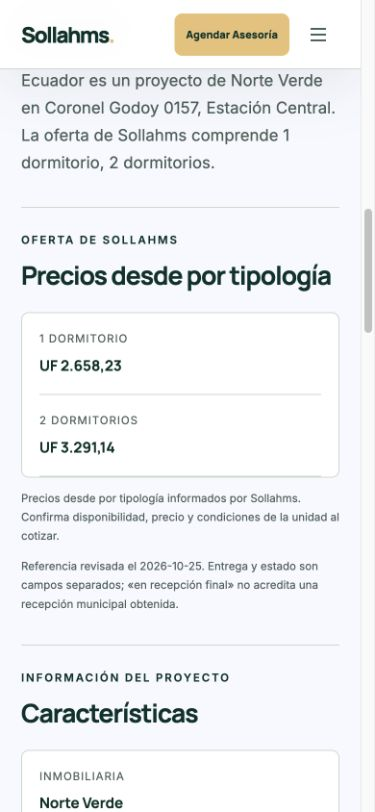

# Resultado de publicación

Dominio comprobado: https://sollahms.cl

- Código publicado: `0932c4d23d333e8af87fb7b7e0e56f7620802961`.
- Despliegue READY: `dpl_CrKWwLe6pvGgR1VwYt9LQA9Usfjw`.
- URL técnica protegida: https://project-wrapp-nowl1igxu-lsandoval2-8260s-projects.vercel.app
- Proyecto/team: `project-wrapp` / `lsandoval2-8260s-projects`.
- Recuperación: `dpl_31y1i14ip3X7n1bufX4YchkBawfJ`; versión anterior `9041a5e33617335a3baa7d32fd4fb6a0b2615a73`.
- Rama: `codex/norte-verde-18-20261025`. Main sigue en `86e200ec191b38af355061e21bc0fc1e549cce3b`; main y rama tienen despliegues automáticos desactivados.

Se promovió el candidato de producción previamente validado, conservando Vercel Authentication. Se verificó que el dominio seguía apuntando a la versión anterior inmediatamente antes de promover. La segunda carga corrigió el precio utilizado por filtros comerciales; el primer candidato no se publicó en sollahms.cl.

## Validación

- 132 registros únicos: 18 Norte Verde y 114 de otras inmobiliarias. Los datos completos y los 114 HTML ajenos a Norte Verde son idénticos a la base.
- Se verificaron las 18 asociaciones de rutas, precios por tipología y fotografías. Los conjuntos activos de catálogo, investigación, registro, contexto de formularios y sitemap coinciden.
- 78 pruebas funcionales satisfactorias: precios y decimales, tipologías, caducidad, identidad, separación de activos, motor financiero, API de contacto con proveedores simulados y asesoría con proveedores simulados. No se enviaron formularios reales.
- Cuatro pruebas de alcance histórico fallan también en la versión de producción previa: dos proyecciones de snapshots León/Sento, una búsqueda por patrón HTML antiguo de contacto y una fijación de bytes FUN-004. Se verificó el fallo en la base intacta. No se relajaron esas guardas históricas; se excluyeron de la ejecución funcional vigente y se añadieron verificaciones de preservación contra la base exacta de esta publicación.
- Navegador real: escritorio de 1440 px y móvil de 390 px. Catálogo completo y Norte Verde, estados, filtros residencial/comercial/mixto, límite de UF y orden por precio, menú móvil, imágenes y enlaces. Sin desbordamiento horizontal en las vistas revisadas.
- Conteos de filtros Norte Verde: 18 total, 15 con oferta residencial, 7 con oferta comercial, 4 mixtos y 11 en recepción final. Los mixtos pertenecen a ambas clases, sin crear duplicados. Comercial hasta UF 4.000 muestra exactamente Parque Panamá, Origen Atacama, Parque Quinta y Bordevivo, en ese orden ascendente.
- Fichas representativas: Ecuador (residencial), Bordevivo (local), Dual (mixto), Verne (galería residencial y mapa). Conservación de las colecciones multimedia de las 18 fichas. Se elimina únicamente el bloque de Verne Oficinas de la ficha residencial.
- Simulador: Dual precarga UF 7.337,21, identifica 1 dormitorio y procedencia Sollahms. A tasa manual efectiva 4,5 %, pie 20 % y 25 años produce 32,33 UF al mes. Bordevivo precarga UF 3.318,19 como local y conserva la advertencia que excluye referencias CMF residenciales.
- JSON del candidato protegido obtenido por Vercel CLI: idéntico byte a byte a la fuente revisada.
- 54 comprobaciones HTTP públicas satisfactorias; véase `public-http.json`. Los 18 HTML y 18 portadas, portada del sitio, catálogo, metadatos de rastreo y archivos compartidos revisados coinciden con el candidato por SHA-256. Las rutas retiradas, con y sin extensión, responden 404. Respaldos y datos internos no son accesibles públicamente.
- UF pública: CLP 41.215,77 del 25/10/2026, fuente SII; sin cambios de lógica.
- Logs Vercel de este despliegue: sin resultados error/fatal en la ventana 2026-10-26 00:41:57–00:56:57 UTC. Esta observación no acredita ausencia futura de errores.
- No se activaron CRM, reservas, envíos reales, servicios pagos ni nuevos proveedores. Los controladores de API y las guardas permanecen idénticos; cambian únicamente los registros vinculados y el texto/procedencia de referencias comerciales.

## Evidencias visuales públicas

## Pendientes de documentación

La identificación del estudio de Dual UF 1.877,27, el número 3902 de Parque Quinta y el sufijo 3008 de Origen Atacama siguen pendientes. No se presentan como datos confirmados. Se publican la dirección oficial de Parque Quinta y el nombre oficial de Origen. Las diferencias de fechas/estados de Playa Peñuelas, Dual, Origen, Plaza Nova y Lira están expresamente indicadas en las fichas. No bloquean los demás datos del listado del propietario. Ver README y decision-register.json.

## Rollback

Promover de nuevo `dpl_31y1i14ip3X7n1bufX4YchkBawfJ` en el mismo proyecto/team. No requiere reconstrucción, merge a main ni activar despliegues automáticos. Los dos proyectos retirados y sus registros se conservan en el commit base y los respaldos de esta carpeta, fuera del paquete público.
