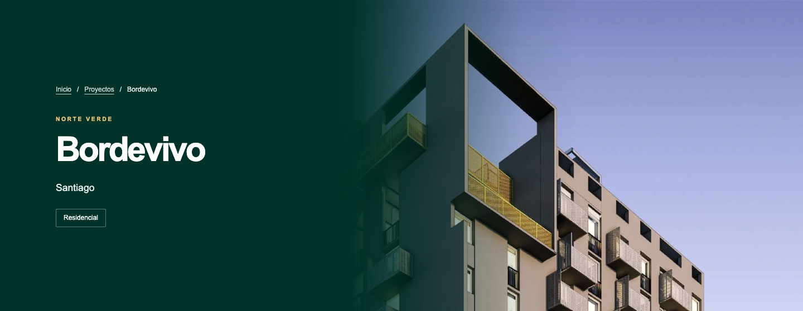
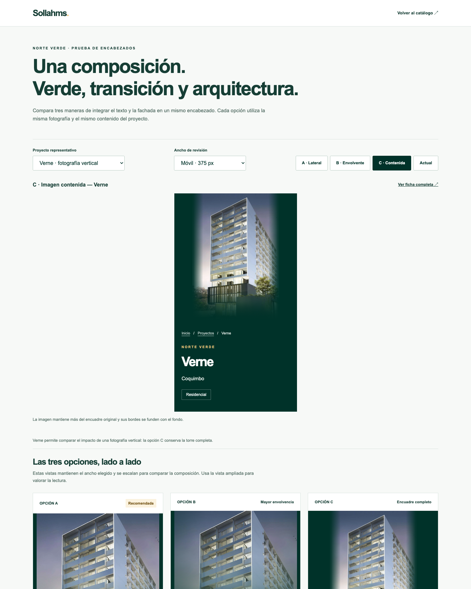

# Norte Verde — prueba de encabezados integrados

Fecha de revisión: 14 de octubre de 2026, America/Santiago.

El Preview protegido permite comparar tres composiciones y el encabezado actual en Bordevivo, Verne, Quintavista y Playa Serena. Las variantes integran el texto sobre verde Sollahms `#003229`, un degradado continuo y la fotografía original del proyecto.

[Abrir comparador protegido](https://project-wrapp-dbb3wbcu2-lsandoval2-8260s-projects.vercel.app/assets/review/norte-verde-hero-variantes.html). Conserva la autenticación de Vercel existente; el usuario debe iniciar sesión con acceso al proyecto.

## Recomendación visual

Recomiendo **A · Lateral** como composición general. La transición amplia permite reconocer una sola superficie: el verde comienza completamente sólido bajo el texto y pierde opacidad sobre la fotografía hasta dejar visible la arquitectura. Mantiene más luminosidad y protagonismo de la imagen que B.

Recomiendo **C · Contenida** para fotografías verticales o encuadres difíciles. En Verne conserva la torre completa, mientras A y B recortan su coronación en escritorio. La imagen llega al borde superior y derecho del encabezado y sus bordes se funden con el verde.

| Variante | Fusión propuesta | Resultado y compromiso |
| --- | --- | --- |
| A · Lateral | Verde sólido y transición horizontal amplia hacia la fotografía. | Mejor equilibrio general entre texto, marca y arquitectura. El encuadre ocupa el área visual disponible y puede recortar fotografías verticales. |
| B · Envolvente | Transición lateral más degradado desde la base de la fotografía. | Más profundidad y continuidad inferior. Oscurece parte de la fachada y reduce la visibilidad de detalles en su base. |
| C · Contenida | Fotografía en su proporción original, máscara suave en los bordes y transición desde el verde. | Conserva más del encuadre y necesita menos ampliación. Las fotografías verticales dejan una superficie verde mayor. |

Las tres opciones usan el mismo texto y la misma fotografía de portada de cada ficha. No se retocaron ni reemplazaron archivos de imagen.

## Cómo revisar

El comparador permite elegir proyecto, ancho de revisión **1440 / 768 / 375 px**, variante **A / B / C / Actual** y abrir la ficha completa. Las tres vistas inferiores mantienen el ancho elegido y se escalan para comparar la composición; la vista ampliada permite evaluar la lectura.

En las fichas completas se activa cada propuesta con:

- `?encabezado=lateral`
- `?encabezado=envolvente`
- `?encabezado=contenida`

Sin ese parámetro, la ficha conserva el encabezado actual. El script autoriza únicamente los 17 proyectos de Norte Verde. El comparador muestra cuatro proyectos representativos; Vicuña Mackenna 6896 se añadió a la verificación como control de nombre largo.

| Proyecto | Aspecto revisado | Preferencia |
| --- | --- | --- |
| Bordevivo | Fachada, marco superior negro y balcones amarillos. | A: encuadre ajustado para que esos elementos sean visibles después de la transición. |
| Verne | Fotografía vertical y torre completa. | C: conserva coronación y acceso. |
| Quintavista | Fuente de 767 × 532 px. | A o C: C necesita menos ampliación y conserva más encuadre. |
| Playa Serena | Esquina apuntada y balcones volados. | A: mantiene una lectura clara de la arquitectura. |

En Quintavista a 1440 px, A/B amplían la fuente aproximadamente 1,31 veces y C 1,09 veces, frente a 1,88 veces del encabezado actual. Son factores de presentación CSS; la resolución original no cambió.

## Comportamiento responsive

- **Escritorio, más de 1000 px:** el contenido ocupa el 40% izquierdo sobre verde sólido. La transición se extiende hacia la fotografía. A/B tienen una altura mínima de 560 px; C, 580 px.
- **Tablet, 761–1000 px:** la zona del texto pasa al 43%, se ajustan tamaño y espaciado del título, y el degradado conserva una transición amplia. La altura mínima es 510 px.
- **Móvil, hasta 760 px:** la fotografía queda arriba y se funde verticalmente en el mismo fondo verde. Nombre, ubicación y badges aparecen debajo, sobre verde completamente sólido. La altura crece con el contenido y admite títulos largos. C mantiene la proporción de la fuente y limita su altura a 390 px.

No se detectó desbordamiento horizontal, superposición ni recorte de textos en los tamaños verificados.

## Verificación y alcance

La revisión local cubrió **42 combinaciones de ficha/variante/tamaño**, **144 estados del comparador** y **2341 comprobaciones**, con cero fallos. Se comprobó la lectura, carga de imágenes, encuadre, ausencia de errores, contenido comercial visible y apertura de la ficha completa.

Se muestrearon **378 líneas de texto** sobre el fondo compuesto: todas quedaron sobre `rgb(0, 50, 41)`; el contraste mínimo medido fue **8,30:1**, considerando color y opacidad del texto. Las 42 capturas de encabezado contienen los títulos visibles.

En el Preview publicado se verificaron seis casos de Bordevivo, escritorio y móvil, con **231 comprobaciones** y cero fallos. La revisión interactiva remota adicional de Verne/C/375 px pasó sus ocho comprobaciones, incluyendo los cuatro iframes, la imagen decodificada y la apertura de la ficha completa con sus seis modelos.

La automatización aisló servicios externos y escrituras. Las capturas automatizadas de fichas usan fuentes de reserva instaladas porque se bloquearon las solicitudes externas de fuentes; las declaraciones Manrope/Inter del sitio permanecen intactas. También se inspeccionó el comparador visualmente.

La conservación se verificó contra el commit base `54c43fabee7ce75031a57f88249e17a7fcd8b3f0` y el Preview anterior:

- Los 141 HTML fuente, las 134 filas del catálogo y los 932 archivos de datos/recursos versionados permanecen idénticos.
- Las 117 fichas publicadas de otras inmobiliarias permanecen idénticas byte por byte.
- Las 17 fichas publicadas de Norte Verde recuperan exactamente el HTML anterior al retirar las dos etiquetas que cargan el CSS y JS de prueba.
- Los 17 PDF originales y los 253 archivos de galerías y planos conservan sus hashes.
- El CSS anterior y el empaquetador original conservan sus hashes.
- Los 10 tests existentes de datos y recursos Norte Verde pasaron. Cuatro intentos de compilación fuera del alcance autorizado fueron rechazados.
- Los precios, galerías, planos y textos comerciales no cambiaron.

El artefacto publicado contiene **1346 archivos estáticos**, tres más que el Preview anterior. Se descargaron todos desde el nuevo Preview protegido y se compararon sus hashes: **1346 coincidencias, cero diferencias**, 301.694.095 bytes.

La compilación nativa de Vercel conservó las cuatro funciones API existentes. Las comprobaciones GET de contacto, creación de reserva y disponibilidad devolvieron 405 como corresponde; no se enviaron mensajes ni se crearon reservas.

## Rama, commit y despliegue

- Rama: `codex/norte-verde-hero-variantes`.
- Commit de aplicación desplegado: [`1deacd509f58d3c033405389d55a139efaf9ecbf`](https://github.com/lasopho/sollahms-web/commit/1deacd509f58d3c033405389d55a139efaf9ecbf).
- Deployment: `dpl_CDb9cmcxVswUZKGvckgFSjyHHrQS`, READY, Preview con autenticación de Vercel.
- El commit posterior de este informe añade únicamente documentación y evidencias; el Preview permanece asociado al commit de aplicación indicado.
- La compilación se hizo con Vercel nativo y se publicó con `--prebuilt --target preview`. El wrapper exige el entorno Preview y la rama de prueba; el empaquetador original recibe su referencia de compatibilidad anterior y queda registrado en el recibo de compilación.
- No se hizo merge a `main`, promoción, cambio de alias ni despliegue a Production. La consulta antes/después confirmó el mismo Production `dpl_9LvbrLDbZhho3Umm5Rmv6AMkauXE`, asociado a `main` y `f1e9bf1715cc99d095a367eba9028a9a1ad2b026`.

La rama conserva el comportamiento actual por defecto para que la elección visual pueda revisarse antes de adoptar una variante.

## Evidencias

Los recibos y capturas están en [norte-verde-hero-evidencias](norte-verde-hero-evidencias/):

- [Conservación de contenido y recursos](norte-verde-hero-evidencias/preservation.json).
- [QA local](norte-verde-hero-evidencias/qa-local.json) y [revisión visual](norte-verde-hero-evidencias/visual-review.json).
- [QA remota](norte-verde-hero-evidencias/qa-remote.json) y [comparador remoto](norte-verde-hero-evidencias/comparison-remote.json).
- [Integridad remota de los 1346 archivos](norte-verde-hero-evidencias/remote-integrity.json).
- [Recibo del despliegue](norte-verde-hero-evidencias/deployment.json), [compilación](norte-verde-hero-evidencias/build.json) y [paquete fuente](norte-verde-hero-evidencias/source-package.json).
- [Production antes](norte-verde-hero-evidencias/production-before.json) y [después](norte-verde-hero-evidencias/production-after.json).
- [API conservada](norte-verde-hero-evidencias/native-api-check.json).

