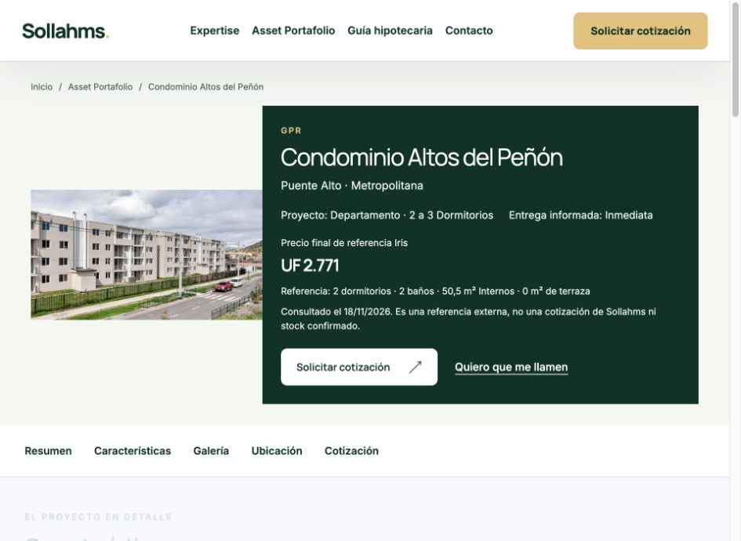

# Candidato local: 21 proyectos y nueva inmobiliaria GPR

Corte real: **18/11/2026**. La nueva instrucción del propietario autoriza preparar la ampliación local. Se incorporaron las **21 identidades de los dos lotes**, nueve GPR y doce de inmobiliarias presentes, en el commit `6cedd329879be1b716be9854d23e1b5538db2806`. El catálogo compuesto llega a **152 proyectos**; producción conserva sus 131. El primer push fue autorizado y ejecutado sin force; el [PR #36](https://github.com/lasopho/sollahms-web/pull/36) está abierto en **Draft**, con el mismo SHA exacto y los 59 archivos verificados. No hubo merge, deployment o publicación de este candidato.

Rama: `codex/ampliacion-21-proyectos-gpr-20261118`. Checkout: `/private/tmp/sollahms-ampliacion-21-gpr-20261118`. Padre/base exacta: `875bd80ddb650b376cb3dd53af4ffae066fcd48f`, destino `codex/footer-sin-frase-20261116`. Árbol técnico limpio. Los 59 archivos del commit son seis modificaciones acotadas y 53 nuevos: 21 fichas, 25 recursos originales y siete archivos de datos, adaptación, CSS, preparación y pruebas. El [manifiesto](qa/MANIFIESTO-59-ARCHIVOS.json) enumera todos y fija sus SHA-256.

## Identidad y lotes

Se reutilizó la verificación individual previa de las 158 fichas. No se repitió el descubrimiento completo ni la auditoría de los 131. Las 21 nuevas son distintas de los 131 slugs y conservan nombre, inmobiliaria atribuida por Iris, dirección literal, comuna, región, tipo y URL propios. Los [21 registros](PROYECTOS-INCORPORADOS-CANDIDATO.json) permiten revisar cada correspondencia.

GPR queda registrada en el catálogo compuesto y su selector, sin inventar RUT, sociedad, mandato o web. Son siete casas y dos departamentos: Altos del Peñón, Reserva Santa Clara, Hacienda Santa Clara, Plaza Nos, Sendero Santa Clara, Terrazas del Mirador, Altos del Mirador, Hacienda Junquillar y Hacienda Volcanes. Los doce restantes son Alameda 4719, Compañía 1735, Nuevo Vivaceta, Kiez, Centro Santa Ana, Edificio Ambar Urbano, Espacio V, Edificio Botánico, Balmaceda, Prat, Vicuña Mackenna Capital y Mirador Capital.

Cero duplicados con el catálogo actual encontrados en este lote. Los posibles duplicados 1412/1587, las identidades insuficientes 1297/1299 y los retiros previos 1341/1468 continúan fuera. No se los declara vendidos ni se incorporan por similitud. No se restaura Patio Brasil ni los seis históricos.

## Evidencia comercial y límites

Las 21 fichas tienen una referencia exacta adicional obtenida de fila/modal mediante navegación oficial acotada, sin reconstruir inventarios. El [original documental](evidencia-iris/RAW-REFERENCIAS-UNITARIAS-21.json), los DOM con campos permitidos y la [lectura visual de planos](evidencia-iris/LECTURA-PLANOS-21.json) conservan fuente, consulta, identidad y rótulos. Los IDs públicos son opacos; nombres de unidades/modelos, documentos owner y contexto interno permanecen en el expediente documental.

| Campo | Cobertura nueva y alcance |
| --- | --- |
| Precio Iris | 21 cabeceras desde y 21 referencias exactas con precio lista/final separados; externos, no stock ni precios Sollahms. Se admite el precio Iris en 19 proyectos. |
| Antecedentes del propietario | Cinco referencias previas en dos proyectos, reutilizadas sin nueva confirmación o pregunta. Nuevo Vivaceta: Estudio UF2.050, 1D UF2.190, 2D UF2.600 y 3D UF4.280. Compañía 1735: 2D UF4.550. |
| Dormitorios / baños | 16 referencias exactas con D numérico y 21 con B. Cinco literales Estudio conservan D desconocido, sin conversión a cero. |
| Superficies | Internos y terraza explícitos en las 21 referencias; once terrazas cero y diez positivas. Útil, total e interior canónicos desconocidos en las 21. No sumar ni homologar métricas. |
| Equipamiento | 96 descriptores con alcance de proyecto en 19 proyectos; las notas fuente adicionales no generan predicados. No prueba de inclusión/disponibilidad de estacionamiento o bodega. |
| Entrega / estado | Entrega en 21, con 19 fuentes Iris y dos antecedentes owner. Estado owner en dos. Ninguna certificación de habilitación legal. |
| Recursos / mapa | 20 portadas, 16 asociaciones a cinco logos y 25 archivos originales distintos. Botánico conserva imagen no disponible. Cero coordenadas verificadas nuevas; el mapa los presenta como pendientes. |

La fecha 30/10/2026 de los antecedentes owner es el contexto del registro archivado, no una fecha documental inventada ni vigencia recién confirmada. Esos dos proyectos enmascaran todos los precios Iris para predicados: UF3.640 de una campaña de Compañía no reemplaza UF4.550. La búsqueda D/B sin precio puede mostrar el perfil Iris, con «Sin precio del propietario vinculado a este perfil». Nunca toma los baños de ese perfil para el precio owner.

Precio y atributos deben pertenecer al mismo testigo admitido. El tipo general Casa/Departamento no se presta a una referencia unitaria con tipo desconocido. Tampoco acredita uso Residencial. Útil y total requieren selección expresa; Internos no satisface ninguno. Las notas de amenity conservan su alcance general y tipo explícito, sin extenderlas a locales u otras referencias.

Nueve imágenes de plano contienen distribución sin rótulos de útil/total; dos asociaciones tienen placeholder y diez no tienen plano observado en el modal seleccionado. No se miden ni se extraen áreas por apariencia. La referencia de superficie no se extiende a otras unidades. Las limitaciones completas están en [cobertura](procedencia-datos/COBERTURA-DATOS-21-CORTE-FINAL.json).

## Integración y preservación

El runtime añade una fuente JSON mínima con hash fijo a la colección existente; `data/proyectos.json` y `data/catalog-facets.json` permanecen byteexactos. GPR y las regiones nuevas se incorporan mediante las opciones derivadas. Sólo las variantes nuevas De los Lagos/Del Biobío se normalizan a Los Lagos/Biobío, conservando el literal fuente.

Una fuente nueva inválida conserva los 131 y muestra un aviso persistente accesible fuera de paneles colapsables. Los nuevos proyectos no reciben escenarios financieros: el inicializador evalúa únicamente los 131 originales, y el bloque se oculta en resultados exclusivamente nuevos. No se modifica ninguna fórmula o módulo financiero. Las cuatro vistas comparten resultados; las coordenadas desconocidas no crean marcadores.

Las 21 fichas usan la composición B y el sistema compartido, precios atribuidos y navegación local. Contacto enlaza a la ruta existente e indica identificar proyecto e intención; no se amplía el formulario o registro backend protegido de los 131. No hay formularios, envíos ni tablas de inventario nuevas. Esta ampliación de identidad pública queda separada de los servicios de captura existentes.

Los [155 archivos protegidos](qa/PRESERVACION-155-Y-131.json) coincidieron con sus 155 SHA-256 certificados; las 131 fichas originales están intactas. Precios/direcciones existentes, siete funciones, CRM360, AI Lab, Resend, formularios, Contacto, Centro de Orientación y módulos financieros no se modificaron. Se conserva el suplemento `24a11df` limpio e independiente; no se integra ni altera su permiso pendiente. Los 1.993 punteros de la consolidación y los 313 IDs históricos permanecen intactos.

## Pruebas y revisión

- Node: **52 casos distintos aprobados** = siete de datos, 19 de comportamiento y 26 regresiones afectadas. La corrida final de los 19 y siete fija los archivos finales; las 26 se reutilizan. No sumar repeticiones dirigidas, ni las suites históricas F10.
- Chrome: 13 casos comerciales, 20 controles de vistas (cuatro vistas por cinco anchos), 15 controles de fichas (tres fichas por cinco anchos) y cuatro flujos dirigidos. Todos aprobados; no se agregan a Node. Anchos: 320, 390, 768, 1024 y 1440 px.
- [HTTP y contratos](qa/FICHAS-HTTP-Y-CONTRATOS-FINAL.json): 21/21 nuevas fichas con identidad, fuente, enlaces/anchors y recursos locales. No se ejecutaron otra vez las pruebas de las 131.
- [Revisión independiente](evidencia-iris/REVISION-INDEPENDIENTE-CANDIDATO-21.json): **APROBADO CON OBSERVACIONES**, cero bloqueantes; limita el dictamen al corte fijado y no certifica disponibilidad, vigencia o combinaciones no respaldadas.

El [recibo Chrome](qa/QA-CHROME.json) y las capturas fijan los resultados. El escenario financiero usó valores ficticios sólo en el calculador local; cero formularios de lead/contacto y cero acciones de servicios. No hubo build de producción, instalación de dependencias o generador histórico. Los dos preparadores nuevos están limitados a la fuente separada y los 21 slugs autorizados.

## Sincronización y siguiente operación

La rama de Leben sincroniza únicamente documentación; el primer push técnico se ejecutó con su autorización independiente. La nueva rama técnica y el destino excluyen deployments automáticos. El [estado de referencias previo al push](qa/PRODUCCION-Y-REFERENCIAS.json) confirma producción READY en `875bd80`, sin deployments de la nueva rama. La autorización `AUTH-PUSH-PR-EXPANSION-21-GPR-20261118-01` fue respondida expresamente «Autorizar push y PR Draft» y ejecutada. El [recibo de sincronización](SINCRONIZACION-PR36.json) confirma SHA remoto exacto, PR36 abierto/Draft/no fusionado, 59 archivos coincidentes, cero deployments de la rama y producción READY en875. GitHub no aporta checks/reviews; su ausencia no es aprobación. Ready, merge, deployment y publicación requieren permisos independientes.

El [parche textual](IMPLEMENTACION-21-SIN-BINARIOS.patch), [mapa de originales](RECUPERACION-RECURSOS.json) y hashes permiten recuperar los 59 archivos si se pierde el checkout. No reconstruirlo ni repetir QA con hashes idénticos. El corte previo de propuesta se conserva sin modificar sus flags históricos de autorización. Continuidad vigente en el NEXT-PROMPT raíz.

## Solicitud presentada y compatibilidad pendiente de integración

La solicitud independiente `AUTH-PUSH-PR-EXPANSION-21-GPR-20261118-01` fue presentada una sola vez para el commit exacto y PR Draft. La respuesta expresa autorizó ambos pasos; fueron ejecutados y verificados en el PR36 Draft. Esta solicitud está cerrada, sin permisos remanentes para Ready, merge, deployment o publicación. No repetirla ni usarla para otros pasos.

Se preparó una [comparación documental con 24a](COMPATIBILIDAD-24A-AMPLIACION-6CEDD32.json), sin merge, aplicación de parches o pruebas. Hay dos archivos compartidos: `catalog-model.mjs` tiene cambios en líneas disjuntas; `vercel.json` requiere conservar manualmente ambas exclusiones `false` en una integración futura. Mantener el cargador de las 19 referencias documentales sobre los 131 originales antes de añadir los 21, sin mezclarlos o habilitarlos como stock. Esta comprobación no autoriza integrar ninguno de los candidatos ni altera sus hashes.

El siguiente permiso `AUTH-READY-PR36-20261118-01` fue presentado una sola vez para cambiar únicamente PR36 a Ready for Review. Sigue pendiente: el PR se conserva Draft. No repetir la solicitud ni interpretar este paso como autorización de merge, deployment o publicación.
