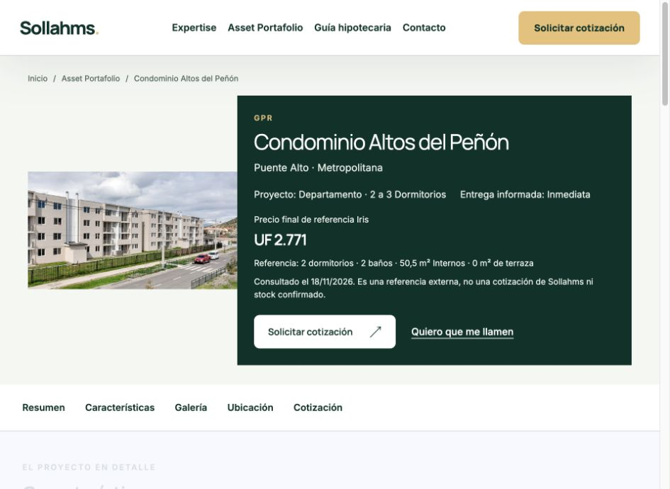
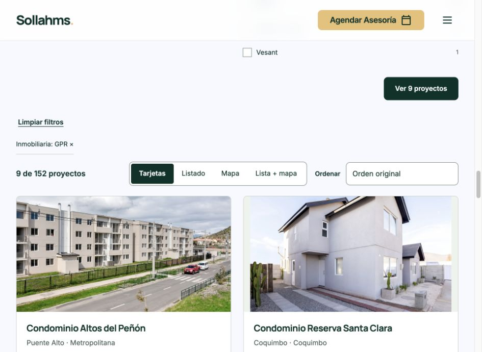

# Deployment PR36: revisión y publicación verificadas

Corte histórico de revisión previo a promoción: ID `dpl_FkyZZgpki5HSpKMRJQFgJE451d3G`, READY, target production sin dominios asignados en aquel corte. Source: `d3fb474f08b81a965d2e0eac927adf88671968c0`. [Catálogo de revisión](https://project-wrapp-kb7gmwe9d-lsandoval2-8260s-projects.vercel.app/proyectos.html).

La autorización `AUTH-DEPLOYMENT-PR36-20261118-01` fue respondida «Autorizar deployment sin dominios», ejecutada una sola vez y consumida. CLI oficial 65.11 con prebuilt, entorno production, skip-domain y proyecto/equipo explícitos. No hubo build, generador, nuevos env, SSO, DNS, asignación de dominios o promoción. No ejecutar otra creación con este permiso.

[Verificación independiente de archivos](VERIFICACION-1721-DIGESTS-DEPLOYMENT-PR36.json): 1.721/1.721 UID=SHA1 coincidentes con el manifiesto congelado, sin faltantes/extras/diferencias ; 57 archivos de funciones y config íntegros. Siete nodoslambda se separan de los archivos reales. Metadatos explícitos ligan el deployment a D3/footer/lasopho/sollahms-web; no se infiere GitSHA del cwd stage.

[Identidad y asignaciones](VERIFICACION-INDEPENDIENTE-DEPLOYMENT.json): READY, proyecto/equipo correctos, alias=[]; los cuatro alias públicos siguen en875/dpl3m. No se crearon sharelinks o bypass ni se leyeron variables o credenciales.

[Chrome protegido](qa-chrome/QA-CHROME-DEPLOYMENT-PR36.json): 3/3 flujos nuevos aprobados con sesión normal existente: catálogo 152 y GPR9; referencia UF 2.771/2D/2B propia con útil desconocida dando 0; navegación a ficha GPR con foto, precio Iris/fuente/fecha y sin forms. La primera lectura positiva fue durante carga y se volvió a observar esperando el resultado visible; no fue defecto ni se sumó como prueba. Cero errores/warnings. No se repitieron52 Node ni QA responsive histórico. No se enviaron formularios de lead/contacto.

La promoción/publicación de **este mismo deployment** requiere autorización independiente. El permiso de creación no la incluye. Producción permanece en 875 con 131 proyectos; el review prepara 152 sin certificar stock o vigencia de referencias Iris. El suplemento 24a permanece separado y pendiente.

## Publicación posterior autorizada y verificada

El propietario respondió «Autorizar promoción y publicación» a AUTH-PROMOTION-PR36-20261118-01. Se promovió **el mismo deployment**, una sola vez con VercelMCP, sin rebuild ni otro deployment. [Recibo](PROMOCION-PR36.json). [Verificación independiente](publicacion/VERIFICACION-INDEPENDIENTE-PROMOCION-PR36.json): cinco alias previos enFky/D3; www y sollhams.cl conservan redirects308. La omisión previa de sollhams.cl en el resumen de cuatro alias queda corregida: no se creó un dominio.

[Chrome público dirigido](publicacion/QA-PUBLICO-PR36.json):152 proyectos yGPR9, sin alertas visibles, overflow o errores/warnings. [Cinco recursos públicos](publicacion/RECURSOS-PUBLICOS-PR36.json)200/SHA256 idénticos al paquete. No se repitieron las suites históricas. Producción anterior875/3m4 preservada en [snapshot](publicacion/ESTADO-PUBLICACION-ANTERIOR-875.json), sin permiso de rollback. Los permisos de creación/promoción están consumidos. El suplemento24a sigue separado y el objetivo global continúa abierto.

