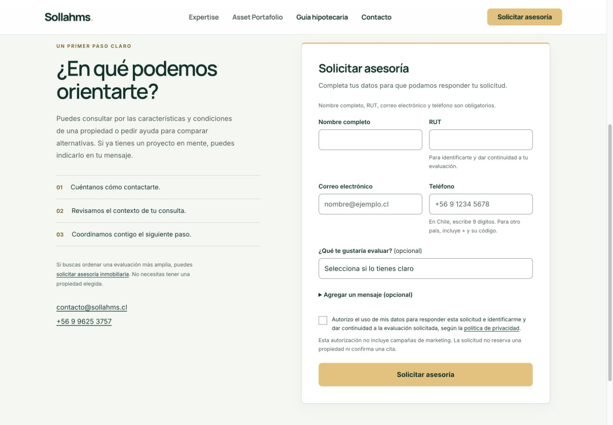
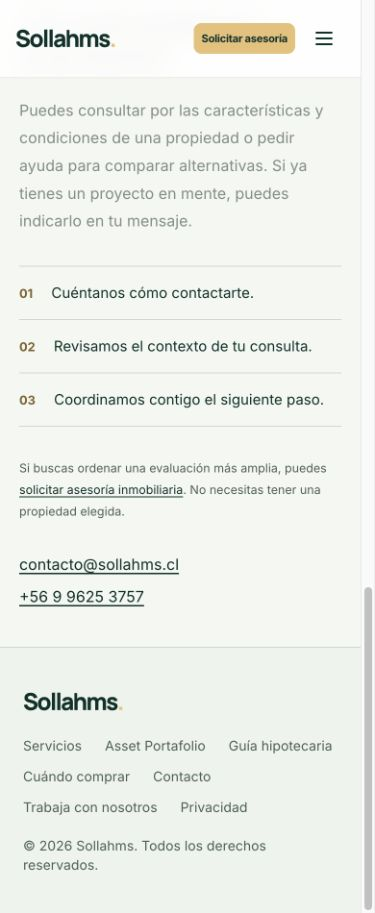

# Teléfono oficial de Sollahms — publicación verificada

Fecha: 30 de octubre de 2026, Chile.

**Publicado: +56 9 9625 3757 en https://sollahms.cl/.**

- Código publicado: `7b83ea31c7f26307b8109aebf14a10530b6465ec`.
- Rama: `codex/official-phone-20261030`; main y los despliegues automáticos permanecen desactivados.
- Deployment: `dpl_DKnCS5UxqJ911mY9dVdcQP9HBciW`, estado READY.
- URL del deployment: https://project-wrapp-e2bfl33df-lsandoval2-8260s-projects.vercel.app
- Panel: https://vercel.com/lsandoval2-8260s-projects/project-wrapp/DKnCS5UxqJ911mY9dVdcQP9HBciW
- Rollback disponible y comprobado READY: `dpl_BZhhRSnpWc3faoDHCByT2p2XzmLa`.
- Panel del rollback: https://vercel.com/lsandoval2-8260s-projects/project-wrapp/BZhhRSnpWc3faoDHCByT2p2XzmLa

## Cambios publicados

| Archivo | Cambio exacto |
|---|---|
| index.html | Dos números visibles, dos enlaces telefónicos y dos propiedades telephone de Organization/ContactPoint |
| contacto.html | Número visible y enlace telefónico |
| agenda-asesoria.html | Número visible y enlace telefónico |
| comparador-hipotecario.html | Número y enlace del aviso alternativo sin JavaScript |

Se sustituyeron las 12 referencias al teléfono anterior. El inventario incluye 142 páginas HTML, las 131 fichas inmobiliarias, catálogo, páginas educativas, encabezados, pies, scripts, plantillas y servicios. Las demás páginas no contenían un teléfono de contacto que reemplazar. Los ejemplos de teléfono en campos de clientes y los datos de terceros se conservaron.

## Configuración compartida y mantenimiento

`data/site-contact.json` es la fuente de edición. `scripts/site_contact.py` deriva los cuatro formatos y sincroniza los HTML estáticos para que el contacto y los datos estructurados funcionen sin JavaScript:

| Uso | Valor |
|---|---|
| Visible | +56 9 9625 3757 |
| Internacional | +56996253757 |
| Llamada | tel:+56996253757 |
| WhatsApp | https://wa.me/56996253757 |

La auditoría no encontró botones ni enlaces de WhatsApp existentes en producción. Se configuró su formato reutilizable, sin añadir botones ni modificar el diseño. La transformación conserva literalmente los parámetros y el mensaje codificado de un enlace WhatsApp; se comprobó con una entrada sintética. No se realizó una llamada ni se envió un WhatsApp.

Para futuros cambios, editar únicamente el número de configuración, conservar el anterior en previousPhones, ejecutar `python scripts/site_contact.py` y `python scripts/site_contact.py --check`. Los números repetidos en HTML son salidas estáticas generadas. `scripts/package-official-phone.py` consume esa configuración y rechaza cualquier cambio adicional en los cuatro HTML al producir el paquete. Antes de reutilizarlo, actualizar y verificar su baseline contra la producción vigente.

## Conservación y comparación con producción

La producción cambió durante la revisión inicial: se publicó la actualización comercial de León. Se rebasó el trabajo sobre su fuente y su manifest congelado, `docs/leon-commercial-20261030/deployment-files.json`, antes de publicar el teléfono.

El hash SHA-1 de release-hashes.json del baseline (`ac52e404419ce528f7dddff7ba593be324307220`) coincidió con el archivo del deployment activo. El paquete conserva sus 1.625 entradas: 1.619 idénticas, cuatro HTML con sustituciones exclusivas del número y dos entradas de control (hashes y bloqueo de despliegue automático de la nueva rama).

Se preservaron íntegramente las seis funciones, sus entradas y la transformación comercial de contacto de 53 registros; imágenes, galerías, planos, datos comerciales, CSS, JavaScript, validaciones, animaciones y metadatos ajenos al teléfono. El build verificó 1.621 archivos de artefacto. No se añadieron rutas públicas.

`data/sento-review.json` conserva su blob `24ee9c59c65e1126b71a38016b1bb512ac43c051`; los recursos exclusivos de Preview y sus controles permanecen fuera del paquete. La protección SSO de Vercel continúa habilitada en todos los dominios salvo los personalizados. Patio Brasil conserva HTTP 410.

## Verificación realizada

- 234 recursos públicos comprobados después de publicar: 142 HTML y 92 archivos de texto auxiliares. Todos coinciden por SHA-256 con el candidato; cero fallos, cero referencias al número anterior y 12 al nuevo.
- Cinco enlaces tel correctos y dos propiedades telephone de Schema.org; textos visibles coherentes.
- Chrome real en escritorio de 1.440 px y móvil de 390 px: las cuatro páginas modificadas conservan su disposición, sin desbordamiento horizontal. Contacto publicado se verificó en ambos tamaños y se adjuntan capturas.
- 25 pruebas de las suites actuales de campos comerciales, solicitudes de proyectos y colaboración superadas. Incluyen las 131 identidades de proyecto, validaciones, consentimiento, destino de correo, rechazo en Preview y reintentos.
- El formulario vacío mostró errores de validación y no envió la solicitud. Las pruebas de transporte usaron receptores simulados; no se enviaron correos reales ni se afirma entrega en buzón.
- `/api/uf`: HTTP 200. `/api/advisory`, `/api/contact`, `/api/collaboration`: HTTP 405 esperado ante GET, conservando la restricción de método.
- `/data/sento-review.json`: HTTP 404. `/patio-brasil.html`: HTTP 410.
- Alias `sollahms.cl` confirmado sobre el nuevo deployment. El anterior permanece READY y figura como candidato de rollback.

El registro `public-before.json` documenta la auditoría inicial que detectó la publicación concurrente; sus diferencias se resolvieron al usar el nuevo baseline. `public-after.json` es la comprobación definitiva, sin discrepancias.

## Archivos de soporte modificados o añadidos

- `data/site-contact.json`
- `scripts/site_contact.py`
- `scripts/package-official-phone.py`
- `AGENTS.md`: regla de mantenimiento del teléfono.
- `vercel.json`: únicamente desactivación de despliegues automáticos para la rama nueva.
- `docs/official-phone-20261030/`: manifest exacto, controles del paquete, auditorías HTTP, pruebas, verificación, servicios, este informe y capturas.

## Rollback

Usar el rollback oficial de Vercel sobre el proyecto `prj_URomRRU0MAy4etGKP5gWv3Qv4DGH`, equipo `team_A9VNIW2f2K1IJpd2pGdvDmEN`, hacia `dpl_BZhhRSnpWc3faoDHCByT2p2XzmLa`. Se recupera la versión inmediatamente anterior con León incluido, sin reconstrucción. El rollback está disponible; no se ha ejecutado.

## Capturas de producción

