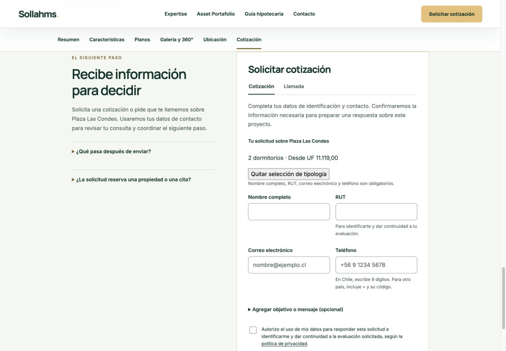
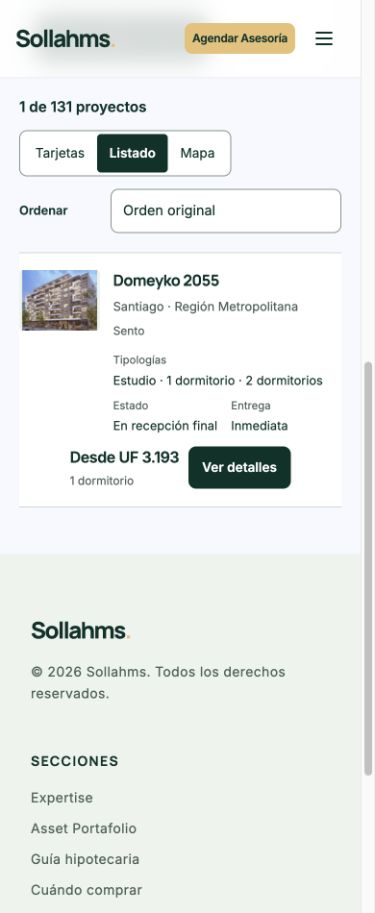

# Sento — actualización comercial y publicación controlada

Fecha: 30/10/2026 (Chile).
Código publicado: f6980e3c374b2c56c5053191513d0d4ad34a30ae.
Deployment: dpl_DqeEbUHFWijsXgRuvCSh4kHAqsuW.
Rama: codex/sento-commercial-20261030.
Producción: https://sollahms.cl/proyectos.html?inmobiliaria=Sento
Rollback READY comprobado: dpl_4Yqd3RdMY8g78HgXj6MvYVhuYBJh.

## Alcance y fuentes

Se revisaron los ocho nombres del documento del propietario y la captura comercial 30/10/2026 19:48:04. Producción contiene siete fichas Sento. Se publicaron 14 precios de esas fichas; el decimoquinto (Compañía 1735) queda registrado en owner-input.json como pendiente de incorporación, sin atribuirlo a otro inmueble ni crear una ficha con recursos protegidos.

La información comercial del propietario prevalece sobre campañas externas. No se inventaron descuentos, unidades, stock, superficies o baños.

| Proyecto | Valores autorizados por tipología (UF) | Desde público | Entrega informada | Estado |
|---|---|---:|---|---|
| San Ignacio | Estudio 3.670; 1D 3.625; 2D 4.495 | 3.625 | Inmediata | En recepción final |
| Angamos | Sin precio autorizado | Consultar precio | Inmediata | En recepción final |
| Curicó 77 | Estudio 3.262; 1D 3.778; 2D 5.050 | 3.262 | Enero 2029 | En blanco |
| Mirador La Florida | Estudio 2.978; 1D 3.561; 2D 4.352 | 2.978 | Primer semestre 2029 | En blanco |
| Plaza Las Condes | 2D 11.119 | 11.073 | Diciembre 2026 | En verde |
| Jofré (URL jofre-135; nombre verificado Jofré 157) | 1D 3.969 | 3.969 | Inmediata | En recepción final |
| Domeyko 2055 | Estudio 2.700; 1D 3.193; 2D 4.112 | 2.700 | Inmediata | En recepción final |
| Compañía 1735 | 2D 4.550, registrado internamente | No incorporado | Inmediata, informada | En recepción final, informado |

## Discrepancias y decisiones

- Plaza: la fuente anterior identifica UF 11.073 como precio de lista de unidad 313. La nueva tabla no revoca ese precio y aporta UF 11.119 por tipología 2D. Se conserva el mínimo general de UF 11.073 y se muestra claramente la referencia de tipología de UF 11.119, sin asignarla automáticamente a unidad 213 ni calcular descuentos. La selección explícita de 2D usa el precio de tipología nuevo; el catálogo general y la portada conservan el mínimo anterior.
- Angamos: no se encontró precio previamente autorizado en su registro público; no se emplean campañas externas para rellenarlo.
- Compañía: no existe ficha activa ni registro público en el inventario. El cotizador oficial https://sento.cl/cotizador-full/?pr=23 identifica Compañía 1735; la página comercial https://sento.cl/proyectos/sento-compania-1703/ lo denomina Compañía 1703. Se documenta la identidad relacionada, pero esta actualización de fichas existentes no copia contenido protegido ni crea una octava ficha. Su incorporación y revisión propia quedan pendientes.
- Se conservan direcciones verificadas: San Ignacio 280, Angamos 205, Curicó 77, Jofré 157 y Eugenia 8. La captura trae San Ignacio 270, Jofré 216 para Angamos, Curicó 55 y Jofré 135; esas numeraciones no sustituyen automáticamente la dirección vigente. Plaza y Domeyko coinciden.
- Fuentes oficiales contrastadas: https://sento.cl/proyectos/sento-san-ignacio-280/ ; https://sento.cl/proyectos/angamos-205/ (referencia existente); https://sento.cl/proyectos/sento-curico-77/ ; https://sento.cl/proyectos/jofre-157/ ; https://sento.cl/proyecto/ . Curicó oficial informa en verde, mientras la nueva tabla del propietario informa en blanco: se usa el estado comercial suministrado y se conserva esta discrepancia documental. Jofré histórico figuraba vendido; se aplica el nuevo estado comercial sin publicar un inventario de unidades.

## Fuente única y sincronización

Los valores residen en data/proyectos.json.commercialOffers por proyecto y tipología. scripts/sento_commercial.py consume esos registros para fichas y proyección de filtros; los generadores compartidos lo invocan. El importador es un registro histórico, no un proceso que deba repetirse sobre futuros precios autorizados. La investigación conserva las actualizaciones y procedencia.

Catálogo, tarjetas, listado y mapa usan la misma referencia por tipología. Precio y dormitorios se evalúan juntos; atributos desconocidos no producen coincidencias. Se conservan amenities y variantes documentadas, sin trasladar características de Plaza a otros edificios. Estado comercial y entrega siguen separados; recepción final no acredita entrega legal habilitada en la guía educativa. Los enlaces de ficha conservan oferta pública y origen; el formulario existente recibe el contexto por su mensaje, sin nuevos destinos o servicios. El simulador resuelve el valor desde el catálogo.

## Conservación y protección

- 131 fichas conservadas; los otros 124 registros y proyecciones permanecen iguales.
- Imágenes, planos, iframes, mapas, formularios, estilos, recursos y efectos existentes preservados.
- data/sento-review.json y protectedPreviewOnly no se modificaron. Blob original: 24ee9c59c65e1126b71a38016b1bb512ac43c051.
- El paquete conserva las 1.625 entradas exactas de la versión anterior: cero rutas nuevas, cero recursos multimedia añadidos. El registro protegido no está en el paquete. Sólo se sustituyen 13 archivos runtime y tres entradas de construcción.
- Funciones conservadas; el catálogo interno de contacto se sincroniza de forma controlada con los siete registros adicionales: 48 filas sincronizadas y 83 restantes intactas.
- main permanece en 86e200ec191b38af355061e21bc0fc1e549cce3b. main:false y rama:false; sin merge ni despliegues automáticos.

## Verificación

- 85 comprobaciones comerciales Sento: 14 valores activos, el 15.º pendiente, mínimos, ofertas, contextos, simulador y filtros combinados.
- 196 comprobaciones de conservación y regeneración focalizada idempotente.
- 77 comprobaciones AJ Urbana y 194 ECasa superadas.
- 10 pruebas existentes del catálogo superadas.
- 13 respuestas HTTP 200 idénticas al candidato validado; otras 13 verificaciones equivalentes en el dominio público, incluyendo las siete fichas.
- Chrome real en escritorio 1440×1000 y móvil 390×950. Sin desbordamiento horizontal de la página (375 px de contenido en viewport de 390 px).
- Búsqueda Sento + Santiago + 1D + máximo UF 3.500: únicamente Domeyko 2055, UF 3.193. Abrir ficha conserva 1D en cotización; simulador muestra 3193. Regreso conserva filtros y listado.
- Plaza comprobada: encabezado UF 11.073; selección 2D UF 11.119; cuatro campos obligatorios y consentimiento conservados.
- Dominio público: 7 de 131 fichas Sento y precios esperados. UF visible en la guía: $41.242,32.
- No se enviaron formularios ni correos. Se comprobó el contexto y las funciones de serialización; no se afirma entrega real de contactos.
- Logs error/fatal del deployment consultados en la última hora, a las 23:00 UTC: sin registros coincidentes.

## Archivos modificados

- curico-77.html
- jofre-135.html
- mirador-la-florida.html
- san-ignacio.html
- domeyko-2055.html
- vercel.json
- plaza-las-condes.html
- proyectos.html
- angamos.html
- AGENTS.md
- data/fichas-proyectos.json
- data/proyectos.json
- data/catalog-facets.json
- tests/sento-preservation.py
- tests/sento-commercial.test.mjs
- scripts/project_header_b.py
- scripts/sento_commercial.py
- scripts/import_sento_owner_20261030.py
- scripts/build-catalog-facets.py
- docs/sento-commercial-20261030/owner-input.json
- assets/js/catalog.mjs
- assets/js/catalog-map.mjs
- assets/js/project-offers.mjs

## Recuperación

Baseline: commit 8384b37e74d8a2f653550a099af349c5233999ad y docs/aj-urbana-20261030/deployment-files.json. El manifest exacto publicado se conserva en deployment-files.json de esta carpeta. El alias de producción se revisó inmediatamente antes y después de promover. Para recuperar, usar rollback oficial al deployment anterior dpl_4Yqd3RdMY8g78HgXj6MvYVhuYBJh, sin reconstrucción.

## Capturas reales

