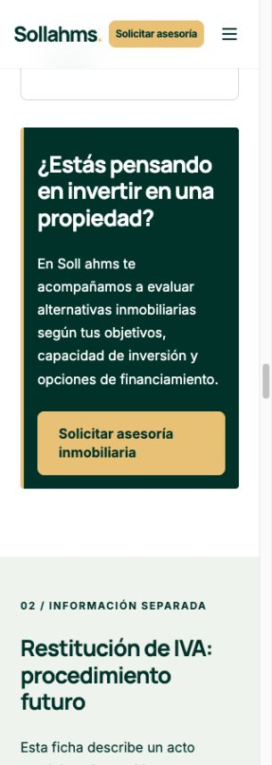
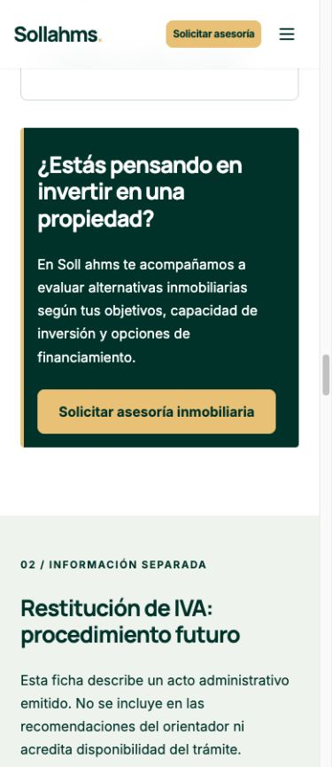
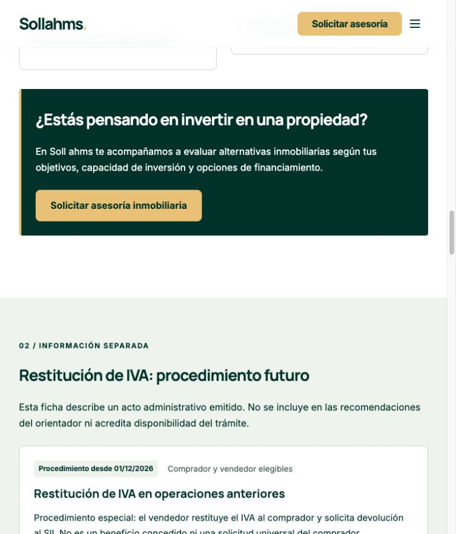
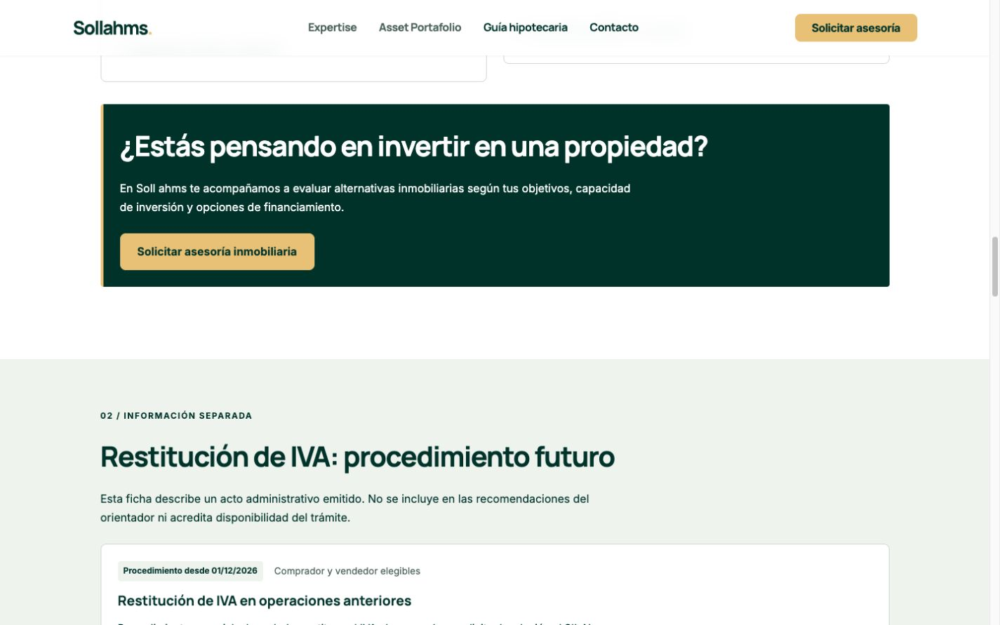

# Publicación controlada del CTA comercial — PR #22

## Resultado
Publicado exclusivamente el reemplazo del aviso final de `beneficios-tributarios-inmobiliarios.html`.
- Fecha de asignación del dominio: **15/11/2026 00:10:57.260 America/Santiago (UTC−03:00)**, según updatedAt del alias.
- Deployment: `dpl_GqikSrihY6ETwsVJtkF6uB6y4Dsw`.
- SHA de código: `f0e8bd59a9589e7d1b5a737778c6bf4783e89e88`.
- URL: https://sollahms.cl/beneficios-tributarios-inmobiliarios.html
- Producción anterior: `dpl_9wtwmxsxawGBf9XGb6yK1hWKUuqC`, SHA `4bea6abcb3fbc663c0f3a559e0086d70a5b977a2`.

## Preservación y procedimiento
Se comprobó la producción vigente y se creó un paquete de producción independiente; no se promovió automáticamente el preview. Auto-assign Custom Production Domains estaba deshabilitado. No se cambiaron ajustes globales.
Los manifiestos de 1.659 archivos se compararon por ruta y SHA-1: **1.658 archivos idénticos y un único HTML cambiado**. El build verificó el conjunto completo, los hashes y los tamaños disponibles (un registro histórico carece de tamaño; su hash sí fue validado). No hubo archivos adicionales o faltantes en runtime.
Build READY, sin alias antes de la asignación. Salida de verificación:
`{"productionCTA":true,"preserved":1658,"changed":["beneficios-tributarios-inmobiliarios.html"],"total":1659}`

| HTML | Bytes | SHA-1 |
|---|---:|---|
| Producción anterior | 43024 | 6808be8c8dcdc7def23527402fc66779dfafd06e |
| Candidato y producción final | 43228 | 871f1e31e65ed96564ef47df492335f9925f6301 |

La inversión del reemplazo restituye byte por byte el HTML anterior. Permanecen idénticos metadatos, JSON-LD, 12 fichas, Resolución 146, orientador, preguntas frecuentes, fuentes, advertencias específicas y todos los recursos. Sitemap, robots, las cinco páginas de origen y las integraciones no se modificaron.

## Antes / después
**Antes:** «Antes de decidir, solicita una evaluación individual a un contador o asesor tributario competente. Se deben revisar documentos, fechas, régimen y uso efectivo del inmueble.»

**Después:**
- Título: «¿Estás pensando en invertir en una propiedad?»
- Descripción: «En Soll ahms te acompañamos a evaluar alternativas inmobiliarias según tus objetivos, capacidad de inversión y opciones de financiamiento.»
- Botón: «Solicitar asesoría inmobiliaria».
- Destino: `/agenda-asesoria.html`.

Se reutilizaron las clases existentes; no cambió CSS ni JavaScript.

## QA público
- HTTP 200 de la guía; cuerpo público idéntico al candidato aprobado.
- 12 fichas presentes en los cuatro tamaños.
- 320, 390, 768 y 1440 px: CTA y botón visibles, sin desbordamiento horizontal. Anchos scrollWidth: 305, 375, 753 y 1425 px respectivamente (barra vertical del navegador).
- Teclado: Tab/Shift+Tab, foco visible, outline sólido de 3 px; Enter abre la agenda pública.
- Destino comprobado: https://sollahms.cl/agenda-asesoria.html, título «Solicitar asesoría inmobiliaria en Chile | Sollahms». No se enviaron formularios.
- Contraste reutilizado y aprobado: blanco/verde 14,11:1; dorado/verde 8,30:1.
- Consola de la guía: sin errores ni advertencias observados.
- Comparación íntegra del paquete y smoke HTTP de recursos/páginas protegidas documentados en `publicacion-http.json`.
- No se repitieron pruebas ajenas al cambio; orientador y recursos permanecen idénticos a la versión aprobada.

## Evidencias visuales

## Cierre
El T0 tributario permanece **14/11/2026 23:00:14.697 America/Santiago**. Esta publicación se registra como modificación del CTA, no como nuevo T0.
No se fusionaron PR, no se solicitó indexación ni se modificaron sitemap, robots o las materias tributarias excluidas. Sin incidencias críticas detectadas en el alcance verificado.
