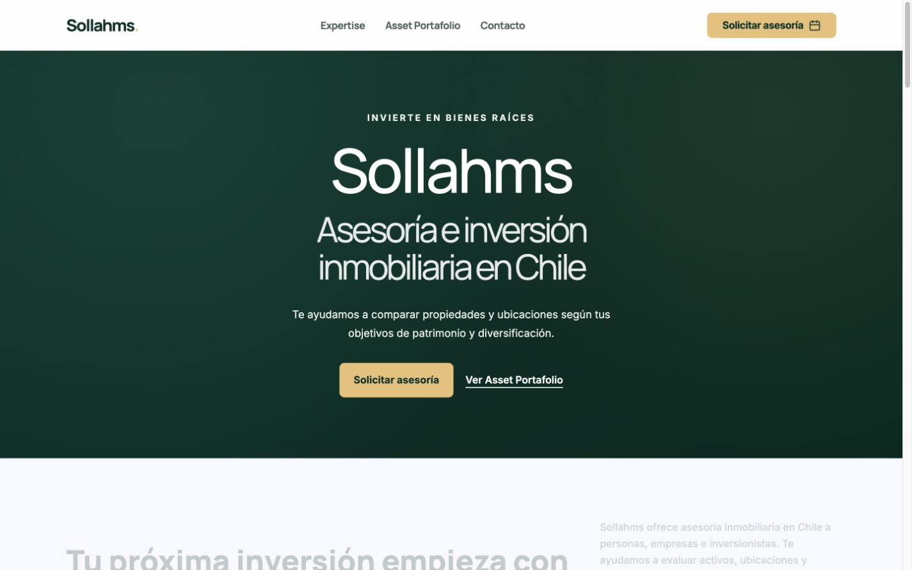
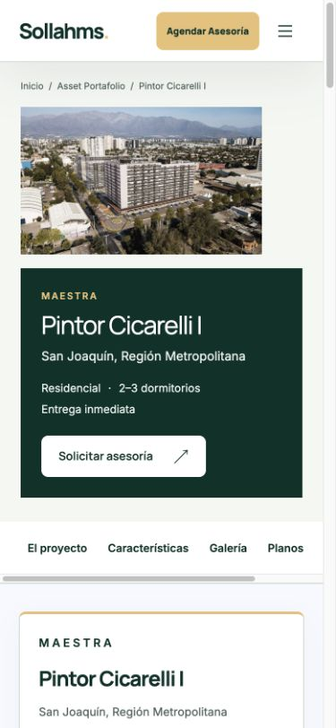
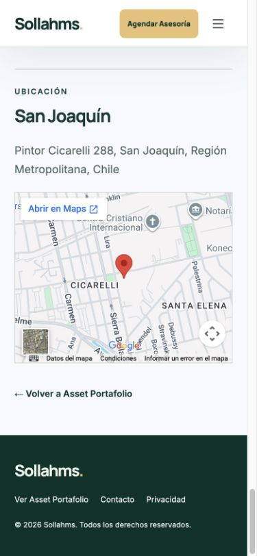

# Logo único — publicación verificada

Publicado el 26/10/2026. Código `489713312f017c6392ae748918190251caee2242`.
Deployment de producción: `dpl_7aP9NvcJ6iSJMeRvSFDddSxSjCbb`.
Dominio verificado: https://sollahms.cl (también www).
Rama independiente: `codex/unified-logo-20261026`.

## Resultado

- SVG maestro transparente, letras #003229 y punto #E9C176, sin eslogan.
  Contornos del Manrope original, peso 800 y tracking -0.065em. No se usó
  la captura como recurso final ni se sustituyó la tipografía.
- Misma geometría con letras claras en fondos oscuros. Favicon derivado de
  la misma S. Guía permanente: `../brand-identity.md`.
- 139 páginas, 132 fichas y 277 logos de cabeceras/pies comprobados. También
  el diagrama de la portada, el marcador de fotos pendientes del catálogo,
  ambas plantillas y el generador compartido.
- Actualizadas las referencias sociales de 138 páginas y la identidad de
  Organization en JSON-LD. WhatsApp mantiene su composición; los píxeles fuera
  del rectángulo del antiguo logo permanecen idénticos. El maestro no tiene
  eslogan; la línea editorial independiente de la composición se conserva.
- No se sustituyen las menciones textuales de la empresa en títulos, párrafos
  ni copyright: siguen siendo contenido, no logos.

## Validación

- 845 comprobaciones locales, incluida transformación delimitada de cada
  página, igualdad de contornos, colores y conservación de datos/funciones.
- 155/155 comprobaciones HTTP públicas: todas las páginas y recursos nuevos
  coinciden por bytes con el candidato. La ruta de documentación privada
  devuelve 404. UF vigente: $41.221,08 al 26/10/2026, fuente SII.
- Navegador real, 1440×900 y 390×844: portada, catálogo, Pintor Cicarelli I,
  Distrito Centro, contacto, asesoría, comparador, privacidad y 404. Logos
  cargados, tamaños 114/104px, sin desbordamiento general. Menú móvil y enlace
  del logo a la portada comprobados; contraste claro/oscuro revisado.
- Preview y producción verificaron los mismos 1129 archivos antes de servir:
  hash agregado `ed0044ef4589570b2e8884320327281d977ce0ba7c7bafb8fc19bb0a64d67518`.
  983 archivos permanecen idénticos; 141 existentes cambian y se añaden 5.
  Los 41 archivos no estáticos, incluidas funciones y rutas, son exactos.
- Sin errores/fatales encontrados en la consulta de logs de producción
  registrada en `post-publication.json`. No se enviaron formularios ni mensajes.

## Recuperación y protecciones

Producción anterior conservada y READY: `dpl_FiXdAifUNWKapc2kMTG4xvUagN7U`,
código `a7290cba211ac73a7acbf88e2f9af31cf7d27e7c`. Recuperación autorizada
mediante `request_rollback` de Vercel con ese deployment y el proyecto
`prj_URomRRU0MAy4etGKP5gWv3Qv4DGH`. No fue necesario ejecutarla.

`main` permanece en `86e200ec191b38af355061e21bc0fc1e549cce3b`.
`main:false` y la rama nueva desactivada en `vercel.json`; no hubo merge ni
activación de despliegues automáticos. Protecciones antes y después:
`enabled:true, deploymentType:all_except_custom_domains`.

Los descriptores de `deployment-files.json`, `candidate-hashes.json` y
`copy-build.mjs` permiten reproducir el paquete aprobado desde el almacén de
Vercel, verificando todos los hashes antes de servirlo. No regenerar la versión
vigente mediante perfiles históricos del empaquetador.

## Capturas públicas reales

