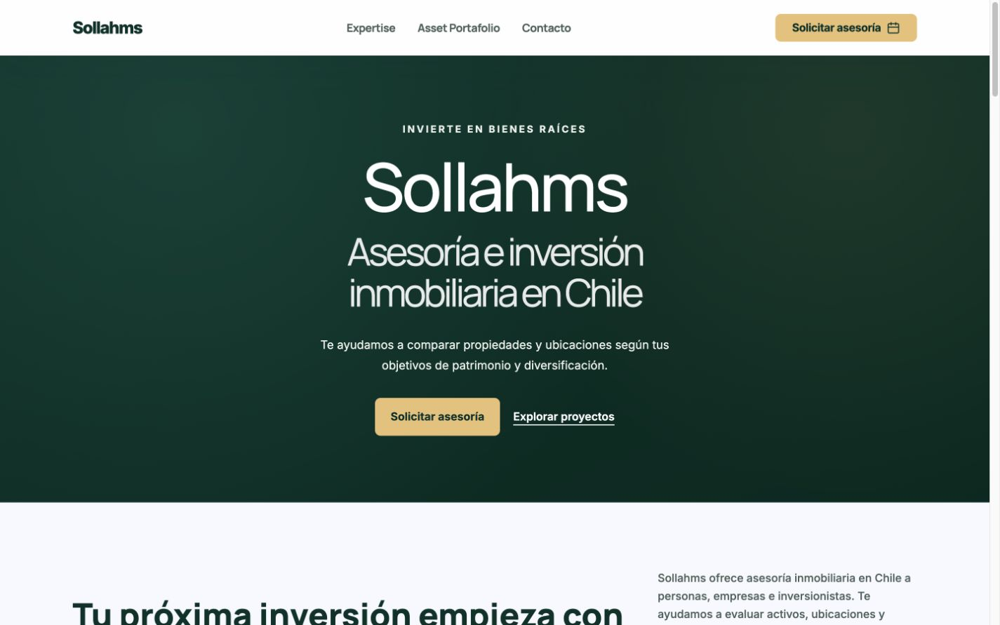
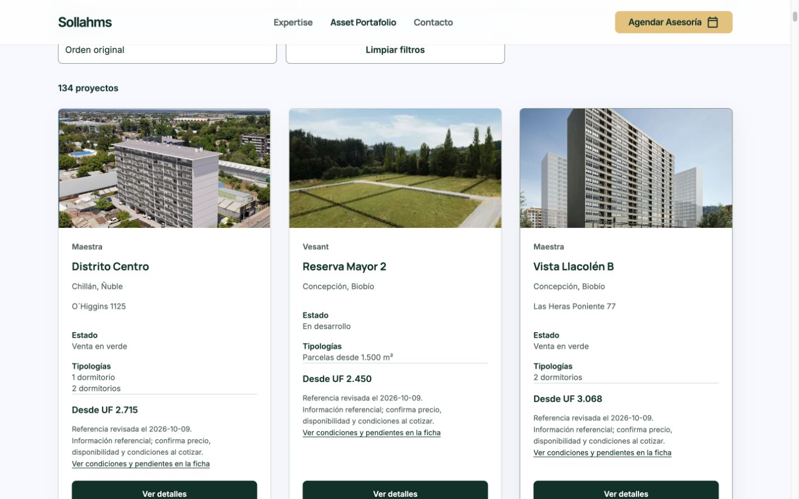
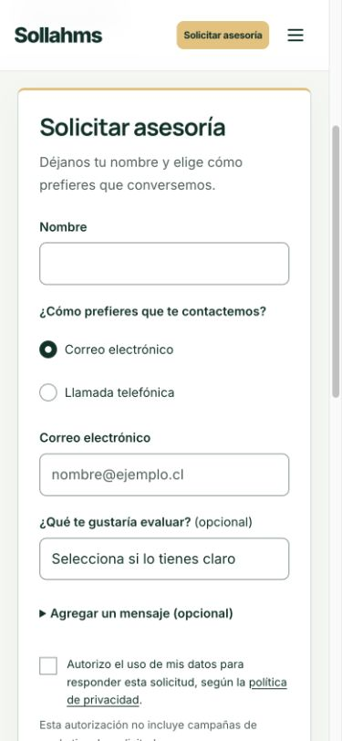

# Publicación de coherencia visual — 25 de octubre de 2026

Publicado en **https://sollahms.cl** mediante promoción del candidato de producción previamente validado. No se hizo merge a main.

- Rama: `codex/visual-unification-20261025`.
- Commit de código: `9041a5e33617335a3baa7d32fd4fb6a0b2615a73`.
- Despliegue publicado: `dpl_31y1i14ip3X7n1bufX4YchkBawfJ`.
- URL técnica: https://project-wrapp-ebtfqrd9z-lsandoval2-8260s-projects.vercel.app
- Base exacta y recuperación: `dpl_7ynhuaYPMN3VryB73zFLq5m6TJDE`, estado READY comprobado después de publicar. URL técnica conservada: https://project-wrapp-g6g2wqmov-lsandoval2-8260s-projects.vercel.app
- Fuentes anteriores: `047c3f03b59b9421ad23f995d1986e683d89ce01`.
- `main` intacta: `86e200ec191b38af355061e21bc0fc1e549cce3b`.
- `main:false` y nueva rama desactivada en `vercel.json`. La protección de autenticación de los despliegues técnicos se mantuvo; el dominio público conserva su acceso habitual.

## Cambios

Los 141 documentos públicos cargan `assets/css/sollahms-theme.css` al final. Paleta, radios, bordes, sombras, foco, controles, selección y movimiento compartidos; estilos locales convertidos a variables. El degradado aprobado de portada conserva sus valores originales. Las superposiciones verdes sobre fotografías dan más contraste a los títulos. Los controles de radio y casillas ya no heredan azul de los estilos antiguos.

Los encabezados de Contacto y Asesoría sustituyen los rótulos Servicios/Proyectos por **Expertise/Asset Portafolio**, tanto en escritorio como en móvil, manteniendo sus destinos. La portada conserva exactamente **Expertise · Asset Portafolio · Contacto**. El resto del contenido, medios, metadatos, datos estructurados, enlaces y scripts permanece igual.

Guía de mantenimiento: [visual-system.md](../visual-system.md).

## Preservación

El paquete parte de los archivos exactos de producción. **761 archivos permanecen byte a byte iguales**, incluidos los 36 archivos de funciones. Se modificaron 153 HTML/CSS y se agregó una hoja CSS (2.865 bytes comprimidos con gzip). No se eliminó ningún archivo. La configuración de rutas es idéntica. Se conservaron fotografías, precios, catálogo de 134 proyectos, calculadora, UF, formularios, agenda, consentimiento, SEO y el archivo aprobado de WhatsApp. No se enviaron formularios, correos ni reservas reales.

`package-verification.json` detalla la comparación SHA-256. `content-and-contrast.json` registra la conservación del contenido de las 141 páginas —con la excepción explícita de los rótulos de encabezado anteriores— y ocho pares de contraste. Los textos comprobados superan 4,5:1; el borde de campos, 3:1.

## Revisión en navegador real

Chrome conectado, escritorio 1440 px, móvil 390 px y comprobaciones adicionales a 320 px. Portada y catálogo; fichas Los Alerces, Novo Catedral, Distrito Centro, Lomas de Puyai y Monjitas 690; Contacto, Asesoría, Comparador hipotecario, Privacidad y 404. No se observaron desbordamientos horizontales de página, imágenes rotas ni controles recortados en las vistas revisadas. La navegación horizontal de las fichas mantiene su desplazamiento interno previsto.

Se comprobaron menú móvil, cierre con Escape, anclas, filtros y limpieza del catálogo, evaluación local de capacidad, formulario vacío con errores y cambio de canal, foco visible y controles seleccionados. La calculadora con 3.000 UF, pie 15%, plazo 25 años y tasa efectiva 4,5% muestra **14,04 UF** mensuales.

Los estados de éxito, carga y deshabilitado se revisaron en un documento aislado sin scripts ni envíos. Para movimiento reducido se verificó la regla real `prefers-reduced-motion` y se aplicaron sus mismas declaraciones en esa prueba aislada mediante un ancho inferior a 600 px: animación `none`, transición `0s`, conservando la transformación de centrado. No se alteró ni emuló la preferencia del sistema operativo. Este documento de prueba **no está publicado**: `/visual-qa.html` devuelve 404. La plantilla reproducible permanece en `tests/fixtures/visual-states.html`.

## Verificación posterior

**151 comprobaciones HTTP:** las 141 páginas y siete hojas CSS coinciden exactamente por SHA-256 con el candidato; además, `www` devuelve 308 al dominio raíz, la página aislada de pruebas devuelve 404 y `/api/uf` responde 200. UF: **$41.215,77, 25/10/2026, fuente SII**. Véase `public-http.json`.

[PageSpeed Insights](https://pagespeed.web.dev/analysis/https-sollahms-cl/o12mn5gw8t), capturado el 25/10/2026 a las 21:38 GMT-3: **100 en rendimiento, accesibilidad, prácticas recomendadas y SEO** en móvil y escritorio. LCP de laboratorio: 1.426 ms móvil y 341 ms escritorio; CLS 0 y TBT 0 en ambos. No hay datos de usuarios reales disponibles. Es una observación de laboratorio de la portada, no una garantía global de accesibilidad ni de posicionamiento. Persisten sugerencias no bloqueantes sobre carga de recursos y animaciones decorativas.

Vercel no devolvió registros con nivel error/fatal para este despliegue en la ventana consultada de 15 minutos. Esto documenta esa observación, no garantiza ausencia futura de errores.

## Recuperación

Promover de nuevo o hacer rollback mediante la herramienta oficial de Vercel al despliegue anterior `dpl_7ynhuaYPMN3VryB73zFLq5m6TJDE`, dentro del proyecto `prj_URomRRU0MAy4etGKP5gWv3Qv4DGH` y equipo `team_A9VNIW2f2K1IJpd2pGdvDmEN`. No se requiere reconstruir ni tocar main. No se ejecutó rollback porque los controles de publicación resultaron satisfactorios.

## Capturas del dominio público

